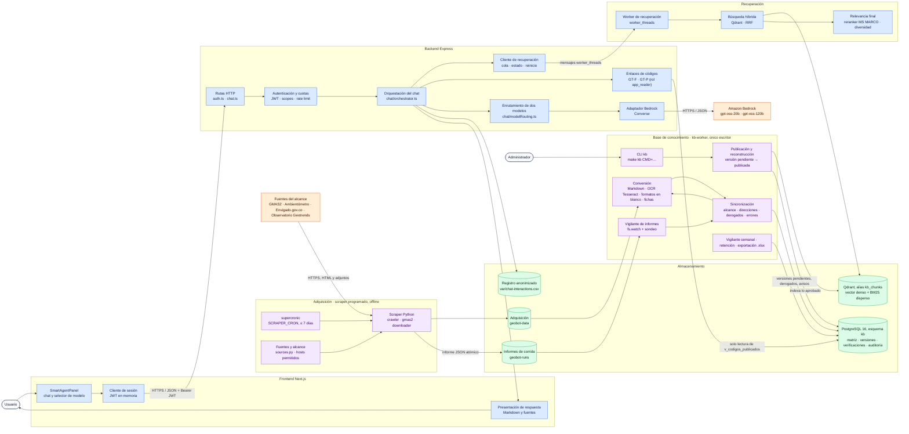
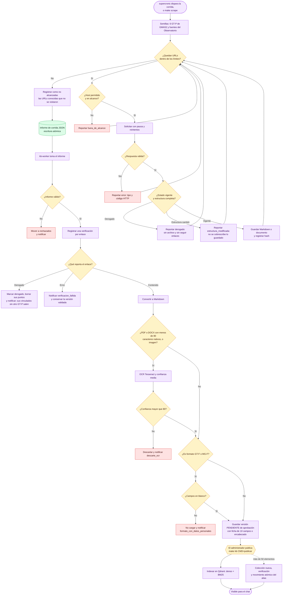
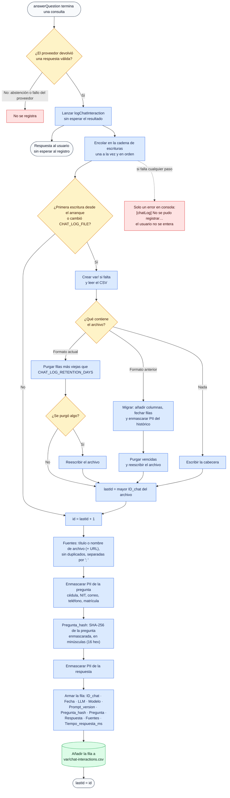
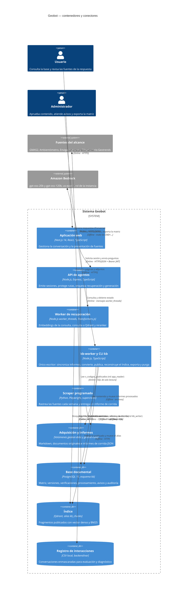

# Arquitectura del sistema Geobot

## Propósito y alcance

Este documento describe la arquitectura implementada actualmente en Geobot. Cubre la adquisición de las fuentes, la base de conocimiento (PostgreSQL y Qdrant), la recuperación híbrida de evidencia y la generación de respuestas desde la interfaz web.

Hay dos caminos separados. El **camino de datos** es offline: el `web_scraper` entrega un *informe de corrida* y el `kb-worker` —único escritor— lo convierte en versiones pendientes de aprobación, y solo lo publicado se indexa en Qdrant. El **camino interactivo** es el chat: el backend lee Qdrant a través del alias `kb_chunks` y, con un rol de solo lectura, la vista `kb.v_codigos_publicados`. El chat nunca llama al scraper ni escribe en la base.

La fuente de verdad de estos diagramas es el código actual y el `README.md`. `DOCUMENTACION-HANDOFF.md` describe una versión anterior, previa a la base de conocimiento.

### Leyenda

En los diagramas de flujo y componentes se emplean estas convenciones:

- Azul: componentes que atienden el flujo interactivo.
- Morado: procesos offline o por lotes.
- Verde: almacenamiento local y artefactos persistidos.
- Naranja: servicios o sitios externos.
- Rojo: resultados de error, rechazo o indisponibilidad.
- Las flechas continuas representan llamadas o transferencia directa. Una conexión con el scraper nunca implica una llamada en tiempo real desde el chat.

## Diagrama de componentes

### Responsabilidades principales

| Área | Responsabilidad |
| --- | --- |
| Scraper | Recorre solo las fuentes del alcance, respeta `robots.txt`, deduplica por SHA-256, reporta derogados y errores, y deja un informe de corrida JSON. Corre solo cada semana (supercronic). |
| `kb-worker` | Único escritor de PostgreSQL y Qdrant. Procesa informes, aplica las reglas de alcance y dirección, convierte (OCR con confianza medida, formatos en blanco, fichas) y deja todo lo nuevo en *pendiente de aprobación*. |
| PostgreSQL (`kb`) | Fuente de verdad: matriz documental de 12 campos, versiones con su contenido, verificaciones, procesamiento, notificaciones y auditoría. Retención mínima de 12 meses. |
| Qdrant | Índice de lo publicado: vector denso (E5) y vector disperso BM25 en una colección física detrás del alias `kb_chunks`. |
| Frontend | Obtiene una sesión anónima, envía preguntas e historial, permite elegir modelo y presenta respuesta y fuentes. |
| API Express | Aplica seguridad HTTP, valida contratos, autentica por scopes, limita solicitudes y traduce resultados a HTTP. |
| Servicio de respuesta | Recupera evidencia, decide entre abstención o llamada LLM, enlaza códigos GT-F/GT-P publicados, agrupa fuentes y registra interacciones. |
| Worker de recuperación | Mantiene los modelos locales fuera del hilo HTTP; limita la cola y reporta su estado. |
| Búsqueda híbrida | Consulta Qdrant con vector denso y BM25, fusiona con Reciprocal Rank Fusion (RRF), reordena con el reranker y diversifica. |
| Router y adaptadores LLM | Resuelven proveedor/modelo, aplican fallback en modo automático y normalizan las respuestas y fallos. |

El índice ya no vive en memoria ni en snapshots: lo sirve Qdrant, y una reindexación completa construye una colección nueva aparte y mueve el alias en una sola operación atómica, de modo que el chat nunca ve un índice parcial.

## Flujo 1: adquisición, sincronización y publicación

Nada nuevo ni modificado se recupera hasta que el administrador lo publica; lo derogado, en cambio, sale de las respuestas en el acto. Cada acción queda en la auditoría y cada aviso se agrupa por objeto hasta que se revisa. La reindexación completa (`sincronizar --completa`) y las publicaciones de más de 50 elementos usan el movimiento atómico del alias; si algo falla, la colección parcial se borra, el alias sigue donde estaba y se notifica `indexacion_fallida`.

### Latencia de la recuperación tras migrar a Qdrant

Medida con `npm run bench:stages` sobre el corpus acotado del bloque 1 (22 documentos, 1.097 fragmentos, Qdrant local en Docker, 20 consultas factuales; 2026-10-08):

| Etapa | Media | Parte |
| --- | --- | --- |
| Embedding de la consulta | 5,0 ms | 1,3 % |
| BM25 disperso (Qdrant) | 4,1 ms | 1,0 % |
| Vectorial denso (Qdrant) | 46,2 ms | 11,8 % |
| Fusión RRF | 0,0 ms | 0 % |
| Reranker (cross-encoder) | 336,5 ms | 85,9 % |
| **Total** | **391,8 ms** | |

La medición previa con el índice en memoria era de ~350 ms por consulta de recuperación: la migración añade ~40 ms (la consulta densa a Qdrant), en su mayoría del lado del reranker, que sigue siendo el ~86 % del tiempo. Es una guarda de no regresión, no una medición de capacidad: la medición formal bajo carga (p95 ≤ 20 s, RNF-C3-IN-02) es del bloque 5.

## Flujo 2: pregunta y respuesta RAG

> **Reemplazado por el bloque 2** (ver «Bloque 2: modelo IA, consentimiento, panel y registro» al final). Lo que sigue describe el flujo anterior con proveedores múltiples y registro CSV, que ya no está activo.

RAG significa *Retrieval-Augmented Generation*: antes de pedir una respuesta al modelo, el sistema recupera fragmentos relevantes del corpus y los incorpora como evidencia.

```mermaid
flowchart TD
    ask([Usuario envía una pregunta]) --> token{¿Hay JWT vigente<br/>en memoria?}
    token -- No --> session[POST /api/session]
    session --> issue{¿Sesión emitida?}
    issue -- No --> sessionError([Mostrar error de sesión])
    issue -- Sí --> request
    token -- Sí --> request[POST /api/chat con pregunta, historial y selección]
    request --> auth{¿JWT, scope, cuota<br/>y cuerpo válidos?}
    auth -- No --> httpReject([401, 403, 400 o 429])
    auth -- Sí --> status{¿Índice ready<br/>o refreshing?}
    status -- No --> unavailable([503 con progreso o error del índice])
    status -- Sí --> queue{¿Worker con<br/>capacidad disponible?}
    queue -- No --> busy([503 + Retry-After])
    queue -- Sí --> context[Normalizar historial y contexto de seguimiento]
    context --> scope[Resolver alcance opcional por carpeta o documento]
    scope --> parallel[Buscar en paralelo: BM25 y coseno vectorial]
    parallel --> rrf[Fusionar rankings con RRF]
    rrf --> rerank{¿Reranker disponible?}
    rerank -- Sí --> threshold[Reordenar con MS MARCO y aplicar umbral]
    rerank -- No --> fallbackRrf[Conservar candidatos RRF]
    threshold --> diversify[Deduplicar, diversificar y limitar a 8]
    fallbackRrf --> diversify
    diversify --> evidence{¿Hay evidencia?}
    evidence -- No --> abstain[Responder abstención sin llamar a un LLM]
    evidence -- Sí --> mode{¿Selección manual<br/>o automática?}
    mode -- Manual --> selected[Validar y usar proveedor/modelo solicitado]
    mode -- Automática --> classify[Clasificar complejidad y elegir proveedor/modelo]
    classify --> configured{¿Proveedor principal<br/>configurado?}
    configured -- No --> replacement[Elegir reemplazo configurado]
    configured -- Sí --> buildPrompt[Construir prompt con evidencia e historial]
    replacement --> buildPrompt
    selected --> buildPrompt
    buildPrompt --> provider[Invocar adaptador LLM con timeout y reintentos]
    provider --> success{¿Respuesta correcta?}
    success -- No, retryable --> fallback{¿Modo automático, reemplazo<br/>y presupuesto disponibles?}
    fallback -- Sí --> callFallback[Invocar proveedor de reemplazo]
    callFallback --> fallbackSuccess{¿Respuesta correcta?}
    fallbackSuccess -- No --> providerError([503 por fallo de proveedor])
    fallbackSuccess -- Sí --> assemble
    fallback -- No --> providerError
    success -- No, no retryable --> providerError
    success -- Sí --> assemble[Consolidar respuesta, metadata y fuentes]
    abstain --> deliver[Devolver JSON al frontend]
    assemble --> log[Registrar interacción con datos personales enmascarados]
    log --> deliver
    deliver --> render([Renderizar respuesta Markdown y fuentes])

    classDef interactive fill:#dbeafe,stroke:#2563eb,color:#172554;
    classDef decision fill:#fef3c7,stroke:#d97706,color:#451a03;
    classDef failure fill:#fee2e2,stroke:#dc2626,color:#450a0a;
    classDef store fill:#dcfce7,stroke:#16a34a,color:#052e16;

    class ask,session,request,context,scope,parallel,rrf,threshold,fallbackRrf,diversify,abstain,selected,classify,replacement,buildPrompt,provider,callFallback,assemble,deliver,render interactive;
    class token,issue,auth,status,queue,rerank,evidence,mode,configured,success,fallback,fallbackSuccess decision;
    class sessionError,httpReject,unavailable,busy,providerError failure;
    class log store;
```

Si el reranker falla, la búsqueda conserva los candidatos producidos por RRF y todavía aplica diversidad; en ese camino de reserva no puede aplicar el umbral basado en el logit del reranker. La abstención ocurre cuando, con el reranker disponible, ningún fragmento supera el umbral de relevancia.

## Flujo 3: registro de interacciones

> **Reemplazado por el bloque 2** (ver «Bloque 2: modelo IA, consentimiento, panel y registro» al final). Lo que sigue describe el flujo anterior con proveedores múltiples y registro CSV, que ya no está activo.

Detalla el paso de registro del flujo anterior. Cada respuesta válida del proveedor se guarda como una fila del CSV de interacciones, que sirve para evaluar la calidad de las respuestas y diagnosticar fallos. Las abstenciones y los fallos de proveedor no se registran, y las consultas rechazadas por validación o cuota no llegan a este punto.

El registro no retrasa la respuesta: se lanza sin esperarlo, y las escrituras se encadenan para que los identificadores sigan en orden aunque varias consultas terminen a la vez. Un fallo al escribir solo deja un error en la consola; el usuario recibe su respuesta igual.

Los datos personales se enmascaran en memoria, antes de tocar el disco. `Pregunta_hash` se calcula sobre la pregunta ya enmascarada, así que agrupa preguntas repetidas sin permitir reconstruir la original. La retención se aplica en la primera escritura tras cada arranque del backend, no con un proceso aparte; en esa misma escritura se migran y enmascaran los archivos con un formato anterior.

## Diagrama C4 de contenedores y conectores

Las relaciones marcadas como **online** forman parte de una petición interactiva. Las marcadas como **offline** adquieren, sincronizan y publican el contenido.

## Contratos HTTP relevantes

> **Reemplazado por el bloque 2** (ver «Bloque 2: modelo IA, consentimiento, panel y registro» al final). Lo que sigue describe el flujo anterior con proveedores múltiples y registro CSV, que ya no está activo.

| Método y ruta | Acceso | Función arquitectónica |
| --- | --- | --- |
| `GET /health` | Público | Confirma que el proceso HTTP está activo, aunque el índice todavía no esté disponible. |
| `POST /api/session` | Público con límite por IP | Emite un JWT anónimo con scope `chat`; el frontend lo conserva solo en memoria. |
| `POST /api/session/operator` | Clave de operador y límite estricto | Emite un JWT con scope `corpus`. |
| `POST /api/chat` | JWT `chat` | Valida la pregunta y ejecuta recuperación, enrutamiento y generación. |
| `GET /api/providers` | Público | Expone proveedores configurados, modelos permitidos y modelo predeterminado, sin secretos. |
| `GET /api/retrieval/status` | Público | Informa el estado de la recuperación (`ready` cuando el alias de Qdrant sirve una colección con contenido publicado), la colección y el número de documentos. |
| `GET /api/folders` | JWT `corpus` | Lista carpetas y entradas del corpus. |
| `GET /api/documents` | JWT `corpus` | Lista documentos por curso y carpeta. |
| `GET /api/document` | JWT `corpus` | Entrega el archivo original con resolución segura bajo la raíz documental. |
| `GET /api/document/text` | JWT `corpus` | Entrega una vista textual extraída, excepto para PDF. |
| `GET /api/document/html` | JWT `corpus` | Convierte hojas XLS/XLSX a HTML para vista previa. |

## Artefactos persistidos y ciclo de vida

| Artefacto | Productor | Consumidor | Propósito |
| --- | --- | --- | --- |
| Páginas Markdown y documentos originales (`geobot-data`) | Scraper | `kb-worker` | Evidencia primaria adquirida; el contenido validado vive además en PostgreSQL, así que sobrescribirla no borra la última versión aprobada. |
| `metadata/*.csv` y `manifest.json` | Scraper | Operación y auditoría | Trazabilidad de las corridas; no se indexan. |
| Informe de corrida JSON (`geobot-runs`) | Scraper | `kb-worker` | Frontera entre adquisición y base: un registro por enlace con su resultado. Se mueve a `procesados/` o `rechazados/` y se purga a los 13 meses. |
| Esquema `kb` de PostgreSQL | `kb-worker` | CLI, exportación, vista de solo lectura del chat | Matriz documental, versiones (pendiente / publicada), verificaciones, procesamiento, avisos, auditoría e indexaciones. |
| Colección de Qdrant tras el alias `kb_chunks` | `kb-worker` | Worker de recuperación | Fragmentos publicados con vector denso y BM25. Se reemplaza entera y de forma atómica en cada reconstrucción. |
| `matriz-documental-<fecha>.xlsx` y fichas `.md` (`var/exports`) | CLI `kb` | Administrador | Exportaciones bajo demanda de la matriz y de las fichas publicadas. |
| `.cache/documents` | Preprocesador | Conversiones posteriores | Evita repetir conversiones cuando el documento no cambió. |
| `backend/var/chat-interactions.csv` | Servicio de respuesta | Evaluación y diagnóstico | Conserva respuestas exitosas con datos personales enmascarados y retención configurable. |

No se documentan valores concretos de variables de entorno ni credenciales. Las rutas anteriores son ubicaciones lógicas o relativas al proyecto y pueden cambiar mediante configuración.

## Bloque 2: modelo IA, consentimiento, panel y registro

Vigente desde la spec `002-diseno-modelo-ia`. Sustituye a los flujos 2 y 3 de arriba.

### Inferencia

- **Solo Amazon Bedrock**, región `us-east-1`, modelos `openai.gpt-oss-20b-1:0` y `openai.gpt-oss-120b-1:0` (Converse, `maxTokens 2200`, `temperature 0`, sin streaming ni herramientas, `maxAttempts 1`). No hay selector ni proveedor alternativo; `/providers` no existe y `validateDiConfig()` rechaza las claves de otros proveedores, `AWS_ACCESS_KEY_ID/SECRET` y `MIN_RERANK_SCORE`.
- **Enrutamiento local, sin LLM**: puntaje determinista por reglas; <3 simple y 3–5 medio → 20b; ≥6 complejo → 120b; con ≥10 pares de historial se fuerza a complejo. Una tentativa al principal y otra al respaldo, con circuito por modelo, dentro de un **plazo único de 40 s** (cola, recuperación, modelos y escritura incluidos).
- **IAM mínimo** (rol de la instancia o sesión temporal): solo `bedrock:InvokeModel` sobre los dos ARN `arn:aws:bedrock:us-east-1::foundation-model/openai.gpt-oss-20b-1:0` y `…/openai.gpt-oss-120b-1:0`. Sin `CountTokens` (no soportado por estos modelos).
- **Longitud**: se cuenta TODO el Markdown visible con el tokenizador `o200k_harmony` (`js-tiktoken@1.0.21`, paridad exacta de IDs con `tiktoken` en `npm run eval:tokenizer`). Tope 2200; al excederlo se quitan unidades completas del final, se recalculan las fuentes y se añade el aviso exacto.

### Recorrido de una consulta (`POST /api/chat`)

1. Perímetro: origen permitido → 60/min/IP (ventana deslizante) → cuerpo ≤128 KiB contado en bytes (sin límite de caracteres) → sesión técnica (Bearer).
2. Validación estricta (`pregunta`, `conversationId`, `categoria`, `historial` de pares; se validan TODOS antes de quedarse con los 10 últimos).
3. Saneamiento de datos personales (cédula, teléfono, correo, dirección, nombre de tercero) de pregunta, historial y fragmentos; aviso antes de la orientación.
4. Recuperación híbrida BM25 + densa → RRF → ≤16 candidatos → reranker → selección (umbral de la **calibración vigente** de la colección servida; ≤3 por documento, hasta 8 si solo un documento sirve; duplicados Jaccard ≥0,6 eliminados sin relleno). Reranker caído: los 8 mejores de RRF sin umbral, estado «degradado». Búsqueda fallida: 503, nunca «sin información».
5. Modelo (prompt único versionado) → selección de fuentes realmente usadas → composición (citas, leyenda, canales) → límite de 2200 tokens.
6. Registro **confirmado antes** de emitir `responseId`. Anónimas: solo `received_at, mode, model, input_tokens, output_tokens, estimated_cost`.

### Datos y roles (PostgreSQL)

Esquemas `chat` y `admin`, propietario sin login `chat_owner`; roles limitados `chat_app` (chat), `admin_app` (panel) y `chat_maint` (purga). Migraciones propias en `backend/migrations/chat/` con registro `chat.schema_migrations`, aparte de `kb.*`. El servicio `chat-migrate` las aplica con la cuenta administradora (también sobre un volumen existente): `make migrate-chat`. Administrador inicial: `make bootstrap-admin EMAIL=… NOMBRE=…` (contraseña temporal por stdin; obliga a cambiarla). Purga horaria idempotente: servicio `chat-purge` (12 meses calendario + hasta 24 h; conserva estadísticas).

### Panel `/admin` (mínimo)

Login, cambio de contraseña, contactos oficiales (edición con control de revisión y auditoría atómica), estado observado y avisos con contador. Sesión opaca en cookie `HttpOnly; Secure; SameSite=Strict`, CSRF y Origin en mutaciones, inactividad de 30 min, bloqueo de cuenta 5/15 min y de IP 20/15 min. Dos perfiles: administrador técnico y Gestor documental (este último recibe 403 en contactos, estado y avisos). Con la base caída, las sesiones ya autenticadas ven estado y avisos volátiles hasta 30 min; no hay nuevos inicios ni mutaciones.

### Readiness (`GET /ready`)

Solo es 200 con: índice cargado **con calibración vigente**, configuración válida, tokenizador con la huella fijada, **contactos oficiales completos** y **tarifas vigentes** de ambos modelos. Responde qué falta, sin valores. No hay valores por defecto inventados: contactos, tarifas, URL y versión de la política de datos los carga la operación.

### Operación

| Tarea | Comando |
|---|---|
| Roles + migraciones chat/admin | `make migrate-chat` |
| Primer administrador | `printf '%s' "$CLAVE" \| make bootstrap-admin EMAIL=a@b.co NOMBRE="Nombre"` |
| Calibrar el índice servido | `npm run eval:retrieval -- --calibrar --informe=… --guardar` |
| Reconstruir calibrando antes del alias | `make kb CMD="sincronizar --completa --oro=<archivo>"` |
| Matriz de aceptación | `npm run eval:di -- --manifest=… --models=both --output=…` |
| Tráfico / carga | `npm run eval:di-traffic`, `npm run eval:di-load` |

## Bloque 4: interfaz del ciudadano (SPEC004)

- **Entrada**: el Observatorio incluye una etiqueta `<script>` con `geobot-launcher.js` (≤10 000 bytes, sin dependencias). Antes del primer clic no hay tráfico hacia Geobot; en el primer clic crea un único `<iframe src=/chat>` y después solo lo oculta/muestra.
- **Aislamiento**: nginx sirve `/chat` con una CSP (`frame-ancestors` únicamente el Observatorio oficial + hashes de scripts en línea, sin `X-Frame-Options`). El host y el iframe se comunican con `postMessage` v1 (READY, CLOSE, VISIBILITY, FOCUS_START, VIEWPORT, FOCUS_BOUNDARY), validando `origin`, `source`, versión y esquema; nunca viajan textos, token ni IDs.
- **Estado**: solo memoria del iframe (sin storage, cookies ni URL). Un reducer único gobierna arranque, un intento activo (45 s, 2 reintentos manuales), reinicio por epoch y valoración.
- **Valoración**: `POST /api/ratings` → `chat.register_rating` (función `SECURITY DEFINER`) que valida propiedad y vigencia y escribe en `chat.valoracion` (UNIQUE por interacción, motivo cerrado). El runtime no escribe ni lee la tabla directamente; la purga de 12 meses conserva solo la estadística sin identificadores.
- **Presentación**: Markdown por lista blanca (`p br strong em ul ol li table thead tbody tr th td h3 h4 a`), HTML bruto eliminado, consultas del ciudadano en texto plano.

Estado de la aceptación: ver `specs/004-interfaz-plataforma/evidencias/aceptacion/` (controlada completa; portal, dispositivos, lectores y servicios reales pendientes).

### Límites y decisiones abiertas

- Una tabla o palabra >1000 caracteres hace **no publicable** al documento (hallazgo REAL): puede bloquear la reconstrucción del corpus real hasta resolverse en la fuente.
- Una publicación incremental añade puntos a la colección servida sin recalibrar; conviene reconstruir con calibración tras cambios de corpus.
- Los módulos heredados de proveedores múltiples, `chatLog.ts` (CSV) y `chatTraffic.ts` quedan **sin invocar**; su retiro definitivo está pendiente de aprobación.

## Bloque 5: integración C3–C4 (SPEC005)

Vigente desde la spec `005-integracion-c3-c4`. Corrige y verifica la integración de los bloques 2–4; no añade API, tablas de ciudadano ni servicios.

### Recepción y perímetro

Orden en `backend/src/app.ts` (antes de cualquier sesión, modelo o registro): **contexto de la solicitud** (`chat/requestContext.ts`: fecha de recepción UTC, reloj monotónico, plazo único de 40 s, cancelación) y `Cache-Control: no-store` desde el primer instante → **guarda de preflight** (origen exacto, método y cabeceras permitidas; 403 sin `Access-Control-*`) → **guarda de origen** (POST/PUT del chat exigen `Origin` HTTPS exacto; la ausencia se rechaza; un GET de configuración del mismo origen puede omitirlo) → CORS → cuota → cuerpo → sesión.

- La cuota de **60 consultas por minuto por IP** (ventana deslizante) solo la consume `POST /api/chat`. Preparación, configuración, conversaciones y valoraciones tienen su propia ventana (`CHAT_PREP_RATE_LIMIT_PER_MINUTE`, 300); el preflight permitido no consume.
- Cuerpo ≤128 KiB contado en bytes aunque llegue por streaming; al excederse se responde 413, el resto se descarta sin acumular (tope de 1 MiB de descarte) y se cierra.
- Los rechazos tempranos (403, 413, 429) no consultan la base; el resto de errores lee los canales vigentes con presupuesto de 1,5 s y devuelve lista vacía si no llegan.

### Topología de proxies (`TRUST_PROXY`)

El backend resuelve la IP del cliente contando saltos confiables. Es un **número** (`1` = solo el nginx del frontend; `2` = Traefik/Dokploy → nginx → backend) o una lista exacta de IP/CIDR de proxies; `true`, `*`, `0.0.0.0/0` y `::/0` se rechazan (`services/trustProxy.ts`, readiness). Cada proxy añade la dirección que ve a `X-Forwarded-For`; lo que el cliente escribe a la izquierda no cuenta. nginx borra `X-Real-IP`, `Forwarded`, `X-Client-IP` y `True-Client-IP`. Si el número no coincide con la cadena real, el backend avisa una vez con `[proxy]`.

### Identidad del servicio

Las credenciales de Bedrock salen **exclusivamente del rol de la instancia** con `fromInstanceMetadata` (IMDSv2 obligatorio, sin retroceso a IMDSv1, timeout 1 s y 2 reintentos). La readiness rechaza (por nombre, sin imprimir el valor) llaves, sesión temporal exportada, perfil/SSO, procesos externos, web identity, credenciales de contenedor, `AWS_BEARER_TOKEN_BEDROCK` y metadatos alternos. Política mínima y verificación: `backend/config/iam-bedrock-policy.json` y `specs/005-integracion-c3-c4/evidencias/aceptacion/iam-configuracion.md`.

### Plazo, persistencia y errores

Un único reloj nace en la recepción y cubre lectura del cuerpo, cola, búsqueda, modelos, registro y construcción del error; el error terminal sale en ≤40 s (objetivo 39 s) con un solo terminal por solicitud. Toda escritura es acotada al presupuesto restante (`chat/boundedDb.ts`): adquisición de pool, sentencia y lock con límites reales y conexión descartada si no puede garantizarse limpia. **`statement_timeout` no acota el `COMMIT`**: un COMMIT que excede el presupuesto queda *indeterminado* (sin `responseId`, sin reintento). Indisponibilidad (modelos, búsqueda, plazo) deja un evento mínimo en `admin.service_event` y un aviso agrupado, sin texto ni identificadores.

### Registro degradado y retención

Un episodio de falla del registro (`chat/registryEpisode.ts`) avisa **una vez** con fecha, hora y modo; el primer éxito restablece el estado; un segundo episodio abre un aviso nuevo aunque el anterior siga sin revisar. El buffer volátil de avisos se drena serializado y se pierde si muere el proceso (no se promete recuperarlo). La purga vacía solo texto e identificadores públicos; se conservan fecha, modo, categoría, tipo, **documentos citados**, duración, tokens, modelo, tarifa y costo.

## Bloque 7: administración C3–C4 (SPEC007)

Amplía el panel mínimo de SPEC002 sin crear otra base documental ni otro registro de conversaciones. La API
vive en `/api/admin`, el panel estático en `/admin` (Next exportado). Dos perfiles exactos: *administrador
técnico* y *Gestor documental*; los permisos se imponen siempre en la API (el menú solo oculta enlaces).

### Migraciones, roles y recuperación
- Esquema `chat`/`admin`: `backend/migrations/chat/009…012` (los administrativos comparten ledger y
  propietario `chat_owner` con el resto del esquema; se aplican con `npm run admin:migrate`, que es el
  migrador de chat). Esquema `kb`: `backend/migrations/005_administracion_documental.sql` y
  `006_admin_sources.sql`, aplicadas por el `kb-worker` (`kb_writer`). Nunca se edita una migración aplicada.
- El runtime del panel (`admin_app`) no escribe en `kb`: crea comandos o llama funciones `SECURITY DEFINER`
  con la cuenta de la sesión. El único escritor documental es el `kb-worker`.
- Recuperación de contraseñas: procedimiento `admin.recover_password(correo, phc_temporal)` ejecutable solo por
  el rol `contractor_recovery` (sin login por defecto; lo habilita el operador fuera del runtime). Se invoca con
  `ADMIN_RECOVERY_DATABASE_URL=… npm run admin:recover -- <correo>` (contraseña por stdin/TTY). Éxito y
  error dejan una fila de auditoría con el rol real; una cuenta desactivada no se activa.
- Bloqueo por IP: `ADMIN_IP_HMAC_SECRET` (o `AUTH_JWT_SECRET`) deriva el HMAC de la IP; cambiarlo reinicia
  los contadores. El estado vive en `admin.login_ip_guard`.

### Publicación y reindexación (protocolo único)
Colección candidata completa → verificación → commit SQL único (`kb.active_generation` + `kb.generation_manifest`,
versiones y metadata vigente) → alias `kb_chunks` reconciliado como espejo → limpieza de la colección anterior.
Hasta el commit cualquier fallo borra solo la candidata; después nunca se borra la activa. Dos intentos de
indexación como máximo; el segundo fallo deja el documento pendiente y la base anterior intacta. El chat lee
la colección de la generación activa y valida cada fragmento contra `kb.v_recuperacion` (versión, estado,
validez civil en Bogotá y metadata vigente) en cada consulta; sin SQL no hay respuesta (indisponibilidad).
- **Rollback limitado**: antes del commit se vuelve a la generación anterior sin pérdida; después del commit el
  contenido anterior ya no existe por diseño (RF-C3-AD-20) y no hay vuelta atrás: se corrige y se republica.
- **Limpieza**: `KB_GRACIA_LIMPIEZA_MS` (por defecto 15 s) espera a las consultas en vuelo antes de borrar la
  colección anterior; si la colección desaparece durante una consulta, se relee la generación activa una vez.
- Cola de operaciones: `kb.document_operation` (fases `queued…complete|failed`); una sola reindexación activa.

### Cargas manuales y configuración
`KB_UPLOAD_DIR` (volumen compartido backend/kb-worker; `staging/`, `archivos/`, `exportaciones/`), límites
`KB_UPLOAD_MAX_BYTES` (32 MiB), `KB_UPLOAD_META_MAX_BYTES` (32 KiB), `KB_UPLOAD_ZIP_MAX_ENTRIES` (100),
`KB_UPLOAD_ZIP_MAX_EXPANDED` (256 MiB), `KB_UPLOAD_ZIP_MAX_RATIO` (100). El formato se verifica por estructura,
no por el tipo MIME; la metadata se valida antes de abrir el archivo.

### Operación, contactos, exportación y retención
- Avisos: unión `admin.notification` + `kb.kb_notificacion` con identificadores `adm:`/`kb:`; el Gestor ve solo
  avisos de carga propios (rechazo, OCR, indexación). Contadores en `/api/admin/counters`. Sin correo ni webhook.
- Contactos: la lista inmediata nunca queda vacía ni con bajas simultáneas; descripción obligatoria (≤120).
- Exportación `.xlsx`: ExcelJS en streaming sobre un temporal privado y efímero, celdas siempre cadena; sin
  `row_id`, `conversation_id` ni `response_id`. El texto con 12 meses calendario cumplidos o `purged_at` no se
  expone aunque la purga diaria se retrase; los casos de mejora no copian texto.
- Tarifas: una edición cierra la vigencia actual e inserta la nueva (instante del servidor); los costos
  registrados no se recalculan.
- Evidencia de validación (SPEC006) para «Validada/Cerrada»: `VALIDATION_EVIDENCE_INDEX` apunta al índice de
  corridas que publica la herramienta de validación; sin índice, la transición se rechaza.

### Entrega H6-C3/H5-C4
Se entrega con los 62 criterios cotejados y los pasos reales pendientes registrados en
`specs/007-administracion-c3-c4/evidencias/recepcion-administracion.md`. No se firman actas nuevas ni se
reemplazan las de SPEC006; ningún estado del panel cierra hallazgos de validación.

### Validación C3/C4 (SPEC006)

`backend/scripts/lib/validation/` administra artefactos schemaVersion=1, hashes canónicos y de bytes, refs confinadas y ledger append-only fuera de tablas ciudadanas. Cada modificación relevante cambia identidad/versiones; una corrida incompleta posterior impide seleccionar un éxito antiguo. Matriz, aprobación documental externa y congelamiento se verifican antes de ejecutar.

VA reutiliza `handleChat`/DI: integrado por HTTP y dos corridas independientes con política privada sin fallback; observa llamadas SDK sin exponer prompts o credenciales. Ataques de fragmento usan copia KB sintética con DB/alias aislados y obligaciones persistentes de retirada/reconciliación. El API público no permite seleccionar modelos de prueba.

PR ejecuta ocho flujos por fila aprobada en configuración Playwright separada contra HTTPS, verifica árbol fuente y conserva checkpoints/runId; resultados móviles físicos y revisiones se importan por archivos privados íntegros. Perfil emulado y stub nunca acreditan dispositivo físico o conexión real.

Expedientes separados H5-C3/H4-C4 requieren corridas/revisiones vigentes, hallazgos íntegros sin Críticos abiertos y criterios fuente de SPEC001–005. H4 añade UI-02 del dueño004 e IN-03 del dueño005 en la misma release. Las actas son borradores hasta recibir ambas firmas originales y recibo humano verificado; se reevalúan puertas y hash/contenido del informe. [Contratos y comandos](../specs/006-validacion-pruebas/quickstart.md).
