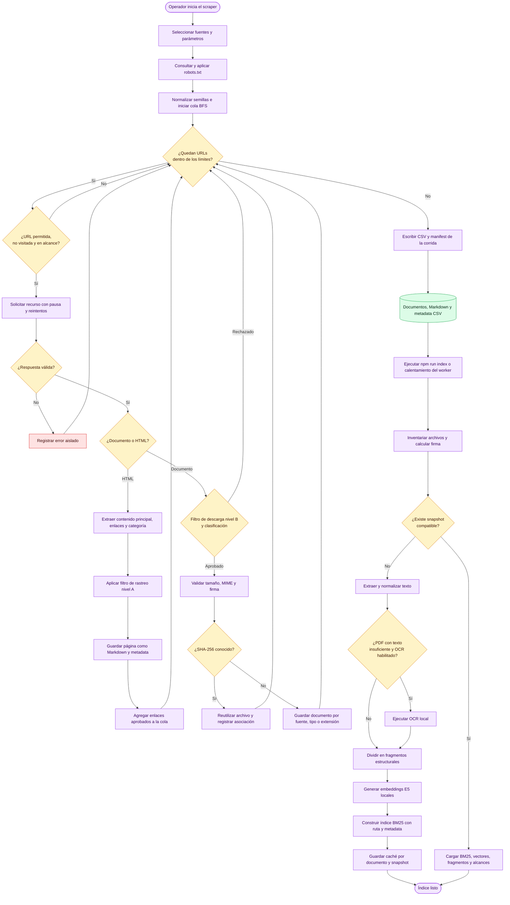

# Arquitectura del sistema Geobot

## Propósito y alcance

Este documento describe la arquitectura implementada actualmente en Geobot. Cubre la adquisición del corpus, su indexación, la recuperación híbrida de evidencia y la generación de respuestas desde la interfaz web.

El `web_scraper` es un proceso auxiliar y offline: escribe documentos y metadatos en el sistema de archivos, pero no recibe ni atiende consultas del chat. El backend solo consume esos artefactos desde la raíz configurada en `GEOTRENDS_DOCUMENTS_ROOT`.

La fuente de verdad de estos diagramas es el código actual y el `README.md`. `DOCUMENTACION-HANDOFF.md` describe una versión anterior, previa al índice híbrido vigente.

### Leyenda

En los diagramas de flujo y componentes se emplean estas convenciones:

- Azul: componentes que atienden el flujo interactivo.
- Morado: procesos offline o por lotes.
- Verde: almacenamiento local y artefactos persistidos.
- Naranja: servicios o sitios externos.
- Rojo: resultados de error, rechazo o indisponibilidad.
- Las flechas continuas representan llamadas o transferencia directa. Una conexión con el scraper nunca implica una llamada en tiempo real desde el chat.

## Diagrama de componentes

```mermaid
flowchart LR
    user([Usuario])
    operator([Operador])

    subgraph acquisition[Adquisición documental · offline]
        scraper["Scraper Python<br/>crawler · relevance · downloader"]
        sourceConfig["Configuración de fuentes<br/>sources.py"]
        metadataWriter["Persistencia y deduplicación<br/>MetadataStore"]
    end

    subgraph storage[Almacenamiento local]
        corpus[("Corpus documental<br/>documentos y páginas Markdown")]
        metadata[("Metadatos<br/>metadata/*.csv y manifest.json")]
        documentCache[("Markdown derivado<br/>.cache/documents")]
        retrievalCache[("Índice persistido<br/>caché por documento y snapshots")]
        chatLog[("Registro anonimizado<br/>var/chat-interactions.csv")]
    end

    subgraph webapp[Frontend Next.js]
        smartPanel["SmartAgentPanel<br/>chat y selector de modelo"]
        sessionClient["Cliente de sesión<br/>JWT en memoria"]
        sourceView["Presentación de respuesta<br/>Markdown y fuentes"]
    end

    subgraph api[Backend Express]
        httpRoutes["Rutas HTTP<br/>auth.ts · chat.ts"]
        auth["Autenticación y cuotas<br/>JWT · scopes · rate limit"]
        answer["Orquestación de respuesta<br/>answerQuestion.ts"]
        providerRouter["Enrutamiento de modelos<br/>manual o automático"]
        llmAdapters["Adaptadores LLM<br/>Gemini · Groq · DeepSeek · OpenAI · Ollama"]
        retrievalClient["Cliente de recuperación<br/>cola · estado · reinicio"]
    end

    subgraph retrieval[Recuperación e indexación]
        worker["Worker de recuperación<br/>worker_threads"]
        preprocess["Preprocesamiento<br/>PDF · Office · texto · OCR"]
        chunkEmbed["Indexación<br/>chunking · E5 embeddings · BM25"]
        hybrid["Búsqueda híbrida<br/>BM25 · coseno · RRF"]
        reranker["Relevancia final<br/>reranker MS MARCO · diversidad"]
    end

    websites["Sitios institucionales<br/>Ambientómetro · Concejo · Ministerios"]
    providers["Proveedores LLM externos<br/>Gemini · Groq · DeepSeek · OpenAI"]
    ollama["Ollama local"]

    operator --> sourceConfig
    sourceConfig --> scraper
    websites -->|HTTPS, HTML y adjuntos| scraper
    scraper --> metadataWriter
    metadataWriter --> corpus
    metadataWriter --> metadata

    user --> smartPanel
    smartPanel --> sessionClient
    sessionClient -->|HTTPS / JSON + Bearer JWT| httpRoutes
    httpRoutes --> auth
    auth --> answer
    answer --> retrievalClient
    retrievalClient -->|mensajes worker_threads| worker
    worker --> hybrid
    hybrid --> reranker
    corpus --> preprocess
    preprocess --> documentCache
    preprocess --> chunkEmbed
    metadata --> chunkEmbed
    chunkEmbed --> retrievalCache
    retrievalCache --> worker
    answer --> providerRouter
    providerRouter --> llmAdapters
    llmAdapters -->|HTTPS / JSON| providers
    llmAdapters -->|HTTP local| ollama
    answer --> chatLog
    answer --> sourceView
    sourceView --> user

    classDef interactive fill:#dbeafe,stroke:#2563eb,color:#172554;
    classDef batch fill:#f3e8ff,stroke:#9333ea,color:#3b0764;
    classDef store fill:#dcfce7,stroke:#16a34a,color:#052e16;
    classDef external fill:#ffedd5,stroke:#ea580c,color:#431407;
    classDef actor fill:#f8fafc,stroke:#475569,color:#0f172a;

    class smartPanel,sessionClient,sourceView,httpRoutes,auth,answer,providerRouter,llmAdapters,retrievalClient,worker,hybrid,reranker interactive;
    class scraper,sourceConfig,metadataWriter,preprocess,chunkEmbed batch;
    class corpus,metadata,documentCache,retrievalCache,chatLog store;
    class websites,providers,ollama external;
    class user,operator actor;
```

### Responsabilidades principales

| Área | Responsabilidad |
| --- | --- |
| Scraper | Recorre fuentes mediante BFS, respeta `robots.txt`, aplica filtros deterministas, descarga adjuntos y deduplica por SHA-256. |
| Corpus y metadatos | Conserva documentos, páginas Markdown y los CSV que relacionan rutas locales con títulos, categorías y URLs originales. |
| Frontend | Obtiene una sesión anónima, envía preguntas e historial, permite elegir modelo y presenta respuesta y fuentes. |
| API Express | Aplica seguridad HTTP, valida contratos, autentica por scopes, limita solicitudes y traduce resultados a HTTP. |
| Servicio de respuesta | Recupera evidencia, decide entre abstención o llamada LLM, agrupa fuentes y registra interacciones. |
| Worker de recuperación | Mantiene el índice y los modelos locales fuera del hilo HTTP; limita la cola y reporta su estado. |
| Índice híbrido | Combina BM25 y similitud coseno mediante Reciprocal Rank Fusion (RRF), reordena y diversifica resultados. |
| Router y adaptadores LLM | Resuelven proveedor/modelo, aplican fallback en modo automático y normalizan las respuestas y fallos. |

El índice es local, en memoria y con persistencia en archivos; no existe una base de datos vectorial externa.

## Flujo 1: adquisición e indexación

La indexación puede ejecutarse explícitamente mediante `npm run index`. Al arrancar el servidor, el worker también precalienta el índice: restaura un snapshot compatible o lo construye si todavía no existe. Durante una reconstrucción, el índice anterior puede seguir atendiendo consultas en estado `refreshing`.

## Flujo 2: pregunta y respuesta RAG

RAG significa *Retrieval-Augmented Generation*: antes de pedir una respuesta al modelo, el sistema recupera fragmentos relevantes del corpus y los incorpora como evidencia.

Si el reranker falla, la búsqueda conserva los candidatos producidos por RRF y todavía aplica diversidad; en ese camino de reserva no puede aplicar el umbral basado en el logit del reranker. La abstención ocurre cuando, con el reranker disponible, ningún fragmento supera el umbral de relevancia.

## Diagrama C4 de contenedores y conectores

Las relaciones marcadas como **online** forman parte de una petición interactiva. Las marcadas como **offline** preparan o mantienen el corpus y el índice.

```mermaid
C4Container
    title Geobot — contenedores y conectores

    Person(user, "Usuario", "Consulta el corpus y revisa las fuentes de la respuesta")
    Person(operator, "Operador técnico", "Configura fuentes, prepara el índice y consulta el corpus protegido")

    System_Ext(sites, "Sitios institucionales", "Ambientómetro, Concejo de Envigado, MinAmbiente y MinAgricultura")
    System_Ext(gemini, "Google Gemini API", "Proveedor LLM externo")
    System_Ext(groq, "Groq API", "Proveedor LLM externo")
    System_Ext(deepseek, "DeepSeek API", "Proveedor LLM externo")
    System_Ext(openai, "OpenAI API", "Proveedor LLM externo")
    System_Ext(ollama, "Ollama", "Proveedor LLM ejecutado localmente")

    System_Boundary(geobot, "Sistema Geobot") {
        Container(frontend, "Aplicación web", "Next.js 14, React, TypeScript", "Gestiona la conversación, la selección de modelo y la presentación de fuentes")
        Container(api, "API de agentes", "Node.js, Express, TypeScript", "Emite sesiones, protege rutas, orquesta recuperación y generación")
        Container(worker, "Worker de recuperación", "Node.js worker_threads, Transformers.js", "Posee el índice en memoria, embeddings y reranker")
        Container(indexer, "Indexador CLI", "Node.js, TypeScript", "Construye anticipadamente el índice con npm run index")
        Container(scraper, "Adquisición documental", "Python, requests, BeautifulSoup", "Rastrea fuentes y genera documentos y metadatos")

        ContainerDb(corpus, "Corpus y metadatos", "Sistema de archivos, documentos, Markdown, CSV/JSON", "Contenido consultable y procedencia de sus fuentes")
        ContainerDb(documentCache, "Caché documental", "Sistema de archivos, .cache/documents", "Markdown normalizado y resultados de preprocesamiento")
        ContainerDb(retrievalCache, "Caché de recuperación", "Sistema de archivos, .cache/retrieval", "Fragmentos, vectores, BM25 y snapshots")
        ContainerDb(chatLog, "Registro de interacciones", "CSV local, backend/var", "Conversaciones enmascaradas para evaluación y diagnóstico")
    }

    Rel(user, frontend, "Conversa y revisa fuentes", "Online · HTTPS")
    Rel(frontend, api, "Solicita sesión y envía preguntas", "Online · HTTPS/JSON + Bearer JWT")
    Rel(api, worker, "Precalienta, consulta y obtiene estado", "Online · mensajes worker_threads")
    Rel(worker, corpus, "Lee documentos y metadata", "Online/refresco · archivos y CSV")
    Rel(worker, documentCache, "Lee y escribe Markdown derivado", "Refresco · archivos")
    Rel(worker, retrievalCache, "Restaura o actualiza el índice", "Online/refresco · binario y JSON")
    Rel(api, chatLog, "Registra respuestas exitosas", "Online asíncrono · CSV con PII enmascarada")

    Rel(api, gemini, "Genera respuestas", "Online · HTTPS/JSON")
    Rel(api, groq, "Genera respuestas", "Online · HTTPS/JSON")
    Rel(api, deepseek, "Genera respuestas", "Online · HTTPS/JSON")
    Rel(api, openai, "Genera respuestas", "Online · HTTPS/JSON")
    Rel(api, ollama, "Genera respuestas", "Online · HTTP local/JSON")

    Rel(operator, scraper, "Inicia y configura corridas", "Offline · CLI")
    Rel(scraper, sites, "Consulta páginas y adjuntos", "Offline · HTTPS")
    Rel(scraper, corpus, "Escribe documentos, Markdown y metadata", "Offline · archivos y CSV/JSON")
    Rel(operator, indexer, "Prepara el índice", "Offline · npm run index")
    Rel(indexer, corpus, "Lee documentos y metadata", "Offline · archivos y CSV")
    Rel(indexer, documentCache, "Lee y escribe preprocesamiento", "Offline · archivos")
    Rel(indexer, retrievalCache, "Escribe caché y snapshot", "Offline · binario y JSON")
    Rel(operator, api, "Solicita sesión de operador y consulta el corpus", "HTTPS/JSON + Bearer JWT")
```

## Contratos HTTP relevantes

| Método y ruta | Acceso | Función arquitectónica |
| --- | --- | --- |
| `GET /health` | Público | Confirma que el proceso HTTP está activo, aunque el índice todavía no esté disponible. |
| `POST /api/session` | Público con límite por IP | Emite un JWT anónimo con scope `chat`; el frontend lo conserva solo en memoria. |
| `POST /api/session/operator` | Clave de operador y límite estricto | Emite un JWT con scope `corpus`. |
| `POST /api/chat` | JWT `chat` | Valida la pregunta y ejecuta recuperación, enrutamiento y generación. |
| `GET /api/providers` | Público | Expone proveedores configurados, modelos permitidos y modelo predeterminado, sin secretos. |
| `GET /api/retrieval/status` | Público | Informa `idle`, `indexing`, `refreshing`, `ready` o `error`, además del progreso. |
| `GET /api/folders` | JWT `corpus` | Lista carpetas y entradas del corpus. |
| `GET /api/documents` | JWT `corpus` | Lista documentos por curso y carpeta. |
| `GET /api/document` | JWT `corpus` | Entrega el archivo original con resolución segura bajo la raíz documental. |
| `GET /api/document/text` | JWT `corpus` | Entrega una vista textual extraída, excepto para PDF. |
| `GET /api/document/html` | JWT `corpus` | Convierte hojas XLS/XLSX a HTML para vista previa. |

## Artefactos persistidos y ciclo de vida

| Artefacto | Productor | Consumidor | Propósito |
| --- | --- | --- | --- |
| Documentos originales | Scraper u operador | Preprocesador, rutas de corpus | Evidencia primaria del sistema. |
| Páginas Markdown del scraper | Scraper | Indexador/worker | Contenido web normalizado. |
| `metadata/paginas.csv` y `metadata/documentos.csv` | Scraper | Cargador de metadata e índice BM25 | Añaden título, categoría, URL original y procedencia a los resultados. |
| `metadata/urls_visitadas.csv`, `errores.csv` y `manifest.json` | Scraper | Operación y auditoría | Trazabilidad de las corridas; no se indexan como contenido. |
| `.cache/documents` | Preprocesador | Construcciones posteriores del índice | Evita repetir conversiones y OCR cuando el documento no cambió. |
| Caché por documento en `.cache/retrieval` | Indexador/worker | Indexador/worker | Reutiliza fragmentos y embeddings válidos. |
| Snapshot en `.cache/retrieval` | Indexador/worker | Worker de recuperación | Restaura rápidamente vectores, BM25, fragmentos y alcances. |
| `backend/var/chat-interactions.csv` | Servicio de respuesta | Evaluación y diagnóstico | Conserva respuestas exitosas con datos personales enmascarados y retención configurable. |

No se documentan valores concretos de variables de entorno ni credenciales. Las rutas anteriores son ubicaciones lógicas o relativas al proyecto y pueden cambiar mediante configuración.
