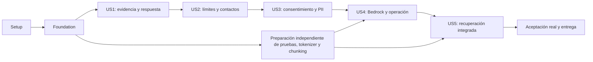

# Tasks: Bloque 2 — Diseño del modelo IA

**Input**: `specs/002-diseno-modelo-ia/` (spec, diagnóstico, plan, investigación, modelo de datos y cinco contratos). Fecha: 2026-10-08.
**Prerequisites**: `plan.md`, `spec.md`, `research.md`, `data-model.md`, `contracts/`, `quickstart.md` y `.specify/memory/constitution.md`.
**Tests**: Obligatorias por los criterios de aceptación del spec y principio X. Los dobles acreditan contratos locales; la aceptación del modelo requiere AWS real y revisión funcional. Estas tareas están pendientes: generar esta lista no ejecuta pruebas ni implementa código.
**Organization**: Cinco historias en el orden del spec: US1–US4 P1; US5 P2. Infraestructura compartida primero y aceptación integrada al final. El orden por prioridad no elimina dependencias de producción entre historias.

## Format: `[ID] [P?] [Story?] Description`

- Cada tarea tiene un ID único, rutas concretas y requisitos trazables. `Dep.:` identifica predecesoras directas; la dependencia es transitiva.
- `[P]` significa que puede ejecutarse junto con otras tareas habilitadas que trabajan archivos distintos. Primero deben completarse sus dependencias. Nunca editar simultáneamente el mismo archivo.
- `[USn]` aparece únicamente en fases de historias. Setup, foundation y cierre no llevan historia.
- Las restricciones entre comillas se transcriben de `data-model.md`; las reglas completas de los contratos también son vinculantes para implementar estas tareas.

## Path Conventions

Rutas relativas a `/Users/geotrends/Desktop/DEV_LAOR/agente`. `backend/src/bedrock/`, `backend/src/chat/`, `backend/src/admin/`, `frontend/app/admin/` y fixtures DI son destinos nuevos propuestos; los archivos existentes se extienden. Confirmar nombres libres y numeración de migraciones al ejecutar, sin sobrescribir trabajo local ni renumerar migraciones aplicadas. Evidencias futuras bajo `specs/002-diseno-modelo-ia/evidencias/aceptacion/`.

## Phase 1: Setup

**Propósito**: Preparar una base reproducible sin repetir lo que ya funciona ni alterar cambios del usuario.

- [X] T001 Registrar revisión Git, inventario de cambios locales y resultados iniciales de `diagnostico.md` en `specs/002-diseno-modelo-ia/evidencias/aceptacion/baseline.md`; vincular cada brecha a esta lista y preservar los 70 resultados previos como evidencia parcial, sin declarar cobertura nueva. Reqs: RF-C3-VA-01/03, constitución IX/X. Dep.: ninguna.
- [X] T002 Añadir dependencias SDK AWS v 3, aritmética decimal y argon2 compatibles con Node 22/TypeScript al `backend/package.json` y `backend/package-lock.json`; revisar versiones instaladas, mantener dependencias de recuperación local y no introducir Python en solicitudes online. Reqs: RF-C3-DI-16, RNF-C3-DI-02, RNF-C3-AD-03. Dep.: T001.
- [X] T003 [P] Definir configuración validada de región/IDs permitidos, URLs de pools limitados, proxy/orígenes, política municipal, contactos/tarifas requeridos y artefactos offline en `backend/src/services/settings.ts`, `.env.example` y `docker-compose.yml`; rechazar credenciales estáticas/defaults inventados y configuración que habilite otros LLM. Reqs: RNF-C3-DI-02, RNF-C3-IN-04/07/08/10. Dep.: T002.
- [X] T004 [P] Crear arnés DI aislado con PostgreSQL/Qdrant reales, cliente Converse doble sin red y reloj controlable en `backend/test/di-integracion/harness.ts` y `backend/test/fixtures/di/manifest.json`; incorporar los casos y cantidades de `contracts/acceptance.md`, datos sintéticos, identidad/hash/versiones y responsable manual. Reqs: RF-C3-VA-01/03/05, constitución IX/X. Dep.: T002.
- [X] T005 Exponer `test:di-integration`, `eval:tokenizer`, `eval:di`, `eval:di-traffic` y `eval:di-load` en `backend/package.json`, con interfaces de `quickstart.md`; marcar qué runners aún requieren implementación y impedir confundir `adapter=double` con aceptación real. Reqs: RF-C3-VA-01/03/05. Dep.: T003, T004.

## Phase 2: Foundational — Prerrequisitos compartidos

**Puerta**: Completar esta fase antes de implementar historias. Las interfaces inyectables permiten validar cada historia con fixtures; ninguna simulación habilita producción.

- [X] T006 Crear contratos TypeScript de pregunta/historial por pares, resultado público, fuentes verificables, snapshot de contactos y adaptador con usage/stopReason/deadline en `backend/src/chat/contracts.ts`, `backend/src/shared/chatHistory.ts` y `backend/src/shared/llmTypes.ts`; modelar las cuatro respuestas en español y separar resultados internos de campos ciudadanos. Reqs: RF-C3-IN-02/03/04, RF-C3-DI-07/08/16/18, RNF-C3-DI-01. Dep.: T005.
- [X] T007 Preparar propietarios no-login, migrador y roles limitados chat/admin/mantenimiento en `backend/db/init/01-roles.sh`, `backend/db/bootstrap-chat-admin.sh` y `backend/scripts/migrate-chat-admin.ts`; aplicar migraciones transaccionales con registro separado sobre volumen limpio y existente, grants/revokes y search_path seguro; preservar `001_esquema_kb.sql` y permisos KB, sin `down -v`. Reqs: RF-C3-DI-16, RF-C3-AD-41, constitución III/VII. Dep.: T003, T006.
- [X] T008 Crear migración nueva `backend/migrations/002_chat_admin_base.sql` y pools `backend/src/chat/db.ts`, `backend/src/admin/db.ts`; propietario distinto de runtime, transacciones acotadas y roles sin DDL/escritura KB. Modelar registro de contactos: “Singleton con `revision` bigint creciente, `updated_at`, `updated_by`”; recepción: “Singleton: `pqrsd_url` https obligatoria, `whatsapp` número con dígitos/símbolos permitidos y `email` válido.” y “No nulos/vacíos ni eliminación.”; general: “Singleton: `phone` por mismo conjunto permitido, `email` válido, `contact_url` https.” y “Tres datos obligatorios y validación por campo.”; inmediatos: id UUID, name “no vacío”, description “≤120 caracteres”, type “teléfono/correo/url”, value “válido según tipo”, position “entero ordenado y único por snapshot”, lista nunca vacía. Reqs: RF-C3-AD-35/36/37, RF-C3-DI-19/20/24. Dep.: T007.
- [X] T009 Crear esquema de identidad y auditoría en `backend/migrations/003_admin_identidad.sql`: cuenta id UUID, email “único”, display_name, profile “solo administrador técnico/Gestor documental”, active “boolean”, password_phc “argon2id con sal única”, must_change_password/failed_attempts/locked_until/created_at/updated_at; sesión token_hash “PK”, account_id “FK”, created_at/last_request_at/revoked_at/csrf_token_hash y “solo hash de secreto de sesión, token opaco en cookie segura”; auditoría id bigint, actor_account_id/action/object_type/id/result/occurred_at, “runtime sinUPDATE/DELETE y sin endpoint correspondiente.”. Implementar invariante ≥1 técnico activo y mutación/auditoría atómicas con procedimientos restringidos. Reqs: RF-C3-AD-08/41, RNF-C3-AD-01/03/07. Dep.: T008.
- [X] T010 [P] Implementar hashing argon2id con sal única y parámetros 65536 KiB/3/1, bootstrap por stdin/TTY y cambio temporal obligatorio en `backend/src/admin/passwords.ts` y `backend/scripts/bootstrap-admin.ts`; longitud ≥12 sin composición, nunca password en args/env/logs, contraseña nueva diferente de temporal. Reqs: RF-C3-AD-09/10, RNF-C3-AD-02/03. Dep.: T009.
- [X] T011 [P] Crear snapshot transaccional y validadores de contactos en `backend/src/admin/contacts.ts`; teléfono/WhatsApp admiten dígitos, espacio, +, -, paréntesis con ≥1 dígito, sin longitud nacional añadida; emails válidos y URL https. Incluir versión/política y bloquear readiness si faltan valores oficiales. No caché TTL que retrase siguiente consulta. Reqs: RF-C3-DI-19/20/24, RF-C3-AD-35/36/37, RF-C3-IN-10. Dep.: T008.
- [X] T012 Implementar autenticación/sesiones y dos perfiles en `backend/src/admin/auth.ts`, `backend/src/admin/sessions.ts` y `backend/src/routes/adminAuth.ts`; cookie HttpOnly/Secure/SameSite=Strict, CSRF/Origin, sesión 30 min por solicitudes reales, 5 fallos por cuenta →15 min, IP 20/15→15 min antes de verificar credencial, éxito reinicia IP; genérico 401, IP 429/Retry-After. Cambio temporal solo habilita sesión/password/logout; revocación sincrónica y lock protegen último técnico. Reqs: RF-C3-AD-08/09/10, RNF-C3-AD-01/04/05/06. Dep.: T009, T010.
- [X] T013 [P] Implementar plazo único cancelable y errores públicos seguros en `backend/src/chat/deadline.ts`, `backend/src/chat/errors.ts` y `backend/src/index.ts`: ≤40 s incluyendo cola/recuperación/escritura, reserva inicial 5 s recuperación/2 s finalización y objetivo operativo <39 s; VALIDACION 400 por campo, SERVICIO_NO_DISPONIBLE 503, ERROR_INTERNO 500, sin SQL/modelo/proveedor/traza. Reqs: RF-C3-IN-04/08, RF-C3-DI-03. Dep.: T006.
- [X] T014 Implementar perímetro de chat y config pública en `backend/src/routes/chat.ts`, `backend/src/routes/auth.ts`, `backend/src/chat/perimeter.ts` y `frontend/nginx.conf`: Bearer técnico distinto de consentimiento, origen allowlist, ventana deslizante 60/min/IP, proxy confiable, cuerpo ≤131072 bytes incluso streaming, sin límite adicional de caracteres, rechazos 413/429 sin LLM/registro y Retry-After; `GET /api/chat/config` completo en ≤2 s sin LLM. Reqs: RF-C3-IN-10, RNF-C3-IN-04/05/06, RF-C4-DC-01/02. Dep.: T011, T013.
- [X] T015 [P] Probar migrador en volúmenes limpio/existente, permisos negativos, último técnico concurrente, bootstrap sin filtración, hashing/sesión/bloqueos y CSRF en `backend/test/di-integracion/admin-security.test.ts`; incluir 19 fallos+éxito+5 y tiempos 29/31 con polling pausado, cambio temporal y Gestor 403. Reqs: RF-C3-AD-08/09/10/41, RNF-C3-AD-01..07. Dep.: T012.
- [X] T016 [P] Probar config pública 3 llamadas≤2 s/0 LLM, orígenes, 62 solicitudes→60 válidas/2 rate-limit, proxy spoofing y bytes exactos 128 KiB/128 KiB+1, pregunta de 20.000 caracteres aceptada y deadline con cola en `backend/test/di-integracion/chat-perimeter.test.ts`; verificar rechazos sin registros y sin secretos. Reqs: RF-C3-IN-04/10, RNF-C3-IN-04/05/06. Dep.: T014.
- [X] T017 Validar gate de prerrequisitos y documentar mecanismos reutilizados/nuevos en `specs/002-diseno-modelo-ia/evidencias/aceptacion/foundation.md`; ejecutar tipos y suites pertinentes, corregir fallos sin desactivar pruebas y registrar que modelos/calibración/evaluación integral todavía faltan. Reqs: RF-C3-VA-03, constitución X. Dep.: T015, T016.

## Phase 3: US1 — Orientarse con evidencia y canales vigentes (P1)

**Goal**: Orientación documental con citas reales, límites de decisión y tres canales de recepción.

**Independent Test**: Sobre documentos publicados/snapshot válidos, comprobar 10 presente/ausente, 10 citas/fuentes (3 sobrantes), 15 decisiones/informativas, 5 conflictos, 10 tono, 8 cierres y 9 estructuras conforme tasas del spec. Dobles solo para contrato; revisión funcional real en cierre.

### Tests

- [X] T018 [P] [US1] Crear pruebas de ausencia/presencia (5+5), enlaces/fechas (10), fuentes declaradas (10 con 3 sobrantes, marcadores inválidos y respuesta factual sin fuente) en `backend/test/di-answer-evidence.test.ts`; no conocimiento general, no fallback a todas las fuentes, listas vacías salvo respondida. Reqs: RF-C3-DI-04/07/08, RF-C3-IN-03. Dep.: T017.
- [X] T019 [P] [US1] Crear pruebas de 10 decisión/5 informativas, 5 conflictos GT-P/GT-N, 8 cierres y fixtures de 10 respuestas/9 estructuras para revisión manual en `backend/test/di-institutional-answer.test.ts` y `backend/test/fixtures/di/us1.json`; comprobar leyenda exacta, tres contactos y evitar pasos artificiales/tablas de una fila. Reqs: RF-C3-DI-09/10/11/24/25. Dep.: T017.

### Implementation

- [X] T020 [US1] Definir textos institucionales y prompt común versionado en `backend/src/prompts/tutorPrompt.ts`, `backend/src/prompts/institutionalTexts.ts`; español/Markdown/tono seis puntos, conocimiento solo recuperado, GT-P prevalente, responsable y “no reemplaza asesoría técnica ni jurídica formal”, secuencias numeradas/comparaciones≥2 con mismos atributos/prosa restante. Pregunta/historial/documentos tratados como datos no confiables; snapshot oficial por canal confiable. Reqs: RF-C3-DI-09/10/11/17/25, RNF-C3-IN-11. Dep.: T018, T019.
- [X] T021 [US1] Adaptar fechas e identificadores documentales desde payload KB en `backend/src/services/documentLinks.ts` y `backend/src/chat/sources.ts`; documentos con actualización/páginas con acceso, nombre/título enlazado, URL https oficial, sin fecha actual inventada; fecha ausente es error de datos. Reqs: RF-C3-DI-07/08, RF-C3-IN-03. Dep.: T020.
- [X] T022 [US1] Parsear IDs opacos declarados y referencias por unidad en `backend/src/chat/sourceSelection.ts`; intersecar usados/recuperados/contenido conservado, rechazar ajenos y marcadores inválidos, no citar todos al faltar declaración, fallo seguro si contenido factual carece de fuente válida. Reqs: RF-C3-DI-08/18. Dep.: T021.
- [X] T023 [US1] Implementar compositor de citas internas, leyenda y cierre PQRSD/WhatsApp/email en `backend/src/chat/composeAnswer.ts`; mantener lista de fuentes sincronizada y tres canales no excluyentes desde snapshot, sin marcador técnico visible. Exponer etapas para aviso/riesgo/recorte de siguientes historias. Reqs: RF-C3-DI-07/09/24, RF-C3-IN-03. Dep.: T022.
- [X] T024 [US1] Implementar abstención documental con literal “No encontré información validada…” más canal oficial y sin citas/datos extra en `backend/src/chat/answerPolicy.ts`; usarla solo ante recuperación exitosa sin evidencia suficiente, nunca ante búsqueda fallida. Reqs: RF-C3-DI-04, RF-C3-IN-04. Dep.: T023.
- [X] T025 [US1] Adaptar orquestación con contratos inyectables en `backend/src/services/answerQuestion.ts`; usar solo evidencia del retriever, prompt único y compositor, respetar precedencia GT-P, sin clasificación remota de complejidad ni generación abierta. Conectar interfaces ahora y proveedores reales en US4/US5. Reqs: RF-C3-DI-04/07/08/09/11/17/24/25. Dep.: T024.
- [X] T026 [P] [US1] Proteger renderizado Markdown/citas/fechas en `frontend/shared/ChatMarkdown.tsx` y `frontend/shared/chatContracts.ts`; deshabilitar HTML bruto, URLs inseguras/marcadores, usar nueva pestaña segura sin borrar pregunta y texto ciudadano plano. Reqs: RF-C3-DI-07/10/25, RNF-C4-UI-03. Dep.: T021.
- [X] T027 [US1] Adaptar `frontend/smart/SmartAgentPanel.tsx` a contrato español de tipos/fuentes y respuesta Markdown con citas internas, manteniendo interfaz accesible y sin uso/costo/modelo público; dejar consentimiento explícito para US3 antes de habilitar entrega integrada. Reqs: RF-C3-IN-03, RF-C3-DI-07/10/25. Dep.: T025, T026.
- [X] T028 [US1] Conectar respuesta contractual a `backend/src/routes/chat.ts` y probar US1 con fixtures publicados/contactos válidos en `backend/test/di-integracion/us1.test.ts`; comprobar 5 ausentes/5 presentes, fechas/enlaces y actualización de snapshot en siguiente consulta. Reqs: RF-C3-DI-04/07/08/09/11/24, RF-C3-IN-03. Dep.: T025, T027.
- [X] T029 [US1] Ejecutar pruebas US1 y preparar rúbrica de revisión tono 10 (≥9/10), estructuras 9 (≥8/9) y correspondencia documental en `specs/002-diseno-modelo-ia/evidencias/aceptacion/us1-local.md`; registrar resultados simulados y reservar firma real para cierre. Reqs: RF-C3-DI-10/25, RF-C3-VA-03/05. Dep.: T028.

**Checkpoint**: US1 demostrable por contrato; habilitación institucional depende además de US2–US5 y aceptación final.

## Phase 4: US2 — Límites, aclaración y atención inmediata (P1)

**Goal**: Límites correctos, una aclaración autorizada y contactos oficiales editables usados inmediatamente.

**Independent Test**: 10 análisis/trámites, 8 ajenas/propias, 8 insuficientes/completas y persistencia, 10 riesgo/informativas; panel real con permisos/validación/CAS y actualización en siguiente respuesta. Estado de aclaración puede probarse con repositorio doble hasta US3.

### Tests

- [X] T030 [P] [US2] Crear fixtures y pruebas de análisis 5/trámites 5, ajenas 4/propias 4, insuficientes 4/completas 4 y segunda insuficiente en `backend/test/di-answer-limits.test.ts`; ≥3/4 insuficientes aclaradas, ninguna completa, no cálculo ni respuesta ajena, una aclaración solo en autorizada/anónimas autónomas. Reqs: RF-C3-DI-01/20/21, RF-C4-DC-02. Dep.: T017.
- [X] T031 [P] [US2] Crear pruebas de riesgo 5/informativas 5 y contactos reales de snapshot en `backend/test/di-risk-channels.test.ts`; ≥4/5 riesgos con canales antes de orientación, ≤1/5 informativas, sin números inferidos. Reqs: RF-C3-DI-19. Dep.: T017.
- [X] T032 [P] [US2] Crear pruebas API/DB de recepción 8 intentos, general 7, inmediatos 10 (6 válidos/4 inválidos), CAS 409, último canal y Gestor 403 en `backend/test/di-integracion/admin-contacts.test.ts`; recepción conserva tres valores obligatorios, mutación+auditoría atómicas. Reqs: RF-C3-AD-35/36/37/41, RNF-C3-AD-01. Dep.: T017.

### Implementation

- [X] T033 [US2] Extender `backend/src/chat/answerPolicy.ts` con análisis rechazado+canal, ámbito tres direcciones+contacto general e insuficiencia; una pregunta de aclaración con estado inyectable solo autorizado, limpiar al responder y segunda insuficiente→literalDI04; anónimo pide nueva pregunta completa sin estado arrastrado. Reqs: RF-C3-DI-01/20/21, RF-C4-DC-02. Dep.: T024, T030.
- [X] T034 [US2] Añadir detección de afectación en curso y composición de canales inmediatos antes de orientación en `backend/src/chat/riskPolicy.ts` y `backend/src/chat/composeAnswer.ts`; usar exclusivamente nombres/valores/orden del snapshot vigente, sin generar/inferir contactos. Reqs: RF-C3-DI-19. Dep.: T023, T031, T033.
- [X] T035 [US2] Implementar mutaciones CAS revision y auditoría transaccional en `backend/src/admin/contacts.ts` y `backend/src/admin/audit.ts`; validar entidad completa, descripción≤120, reordenar IDs completos sin duplicados, lista ≥1, revisión creciente y rechazos sin cambios. Reqs: RF-C3-AD-35/36/37/41, RF-C3-DI-19/20/24. Dep.: T032.
- [X] T036 [US2] Exponer rutas de contactos de `contracts/admin-api.md` en `backend/src/routes/adminContacts.ts` y `backend/src/index.ts`; solo técnico con sesión/CSRF, 422 VALIDACION por campo, 409 revision y 403 Gestor, sin endpoints públicos de edición. Reqs: RF-C3-AD-35/36/37, RNF-C3-AD-01. Dep.: T035.
- [X] T037 [US2] Crear login/cambio obligatorio/contactos accesibles en `frontend/app/admin/login/page.tsx`, `frontend/app/admin/password/page.tsx`, `frontend/app/admin/contacts/page.tsx` y `frontend/shared/adminSession.ts`; API protege rutas directas, mostrar errores por campo y revisión 409 sin perder edición. No construir gestión documental/cuentas completa del bloque 7. Reqs: RF-C3-AD-09/10/35/36/37, RNF-C3-AD-01/09. Dep.: T036, T012.
- [X] T038 [US2] Integrar políticas de límites/riesgo y acceso a contactos públicos previos al consentimiento en `backend/src/services/answerQuestion.ts`, `frontend/smart/SmartAgentPanel.tsx`; apertura Geobot fija y canal de urgencia activo sin consulta C3 ni autorización, contactos completos≤2 s; probar 6 recorridos de urgencia y 5 aperturas 3 desktop/2 mobile. Reqs: RF-C3-DI-01/19/20/21, RF-C3-IN-10, RF-C4-DC-01/04. Dep.: T034, T036, T037, T027.
- [X] T039 [US2] Ejecutar suite y recorridos de límites/contactos, verificar edición→siguiente respuesta sin redespliegue y guardar evidencia en `specs/002-diseno-modelo-ia/evidencias/aceptacion/us2-local.md`; diferenciar detectores simulados de tasas semánticas pendientes de revisión real. Reqs: RF-C3-DI-01/19/20/21/24, RF-C3-VA-03/05. Dep.: T038.

**Checkpoint**: Políticas/contactos comprobables independientemente; persistencia real del turno aclarado se valida al integrar US3.

## Phase 5: US3 — Conversar sin exponer datos personales (P1)

**Goal**: Consentimiento verificable, preguntas anónimas independientes y PII saneada antes de salir.

**Independent Test**: 15 payloads PII+historial>10, 14 saneamientos (9 PII/5 normas), 8 provocaciones, 8 equivalentesPII/neutras+3 turnos; autorizadas con UUID backend/pares válidos, 5 anónimas con 2 seguimientos sin texto/IDs/estado persistidos. Usar capturas sintéticas solo test.

### Tests

- [X] T040 [P] [US3] Crear pruebas de saneamiento en `backend/test/di-pii.test.ts`:14 casos 9 PII/5 normas, etiquetas exactas `[CÉDULA]`/`[TELÉFONO]`/`[CORREO]`, no dañar códigos/fechas, 8 equivalentes 4 PII/4 sinPII (incluye dirección/nombre de tercero), aviso antes de orientación cada uno de 3 turnos. Reqs: RF-C3-DI-23, RF-C3-IN-06. Dep.: T017.
- [X] T041 [P] [US3] Crear inspección de 15 salidas 5 por dato e historial>10, 8 provocaciones 4 ofensivas (2 válidas)/4 neutras y 9 inyecciones 3 pregunta/3 historial/3 fragmento en `backend/test/di-provider-privacy.test.ts`; jamás razonamiento/logs/cuerpo crudo, misma orientación válida, anclaje/leyenda intactos. Reqs: RF-C3-DI-22/23, RNF-C3-DI-01, RNF-C3-IN-11. Dep.: T017.
- [X] T042 [P] [US3] Crear 12 requests 8 válidas/4 inválidas (incluye 15→10 pares, UUID ajeno/desconocido, historial sin autorización) y recorridos bypass/reload/5 anónimas con 2 seguimientos en `backend/test/di-integracion/consent.test.ts` y `frontend/test/di-consent.spec.ts`; inválidas sin LLM/registro, ningún UUID generado por navegador. Reqs: RF-C3-IN-01/02/07, RF-C4-DC-02, RF-C4-IN-01. Dep.: T017.

### Implementation

- [X] T043 [US3] Crear `backend/migrations/004_chat_conversacion.sql` y repositorio `backend/src/chat/conversations.ts`: conversation_id “UUIDv 4, emitido exclusivamente backend; PK mientras vigente.”, “`created_at`: timestamptz; `authorized_at`: timestamptz, evidencia de decisión Autorizo; `policy_version`: versión de política mostrada.”; transport_binding_hash “hash de credencial técnica vigente que autoriza usar esta conversación; nunca expuesto ni usado en modo anónimo persistente.”; clarification_pending “booleano, inicialmente false; no historial ni texto en esta tabla.”; last_active_at “timestamptz para operación; no inventar duración contractual de consentimiento.”. Rechazar UUID ajeno/desconocido y nunca crear conversación anónima. Reqs: RF-C3-IN-01/02/07, RF-C3-DI-21, RF-C4-DC-02. Dep.: T042, T008.
- [X] T044 [US3] Implementar `POST /api/conversations` y validación estricta de chat en `backend/src/routes/conversations.ts`, `backend/src/chat/validateRequest.ts`, `backend/src/routes/chat.ts`; UUID solo Autorizo/política vigente, historial de pares completos validar TODOS antes de últimos 10, categoría enum y pregunta no vacía, rechazar modelo/proveedor/prompt/autoRoute y mensajes role/content. Reqs: RF-C3-IN-01/02, RNF-C3-DI-01. Dep.: T043, T014.
- [X] T045 [US3] Extender `backend/src/services/pii.ts` a texto saneado+tipos detectados; enmascarar cédula/teléfono/correo de pregunta/fragmentos/historial antes de Bedrock, detectar direcciones/nombres de tercero para aviso/no reproducción y conservar normas/códigos/fechas. Contactos oficiales por canal confiable sin eximir PII ciudadano coincidente. Reqs: RF-C3-DI-23, RNF-C3-DI-01, RF-C3-IN-06. Dep.: T040, T041.
- [X] T046 [US3] Integrar barrera de salida/aviso por cada turno PII y tono ante provocación en `backend/src/chat/composeAnswer.ts`, `backend/src/prompts/tutorPrompt.ts` y `backend/src/services/answerQuestion.ts`; advertir no necesarios/evitar/política antes de orientar, no repetir groserías/reprochar/interrumpir pregunta válida, no aviso en neutras. Reqs: RF-C3-DI-22/23, RNF-C3-DI-01. Dep.: T045, T034, T038.
- [X] T047 [US3] Conectar aclaración pendiente autorizada y eliminar arrastre anónimo en `backend/src/chat/conversations.ts` y `backend/src/chat/answerPolicy.ts`; segunda insuficiente→DI04, respuesta suficiente limpia pendiente, sin guardar texto/historial en tabla conversación. Reqs: RF-C3-DI-21, RF-C4-DC-02. Dep.: T043, T033, T046.
- [X] T048 [US3] Implementar decisión Autorizo/No autorizo, enlace/versión de política, consulta deshabilitada hasta decisión e historial autorizado en memoria en `frontend/smart/SmartAgentPanel.tsx`, `frontend/shared/session.ts`; UUID backend descartado al reiniciar/recargar, No autorizo no envía historial ni mantiene preguntas/estado para seguimiento, aviso de reformulación completa y bloqueo de bypass por cierre/recarga/ruta directa. Reqs: RF-C4-DC-02, RF-C4-IN-01, RF-C3-IN-01/02. Dep.: T044, T047, T038.
- [X] T049 [US3] Eliminar captura de texto/Authorization/respuesta/IP o hashes de consultas anónimas en `backend/src/services/chatLog.ts`, `backend/src/services/chatTraffic.ts`, `backend/src/index.ts` y `frontend/nginx.conf`; retirar escritura CSV activa sin importar registros antiguos como consentimiento y permitir solo errores estructurales sanitizados. Reqs: RF-C3-IN-06/07, RNF-C3-DI-01, constitución IV. Dep.: T046, T014.
- [X] T050 [US3] Integrar consentimiento/validación/PII y ejecutar inspección de todos los destinos persistentes en `backend/test/di-integracion/privacy.test.ts`; verificar payload doble saneado y 5 anónimas incl 2 seguimientos sin UUID/hash/token/IP/texto/estado; ampliar contra registro real US4 en gate final. Reqs: RF-C3-DI-22/23, RNF-C3-DI-01, RF-C3-IN-01/02/06/07. Dep.: T044, T048, T049.
- [X] T051 [US3] Guardar resultados de privacidad y recorridos navegador en `specs/002-diseno-modelo-ia/evidencias/aceptacion/us3-local.md`, incluyendo limitaciones comprobadas de PII libre y fallos REAL que deben corregirse antes de cierre; no usar datos personales reales. Reqs: RF-C3-VA-03/05, RF-C3-DI-23, RNF-C3-DI-01. Dep.: T050.

**Checkpoint**: Consentimiento y barreras PII listos; consumo PostgreSQL y prueba contra tráfico AWS real se cierran con US4/fase final.

## Phase 6: US4 — Continuidad y control del consumo (P1)

**Goal**: Bedrock único, enrutamiento/respaldo, consumo real, corte correcto y panel de operación seguro.

**Independent Test**: 12 clasificaciones, 9 rutas principal/respaldo/doble fallo, 10 consumos, 10 preguntas por ambos modelos, 6 cortes+3 normales, 10 largas, 3 RRF degradado; registro 6 fallos+2 recuperadas, 5 estados visibles<60 s y avisos/contador. Contratos locales primero; AWS real obligatorio al cierre.

### Tests

- [X] T052 [P] [US4] Crear pruebas de 12 clasificaciones (3 por nivel+3 simples con 10 pares), score finito/repetible/0 LLM y 9 rutas en total, tres por nivel en `backend/test/di-model-routing.test.ts`; verificar deadline total/cancelación/circuitos y error 503 sin detalles tras doble fallo. Reqs: RF-C3-DI-02/03, RF-C3-IN-04. Dep.: T017.
- [X] T053 [P] [US4] Crear fixtures de Converse text/reasoning/usage/stopReason, 6 cortes 3 por modelo+3 normales y 10 largas 5 por modelo en `backend/test/di-bedrock.test.ts`, `backend/test/di-output-limit.test.ts`; validar prompt/config común, usage real no inventado, tope 2200 oficial/visible y fuentes después del recorte. Reqs: RF-C3-DI-16/17/18, RNF-C3-DI-02/03. Dep.: T017.
- [X] T054 [P] [US4] Crear pruebas PostgreSQL de 10 registros 5 por modelo incluyendo respaldo, 6 anónimos solo seis campos, 6 escrituras fallidas+2 recuperadas y retención 11 m 29 d/12 m 1 d en `backend/test/di-integracion/consumption.test.ts`; costo decimal recalculable, responseId solo commit/omitido si falla y dos purgas automáticas idempotentes. Reqs: RF-C3-DI-16, RF-C3-IN-03/05/07/08, RNF-C3-IN-01. Dep.: T017.
- [X] T055 [P] [US4] Crear pruebas de 5 estados<60 s (20b/120b/reranker/registro/scraper), 8 tipos avisos, 4 revisiones de 5→contador 1, agrupación/nueva ocurrencia tras revisión, Gestor 403 y overlay con DB caída en `backend/test/di-integracion/admin-operations.test.ts`; reinicio con DB caída→401, sesiones previas expiran/invalidadas. Reqs: RF-C3-AD-28/29/30/48, RF-C3-IN-08, RNF-C3-AD-01/05. Dep.: T017.

### Implementation

- [X] T056 [US4] Implementar adaptador `backend/src/bedrock/askBedrock.ts` y `backend/src/bedrock/client.ts`: Converse SDK v3, IDs exactos openai.gpt-oss-20b-1:0/openai.gpt-oss-120b-1:0 us-east-1 sin fallback regional, rol EC2/sesión temporal sin llaves estáticas, maxAttempts=1/maxTokens=2200/temperature=0 y sin streaming/tools. Extraer text/usage/stopReason/modelo efectivo; excluir reasoning de todo destino y fallo seguro ante usage inválido/guardrail/texto vacío. Reqs: RF-C3-DI-03/16/17/18, RNF-C3-DI-01/02/03, RNF-C3-IN-07/08/10. Dep.: T052, T053, T045.
- [X] T057 [US4] Sustituir puntaje/enrutamiento en `backend/src/services/providerRouter.ts` y `backend/src/services/llm.ts`: local simple<3/media 3–5/compleja≥6, ≥10 PARES fuerza max(base, 6) finito; 20b simple/media, 120b compleja y otro respaldo, una tentativa cada uno dentro del plazo y circuitos. Reqs: RF-C3-DI-02/03/17, RF-C3-IN-04. Dep.: T056, T013.
- [X] T058 [US4] Retirar acceso público/activo a catálogo y proveedores legacy en `backend/src/routes/chat.ts`, `backend/src/services/settings.ts`, `backend/src/services/llm.ts` y `frontend/smart/SmartAgentPanel.tsx`; eliminar selector/proveedores y rutas `/providers`, bloquear Ollama/Gemini/OpenAI-compatible externos en toda configuración de inferencia, conservar embeddings/reranker locales. Reqs: RNF-C3-DI-02, RNF-C3-IN-07/08/10. Dep.: T057, T048.
- [X] T059 [P] [US4] Crear oráculo offline con `backend/scripts/tokenizer-oracle.py`, `backend/test/fixtures/di/tokenizer-oracle.json` y `backend/scripts/eval-tokenizer.ts`; fijar revisión+SHA tokenizer oficial o200k_harmony, paridad exacta de IDs contra tiktoken.encode_ordinary en español/Unicode/Markdown/URLs/PII/tokens especiales literales, sin Python online ni CountTokens. Reqs: RNF-C3-DI-03, RF-C3-DI-18. Dep.: T053.
- [X] T060 [US4] Implementar contador offline en TypeScript en `backend/src/chat/outputTokenizer.ts`; usar artefactos fijados/paridad T059 y red deshabilitada, fallback WASM local solo si demuestra la misma paridad; contar concatenación completa sin tokens estructurales añadidos. Gate obligatorio: ninguna aproximación por palabras/caracteres ni llamada CountTokens. Reqs: RNF-C3-DI-03. Dep.: T059, T002.
- [X] T061 [US4] Implementar abreviación y límite de texto final en `backend/src/chat/outputLimit.ts`, `backend/src/chat/composeAnswer.ts` y `backend/src/services/contextBudget.ts`; ante max_tokens conservar última oración completa y cita+enlace/fecha, literal “Respuesta abreviada por su extensión; consulte el documento para el detalle completo”; incluir avisos/canales/citas en ≤2200, retirar unidades completas sin partir URLs/tablas, recalcular fuentes, fallar seguro si nada respaldado cabe. Reqs: RF-C3-DI-18, RNF-C3-DI-03, RF-C3-DI-08. Dep.: T060, T022, T046.
- [X] T062 [US4] Crear `backend/migrations/005_chat_registro_tarifas.sql`: Interaction row_id “bigint técnico interno, sin significado ciudadano ni exposición pública; conserva estadísticas después de purga.”; conversation_id “UUID FK nullable”, response_id “UUIDv 4 nullable, único mientras existe; emitido solo tras commit.”; received_at “timestamptz”/mode “constante conversación.”; category “enum Ecosistemas/Bienestar Animal/Gestión Ambiental o null”, question_text/answer_text “texto previamente saneado.”; result_type “respondida/sin información/fuera de alcance/aclaración”, cited_documents “snapshot de identificador/nombre/URL/fecha, vacío salvo respondida.”; duration_ms “entero≥0”, visible_output_tokens “entero 0..2200.”; model “gpt-oss-20b/gpt-oss-120b/none”, input_tokens/output_tokens “entero≥0”, tariff_version “FK nullable si none”, estimated_cost “decimal no negativo”, purged_at “timestamptz nullable.”. Reqs: RF-C3-DI-16, RF-C3-IN-03/05/06, RNF-C3-IN-01. Dep.: T054, T043.
- [X] T063 [US4] Extender `backend/migrations/005_chat_registro_tarifas.sql` con consumo anónimo “Únicamente `received_at`, `mode=anónima`, `model`, `input_tokens`, `output_tokens`, `estimated_cost`.” y “No PK de consulta, UUID, conversation_id/response_id, texto/hash, token/IP, categoría, tipo de resultado, documentos, historial, duración ni valoración.”; tarifas version “PK”, model_id “de allowlist”, region/currency, input_price_per_million/output_price_per_million “NUMERIC≥0”, valid_from, valid_to “nullable”, source_url “oficial”, registered_at y “Sin periodos activos solapados por modelo/región.”. Reqs: RF-C3-DI-16, RF-C3-IN-07. Dep.: T062.
- [X] T064 [US4] Implementar tarifas/consumo y escritura confirmada en `backend/src/chat/tariffs.ts`, `backend/src/chat/records.ts`, `backend/src/services/chatLog.ts`; fórmula decimal (input×precioEntrada+output×precioSalida)/1000000 con precisión documentada, modelo efectivo/tokens oficiales, una fila y responseId tras commit. none→0 demostrable/sin tarifa; falta tarifa no inventa 0; anónimo solo seis campos, sin CSV activo, fallo escritura entrega respuesta sin ID y no retiene texto para reintento. Reqs: RF-C3-DI-16, RF-C3-IN-03/05/07/08. Dep.: T063, T056, T049.
- [X] T065 [P] [US4] Crear `backend/migrations/006_operacion_auditable.sql` y servicio `backend/src/admin/operations.ts`: component “PK (20b, 120b, reranker, registro, scraper)”, status “normal/degradado/no comprobado”, last_success_at/last_failure_at/updated_at, threshold_applied “solo reranker”, safe_reason “estructural sin texto de consulta.”; notificación id “UUID interno”, type/object (componente/cuenta/documento)/safe_description, state “no_revisada/revisada”, first_at/last_at/repetitions/reviewed_by/reviewed_at; “Única no_revisada por tipo+objeto”, revisión conserva fila/actor/fecha y siguiente ocurrencia crea otra. Reqs: RF-C3-AD-28/29/30/48. Dep.: T055, T009.
- [X] T066 [US4] Integrar estado/avisos con circuito/modelos, reranker y registro en `backend/src/services/circuitBreaker.ts`, `backend/src/services/alerts.ts`, `backend/src/admin/notifications.ts` y `backend/src/admin/operations.ts`; eventos reales/no comprobado sin inferencias pagadas, fallo registro 1 aviso/episodio y recuperación normal. Overlay sanitizado de DB caída solo a sesiones previas aún válidas, sin nuevos logins/mutaciones, persistir metadata al recuperar sin texto; integrar lectura de informes/avisos KB con permisos precisos, cero webhook/email. Reqs: RF-C3-DI-03/06, RF-C3-IN-08, RF-C3-AD-28/29/30/48. Dep.: T065, T064, T012.
- [X] T067 [US4] Exponer `GET /api/admin/status`, lista/contador de notificaciones y revisión CSRF en `backend/src/routes/adminOperations.ts` y `backend/src/index.ts`; lista descendente, actor/fecha auditados, Gestor 403, scraper última corrida KB real, estado de ambos modelos/reranker/registro y polling ≤15 s con actualización <60 s. Reqs: RF-C3-AD-28/29/30/41/48, RNF-C3-AD-01/05. Dep.: T066.
- [X] T068 [P] [US4] Crear purga horaria idempotente con `backend/migrations/007_chat_retencion.sql`, `backend/src/chat/retention.ts` y `backend/scripts/purge-chat.ts`: PurgeRun run_id “técnico”, started_at/finished_at/cutoff_at/rows_purged/status, “sin texto ni UUID ciudadano.”; 12 meses calendario+≤24 h, vaciar textos/conversation_id/response_id, conservar estadísticas del contrato, borrar conversación sin filas vigentes y permitir FK compatible con purga. Integrar tarea horaria verificable en `docker-compose.yml`. Reqs: RNF-C3-IN-01, RF-C3-IN-05/07. Dep.: T063, T054.
- [X] T069 [US4] Crear pantallas estado/avisos y contador en tres pantallas del panel mínimo en `frontend/app/admin/status/page.tsx`, `frontend/app/admin/notifications/page.tsx` y `frontend/app/admin/layout.tsx`; técnico únicamente, estado observado/último fallo/umbral/scraper/registro, revisión sin eliminar, polling ≤15 s/expiración y accesibilidad. Reqs: RF-C3-AD-28/29/48, RNF-C3-AD-01/05/09. Dep.: T067, T037.
- [X] T070 [US4] Integrar adaptador/enrutamiento/corte/consumo/degradación en `backend/src/services/answerQuestion.ts`, `backend/src/routes/chat.ts`, `backend/src/routes/health.ts`; orden de plan/deadline único, respaldo efectivo, doble fallo registrado como evento operativo sanitizado/visible en panel, registro antes del ID, ausencia documental distinta de falla y readiness bloqueada por tarifas/tokenizer/config inválidas. Reqs: RF-C3-DI-02/03/16/17/18, RNF-C3-DI-01/02/03, RF-C3-IN-04/08. Dep.: T058, T061, T064, T066, T068, T047.
- [X] T071 [US4] Ejecutar suites locales routing/corte/DB/panel y registrar paridad tokenizer, costos, 2 purgas y estados en `specs/002-diseno-modelo-ia/evidencias/aceptacion/us4-local.md`; dejar comparación semántica/tráfico/tokens reales en AWS explícitamente pendientes del gate final. Reqs: RF-C3-DI-02/03/06/16/17/18, RNF-C3-DI-02/03, RF-C3-VA-03/05. Dep.: T069, T070.

**Checkpoint**: Adaptador/producto integrado con contratos probados; corpus/calibración US5 y evaluación real siguen siendo necesarios para aceptar DI.

## Phase 7: US5 — Evidencia pertinente y seguimientos (P2)

**Goal**: Recuperación híbrida fiel, corpus conforme, calibración vigente y seguimientos sin contexto adicional.

**Independent Test**: 5 trazas híbridas, ≥5 documentos/≥2 tablas, 3 diversidad/dedupe, 5 seguimientos/5 autónomas, 3 fallos del reranker y barrido real con cero falsas abstenciones; publicación fallida conserva alias anterior.

### Tests

- [X] T072 [P] [US5] Crear muestra≥5 documentos/≥2 tablas en `backend/test/fixtures/di/chunking/` y pruebas `backend/test/di-chunking.test.ts`; longitud completa 1000 incluyendo título/contexto, palabras intactas, overlap 150±1 palabra, tablas indivisibles, fronteras 1000/1001 y palabra>1000 bloquean nueva publicación. Reqs: RF-C3-DI-13, RNF-C3-IV-02. Dep.: T017.
- [X] T073 [P] [US5] Crear pruebas de 5 trazas BM25+denso/RRF/top 16/top 8, 3 casos diversidad/único documento/duplicados y 3 fallos del reranker en `backend/test/di-retrieval-selection.test.ts`; score>umbral (igual fuera), Jaccard≥0.6 nunca reintegrado, orden estable, ≤3 por doc salvo única útil y degradado top 8 RRF directo. Reqs: RF-C3-DI-06/12/14. Dep.: T017.
- [X] T074 [P] [US5] Crear pruebas 5 seguimientos/5 autónomas y cola≤500 límite palabra (palabra>500→vacía), barrido mayor finito válido y publicación versionada en `backend/test/di-followup-calibration.test.ts`; no cola adicional al LLM, cero falsa abstención y cambio de embedding/reranker invalida calibración. Reqs: RF-C3-DI-05/15. Dep.: T017.

### Implementation

- [X] T075 [US5] Corregir fragmentación en `backend/src/services/chunking.ts`, `backend/src/services/retrievalMath.ts`, `backend/src/services/documentPreprocessor.ts` y `backend/src/kb/indexer.ts`; “Texto≤1000 incluyendo contexto textual añadido”, prosa 1000/overlap 150±1 palabra, tablas Markdown completas aunque mezcladas con prosa, conservar páginas/secciones en metadata y no perder contenido. Tabla/palabra>1000 produce hallazgo REAL/no publicación, no dividir ni aceptar excepción. Reqs: RF-C3-DI-13, RNF-C3-IV-02. Dep.: T072.
- [X] T076 [US5] Completar payload de fuente publicada en `backend/src/kb/indexer.ts` y `backend/src/services/retrievalWorker.ts`: referencia de elemento/versión KB, nombre/URL/fechaActualización/fechaAcceso/fragmento/texto/código/tipo; sin tabla documental paralela, rechazar fechas faltantes sin inventar y registrar metadata de versión de calibración. Reqs: RF-C3-DI-07/13, constitución II/III. Dep.: T075, T021.
- [X] T077 [US5] Fijar máximos 16 candidatos/8 seleccionados y RRF deduplicado en `backend/src/services/search.ts`, `backend/src/services/settings.ts` y `backend/src/services/retrievalWorker.ts`; BM25+denso sobre alias publicado, top 40 actuales de cada uno→RRF, settings no>16, trazas de IDs/puntajes sintéticas solo aceptación. Reqs: RF-C3-DI-12, RF-C3-IN-07. Dep.: T073, T058.
- [X] T078 [US5] Corregir selección en `backend/src/services/search.ts`: score>umbral, ordenar estable score/ID, Jaccard≥0.6 eliminación irreversible, preferir≤3 por doc y entregar menos si faltan alternativas, hasta 8 solo único documento útil; no relleno bajo umbral ni reinserción duplicados. Reqs: RF-C3-DI-04/14. Dep.: T077.
- [X] T079 [US5] Implementar excepción reranker caído en `backend/src/services/search.ts`, `backend/src/services/retrievalClient.ts` y `backend/src/admin/operations.ts`; devolver exactamente 8 mejores RRF disponibles sin filtro/diversidad, thresholdApplied=false/degradado, siguiente éxito normal; Qdrant/embedding fallidos→503 jamás DI04. Reqs: RF-C3-DI-06, RF-C3-AD-48, RF-C3-IN-04. Dep.: T078, T066.
- [X] T080 [US5] Corregir cola de seguimiento en `backend/src/shared/chatHistory.ts` y `backend/src/services/search.ts`; últimos≤500 caracteres de pregunta anterior en límite de palabra solo búsqueda, vector consulta actual/BM25 y reranker cola con ponderación existente 0.3, pregunta autónoma sin cola y palabra mayor 500→vacía; no fragmento ni contexto LLM adicional. Reqs: RF-C3-DI-15, RNF-C3-DI-01, RF-C4-DC-02. Dep.: T074, T047, T078.
- [X] T081 [US5] Extender oro/manifest de corpus vigente y `backend/scripts/lib/goldenSet.ts`, `backend/scripts/eval-retrieval.ts`, `backend/test/fixtures/di/retrieval-golden.json`; definir respondibles/ausentes antes del barrido, ejecutar selección final por todos umbrales finitos, elegir máximo con 0 falsas abstenciones, sin recall relativo/-Infinity, error REAL si ningún valor válido. Reqs: RF-C3-DI-05, RF-C3-VA-01/03. Dep.: T074, T078, T080.
- [X] T082 [US5] Generar CalibrationReport en `backend/scripts/lib/calibrationReport.ts` y `specs/002-diseno-modelo-ia/evidencias/calibracion/`: id/fecha, corpusAlias/collection/hash, embeddings/reranker/retrievalPolicy versions, goldenSetHash, “lista de umbrales finitos”, IDs de respondibles/ausentes y falsa abstención/recall por valor, selectedThreshold/regla. Guardar resultados completos y rechazar versión incompatible; embedding/reranker nuevo fuerza recalibración. Reqs: RF-C3-DI-05, constitución IX. Dep.: T081.
- [X] T083 [US5] Coordinar colección candidata/calibración publicada y readiness en `backend/src/kb/indexer.ts`, `backend/src/services/retrievalWorker.ts`, `backend/src/routes/health.ts`; calibrar candidata antes de alias atómico, cada lectura resuelve colección + metadata compatible, conservar alias previo ante tabla grande/fallo de calibración y notificar sin revelar contenido. Reqs: RF-C3-DI-05/13, RNF-C3-IV-02. Dep.: T076, T079, T082, T070.
- [X] T084 [US5] Actualizar pruebas existentes que admitían tablas partidas/duplicados reintegrados en `backend/test/chunking.test.ts` y `backend/test/retrieval.test.ts` y `backend/test/diversity.test.ts` y ejecutar integración real Qdrant/worker en `backend/test/di-integracion/retrieval-publication.test.ts` y `backend/test/di-retrieval-selection.test.ts`; reproducir 5 trazas/3 casos/3 caídas, publicación inválida intacta y compatibilidad del corpus cerrado. Reqs: RF-C3-DI-05/06/12/13/14/15, RNF-C3-IV-02. Dep.: T083, T080.
- [X] T085 [US5] Construir candidata con muestra/corpus vigente, ejecutar barrido completo y registrar huellas/mayor valor válido en `specs/002-diseno-modelo-ia/evidencias/aceptacion/us5-local.md`; fixtures/local no sustituyen informe de corpus que se servirá, no borrar volumen/alias vigente. Reqs: RF-C3-DI-05/13, RF-C3-VA-03/05. Dep.: T084.
- [X] T086 [US5] Verificar integración de evidencia/seguimiento con pregunta saneada y plantilla común en `backend/test/di-integracion/us5-answer.test.ts`;5 presentes/5 ausentes sobre colección validada, fuentes/fechas conformes y diferencia cola de búsqueda/historial permitido, ninguna ampliación anónima. Reqs: RF-C3-DI-04/05/07/08/15, RNF-C3-DI-01. Dep.: T085, T071, T050.

**Checkpoint**: Corpus, recuperación y calibración conformes; aceptación global espera pruebas reales y revisiones de la fase final.

## Phase 8: Polish & Cross-Cutting Concerns — Aceptación y entrega

**Puerta de cierre**: Las tareas de ejecución AWS/panel/carga son trabajo futuro del implementador en entorno autorizado. No declarar cumplimiento a partir de una lista, mocks o pruebas antiguas.

- [X] T087 [P] Implementar matriz de evaluación real en `backend/scripts/eval-di.ts` y `backend/scripts/lib/diAcceptance.ts`; interfaz --manifest/--models=both/--output, forzar modelo solo en runner privado, versiones Git+hash de cambios/imagen/corpus/contactos/tarifas/prompt/matriz/hash, resultado/evidencia por caso, fallos Datos/Recuperación/Modelo con prioridad original y firma manual. Cubrir los 28 criterios DI y dependencias completas de `contracts/acceptance.md`, sin modelo seleccionable en API. Reqs: RF-C3-VA-01/03/05, RF-C3-DI-01..25, RNF-C3-DI-01..03. Dep.: T086.
- [X] T088 [P] Implementar captura sintética de 20 consultas/destinos y runner de carga en `backend/scripts/eval-di-traffic.ts`, `backend/scripts/eval-di-load.ts`; tráfico solo AWS dos modelos, 100 secuenciales 40 simple/30 media/30 compleja incl 10 historial/10 largas, 3 oleadas 25 simultáneas separadas 2 min, ejecuciones en 2 días; exportar p95≤20 s/errores≤40 s, filas correctas/anónimo 6 campos, sin payload/credenciales en evidencia de tráfico. Reqs: RNF-C3-DI-02, RNF-C3-IN-02/03, RF-C3-IN-07. Dep.: T086.
- [X] T089 [P] Completar imágenes, artefactos offline, IAM mínimo 2 ARN y migración/bootstrap verificables en `backend/Dockerfile`, `frontend/Dockerfile`, `docker-compose.yml`, `Makefile` y `docs/arquitectura-sistema.md`; probar nativas argon2/tokenizer y rollback seguro sin reactivar CSV/proveedores, configurar rol/política/contactos/tarifas reales sin secretos versionados, validar readiness. Reqs: RNF-C3-DI-02, RNF-C3-IN-07/08/10, RNF-C3-AD-03. Dep.: T086.
- [X] T090 Ampliar CI en `.github/workflows/ci.yml` con typecheck/unitarias/integración Postgres-Qdrant/contratos, build de frontend, auditoría sin vulnerabilidades altas e imágenes/nativas; pruebas con dobles sin AWS, no desactivar pruebas ni afectar la validación del scraper/bloque 1. Reqs: constitución X, RF-C3-VA-03. Dep.: T087, T088, T089.
- [X] T091 Ejecutar integración completa local y regresión de los contratos en `specs/002-diseno-modelo-ia/evidencias/aceptacion/integracion-final.md`; UUID/12 requests/tipos/errores 9 casos, 14 PII, 6 anónimas, 6 fallos de escritura+2 recuperadas, 2 purgas, perímetro/9 inyecciones, roles/contactos/avisos/5 estados, no truncar pregunta de 20.000 caracteres ni exponer secretos. Verificar esquemas y todos los destinos de registro reales, no solo mocks. Reqs: RF-C3-IN-01..08/10, RNF-C3-IN-01/04..11, RNF-C3-AD-01..07. Dep.: T090.
- [ ] T092 Ejecutar evaluación real Bedrock en `specs/002-diseno-modelo-ia/evidencias/aceptacion/aws-modelos/` con rol temporal y ambos modelos:10 preguntas cada uno ≥3 por dirección/mismos fragmentos, 10 consumos 5 por modelo≥1 respaldo/costo manual, 6 cortes 3 por modelo+3 normales, 10 largas 5 por modelo y 15 payloads PII sintética+historial>10. Registrar uso oficial/salida ≤2200, configuración común/fechas/fuentes/datos clave y modelo efectivo. Reqs: RF-C3-DI-16/17/18/23, RNF-C3-DI-01/03. Dep.: T091.
- [ ] T093 Ejecutar matriz real de las cinco historias en `specs/002-diseno-modelo-ia/evidencias/aceptacion/aws-matriz/`; conservar cantidades/tasas de cada uno de 28 RF/RNF y corpus calibrado vigente, 9 rutas de fallo/3 reranker y estados observados, anclaje/límites/decisión/PII/riesgo y cierres. Si fallos técnicos se inducen con doble registrar evidencia local aparte; eso no sustituye llamadas y verificación real del componente requerido. Reqs: RF-C3-DI-01..25, RNF-C3-DI-01..03, RF-C3-VA-01/03/05. Dep.: T092.
- [ ] T094 Ejecutar 20 consultas con comprobación real de destinos/configuración e IAM y ausencia de tráfico a Ollama/otros en `specs/002-diseno-modelo-ia/evidencias/aceptacion/trafico/`; inspeccionar sin revelar contenido/llaves, diferenciar modelo Bedrock de modelos locales de embedding/reranker. Reqs: RNF-C3-DI-02, RNF-C3-IN-07/08/10. Dep.: T093, T088.
- [ ] T095 Ejecutar carga real secuencial 100 y oleadas 3×25 en dos días, con pausas 2 min entre oleadas, en `specs/002-diseno-modelo-ia/evidencias/aceptacion/rendimiento/`; p95≤20 s, ningún silencio>40 s/errores en oleadas, verificar registros por consulta/anónimo 6 campos y cancelar limpiamente al plazo. Reqs: RNF-C3-IN-02/03, RF-C3-IN-04/05/07, RNF-C3-DI-03. Dep.: T094, T088.
- [ ] T096 Revisar navegador/panel real y accesibilidad en `frontend/test/di-flows.spec.ts` y `specs/002-diseno-modelo-ia/evidencias/aceptacion/interfaz.md`; consentimiento/5 anónimas/6 urgencias, 3 pantallas con contador, edición→siguiente respuesta, Gestor/ruta directa/cambio temporal, estados<60 s, polling pausado 29/31 min, teclado/foco/labels/contraste/lector WCAG2.1 A/AA, enlaces en nueva pestaña y apertura institucional 3 desktop/2 mobile. Reqs: RF-C4-DC-01/02/04, RF-C4-IN-01, RF-C3-AD-28/29/35/36/37/48, RNF-C3-AD-09. Dep.: T095, T069, T048.
- [ ] T097 Obtener revisión funcional firmada en `specs/002-diseno-modelo-ia/evidencias/aceptacion/revision-funcional.md`:10 tono≥9/10 cumplen los seis criterios, 9 estructuras≥8/9, 10 citas con URLs que abren/fechas coinciden, 10 decisiones/5 informativas, 5 GT-P, 10 comparaciones por modelo y tasas de riesgo/PII exactas; revisar contenido respaldado, sin confundir checks automáticos con juicio funcional. Reqs: RF-C3-DI-07/09/10/11/17/19/23/25, RF-C3-VA-05. Dep.: T096.
- [ ] T098 Resolver cada hallazgo REAL en los archivos de implementación asociados en `specs/002-diseno-modelo-ia/evidencias/aceptacion/hallazgos.md`; registrar fallo antes de cambio/causa/prioridad/corrección y volver a ejecutar T091–T097 completos tras cambios relevantes, incluyendo calibración si cambia corpus/embedding/reranker/selección. Si no hay fallos, adjuntar informe completo que lo acredita; no cerrar con subconjunto de pruebas verde. Reqs: RF-C3-VA-03/05, RF-C3-DI-05, constitución IX. Dep.: T097.
- [X] T099 Consolidar documento de diseño final, alcance/límites/guion/rutas y matriz 28/28 con dependencias/evidencia en `specs/002-diseno-modelo-ia/diseno-final.md`, `specs/002-diseno-modelo-ia/informe-validacion.md` y `specs/002-diseno-modelo-ia/diagnostico.md`; actualizar estados solo con evidencia, señalar lo pendiente y no atribuir aceptación formal H5-C3 a H2-C3. Reqs: RF-C3-VA-01/03/05, todos RF/RNF-C3-DI, constitución IX. Dep.: T098.
- [X] T100 Actualizar guía de operación/comandos reales y handoff en `specs/002-diseno-modelo-ia/quickstart.md` y `README.md`; explicar bootstrap/migración segura, política/contactos/tarifas/rol, purga/avisos/calibración/readiness y referencias de evidencia, comprobar gate I–X final y marcar tareas completas únicamente tras verificarlas. Reqs: RF-C3-VA-05, constitución I–X. Dep.: T099.

## Dependencies & Execution Order

### Phase Dependencies

1. Setup T001–T005 → Foundation T006–T017 → historias.
2. US1 T018–T029 define orientación y compositor base.
3. US2 T030–T039 amplía política/compositor y entrega contactos/panel; sus tres pruebas pueden prepararse tras foundation mientras US1 avanza, pero sus mutaciones compartidas esperan US1.
4. US3 T040–T051 integra consentimiento/PII/clarificación persistida sobre US1/US2. Sus pruebas pueden prepararse tras foundation; integración espera políticas de US2.
5. US4 T052–T071 integra el proveedor exclusivo, consumo, corte y estado sobre US1–US3. Routing/tokenizer/esquemaoperación pueden adelantarse según `Dep.:`; el pipeline final espera privacidad/consentimiento.
6. US5 T072–T086 completa recuperación/calibración. Fixtures y chunking independientes pueden adelantarse; cambios a search/settings/payload se serializan y la prueba de respuesta real espera US4.
7. Cierre T087–T100 depende de las cinco historias. Las ejecucionesreal AWS requieren rol/cuota, corpus calibrado y valores oficiales provisionados; esperar insumos si faltan, no inventarlos ni marcar aceptacióncon mock.

### User Story Dependency Graph

Este es el orden de integración, no una afirmación de que todos los trabajos de una historia dependan de toda la anterior. El detalle ejecutable está en `Dep.:` de cada tarea; todos los enlaces apuntan a IDs anteriores. US1 se prueba con retriever/proveedor/registro inyectados y fixtures válidos; aceptación con los componentes reales se repite en T091–T097. US2 prueba aclaración con repositorio doble y US3 verifica persistencia real. US4 prueba excepciónRRF por interfaz y US5 verifica el retriever real. Nunca etiquetar esa independencia local como aceptación institucional.

### Within Each User Story

Preparar contratos/pruebas → modelos/servicios → rutas/UI → integración y evidencia local. No es requisitoTDD, pero revisar fallos esperados antes de modificar comportamientos que hoy incumplen; los tests que reflejaban tablas partidas/duplicados se corrigen al contrato, sin esconder regresiones. Mantener [P] solo sobre archivos disjuntos y dependencias ya satisfechas.

## Parallel Execution Examples

Las parejas/grupos siguientes pueden comenzar al finalizar su prerrequisito común:

| Grupo | Ejemplo concreto | Prerrequisito y límite |
| --- | --- | --- |
| Setup | T003 configuración y T004 arnés | T002; archivos distintos |
| Foundation | T010 password/bootstrap y T011 lectura contactos | T009; no tocar migraciones simultáneamente |
| Foundation | T015 seguridad y T016 perímetro | T012/T014 respectivamente |
| US1 | T018 evidencia y T019 orientación | T017; suites/fixtures distintos |
| US2 | T030 límites, T031 riesgo y T032 contactos | T017; no editar compositor compartido |
| US3 | T040 PII, T041 payload y T042 consentimiento | T017; archivos distintos |
| US4 | T052 routing, T053 corte, T054 consumo y T055 operación | T017; suites distintas |
| US4 | T059 oráculo y T056 adaptador | T053/T045/T052; separación tokenizer/proveedor |
| US5 | T072 chunking, T073 selección y T074 seguimientos | T017; fixtures/suites distintos |
| Cierre | T087 matriz, T088 tráfico/carga y T089 imágenes | T086; no editar package.json simultáneamente |

T065 operación puede avanzar mientras se desarrolla routing/tokenizer después de T055/T009. T068 purga puede avanzar mientras T066/T067 operación una vez T063 termina. No paralelizar T020/T046 (prompt), T023/T034/T046/T061 (compositor), T027/T038/T048/T058 (panel ciudadano), T062/T063 (misma migración) ni T077–T080 (search) cuando haya edición del mismo archivo.

## Implementation Strategy

### MVP First — US1 demostrable

Completar T001–T017 y T018–T029 para una demostración interna de orientación con fixtures/documentos/contactos válidos y proveedor inyectable. Mostrar citas/fechas, leyenda, ausencia estricta y cierres. Este MVP no es una entrega ciudadana habilitada: privacidad/consentimiento, Bedrock real, contactos administrables y calibración conformes son puertas obligatorias para uso institucional. No eximir requisitos P2/Importantes del cierre del bloque.

### Incremental Delivery

Entregar evidencia local por historia en su checkpoint; integrar en el orden del gráfico para no perder contratos. Reutilizar recuperación/circuito/KB y saneamiento existentes, corregir partes parciales y construir lo ausente según diagnóstico. Ejecutar aceptación final sobre la versión/corpus que se servirá, guardar fallos antes de corregir y repetir matriz completa tras cambios relevantes. El checklist solo se marca cuando la tarea y sus criterios verificables pasan.

## Notes

- Inventario previo: **0 completos, 21 parciales y 7 no implementados** entre 28 requisitosDI; “parcial” significa corregir/extender, no reconstruir sin revisar. Las 70 pruebas previas no acreditan el bloque completo.
- Esquemas: conversaciones US3; interacción/consumo/tarifas/purga US4; contactos/identidad/auditoría compartidos enfoundation; edicióncontactos US2; operación/avisos US4; calibración/aceptación artefactos US5/cierre. Payload documental reutilizaKB/Qdrant.
- Contratos: `chat-api.md`→US1/US2/US3/US4; `admin-api.md`→foundation/US2/US4; `bedrock-runtime.md`→US3/US4; `retrieval.md`→US1/US4/US5; `acceptance.md`→todas/fase final.
- No borrar CSV legado/volúmenes ni migrar contenido como autorizado, no agregar proveedor alternativo, no aumentarmaxTokens, no inventar contactos/tarifas/fechas y no introducir notificaciones externas. Mantener controles dentro del alcance autorizado.
- Las tareas de runners/manuales especifican entregables verificables; los comandos nuevos no se consideran ejecutados al generar estas tareas.

## Notas de implementación (2026-10-08)

Estado: 93 de 100 tareas hechas. Siguen abiertas T092–T095 (AWS real y carga en dos días), T096 (navegador y accesibilidad reales), T097 (firma funcional) y T098 (repetir T091–T097 tras los hallazgos reales). Los runners de T087/T088 están listos y probados con dobles; no se ejecutaron contra AWS.

Desviaciones respecto del texto de las tareas (todas con su motivo en `evidencias/aceptacion/foundation.md`, `hallazgos.md` y `diseno-final.md`):

- **Migraciones** (T008, T009, T043, T062, T063, T065, T068): viven en `backend/migrations/chat/001…006` con registro propio (`chat.schema_migrations`), porque `002_`/`003_` de la KB ya existían y su runner aplica todo `NNN_*.sql` como `kb_writer`. La calibración (T082/T083) sí es una migración de la KB: `backend/migrations/004_calibracion.sql`.
- **T025**: la orquestación nueva está en `src/chat/orchestrator.ts` (+ `handleChat.ts`); `services/answerQuestion.ts` solo conserva `fixCarnet` y queda sin invocar.
- **T049/T057/T058**: la ruta nueva ya no usa `chatLog.ts`, `chatTraffic.ts` (salvo la cola de admisión), `llm.ts` ni `providerRouter.ts`; esos archivos y los adaptadores `gemini/ groq/ deepseek/ openai/ ollama/` siguen en el repositorio **sin invocarse** hasta que se apruebe su retiro (tenían cambios locales).
- **T059/T060**: el contador usa `js-tiktoken@1.0.21` con huella fijada en lugar de `AutoTokenizer` (el contrato permite la alternativa si demuestra la misma paridad: 19 textos, IDs idénticos).
- **T081/T082**: el barrido y el informe de calibración están en `src/kb/calibration.ts` y `calibrateCollection.ts`, y se exponen con `eval-retrieval.ts --calibrar` y `kb sincronizar --completa --oro=`; no se creó un `retrieval-golden.json` aparte: se usa el oro existente.
- **T096**: `frontend/test/di-flows.spec.ts` se implementó como `di-flows.test.mts` con jsdom (no hay Playwright); no sustituye la revisión en navegador.
- Se eliminaron `test/http-smoke.ts`, `test/smoke.ts` y `test/relevance-threshold.test.ts` (contrato retirado) y se reescribió `test/diversity.test.ts`; ver `integracion-final.md`.

## Phase 9: Convergence

- [X] T101 CRITICAL: Eliminar los contactos fijos del bloque `contact_info` de `backend/src/prompts/tutorPrompt.ts` (líneas con 018000429800, +57 (604) 3394000, ciudadano@envigado.gov.co, notificaciones@juridica.envigado.gov.co, direcciones y horarios) y la ruta `buildSystemPrompt` que lo usa; el prompt activo `buildTutorPrompt` ya toma los canales del snapshot administrable, y `backend/test/di-institutional-answer.test.ts` debe seguir verificando que no aparecen per Constitution II (contradicts)
- [X] T102 Completar T058 retirando el código de proveedores legacy que ninguna ruta invoca (`backend/src/gemini/`, `groq/`, `deepseek/`, `openai/`, `ollama/`, `services/llm.ts`, `providerRouter.ts`, `answerQuestion.ts`, `chatLog.ts`, `shared/openAiCompatible.ts`, `shared/providerModel.ts`) y sus pruebas, conservando `fixCarnet` (`chat/textFixes.ts`) y la cola de `chatTraffic.ts`; requiere aprobación del usuario antes de borrar, y limpiar las variables comentadas de `.env.example` per T058 / Constitution V (partial)

## Phase 10: Convergence

- [X] T103 Actualizar `docs/arquitectura-sistema.md` (diagramas de contenedores y C4: nodos `llmAdapters`, `providers`, `ollama`, `gemini`, `groq`, `deepseek`, `openai` y sus relaciones "Genera respuestas") y `README.md` (párrafos de "Código heredado" y "un adaptador por proveedor") para que representen únicamente Amazon Bedrock con los dos modelos fijos, como ya describe la sección Bedrock del mismo documento per Constitution V / RNF-C3-DI-02 (contradicts)
- [X] T104 Retirar los residuos de proveedores legacy fuera de la lista de T102: la opción `ollamaTimeoutMs` / `OLLAMA_TIMEOUT_MS` de `backend/src/services/settings.ts` (y su prueba en `backend/test/settings.test.ts` si existe) y las clases `.agent-gemini`, `.agent-groq`, `.agent-ollama` y `.agent-deepseek` de `frontend/app/globals.css`, que ningún componente referencia, conservando `diConfig.ts` que rechaza esas variables per T058 / Constitution V (unrequested)
