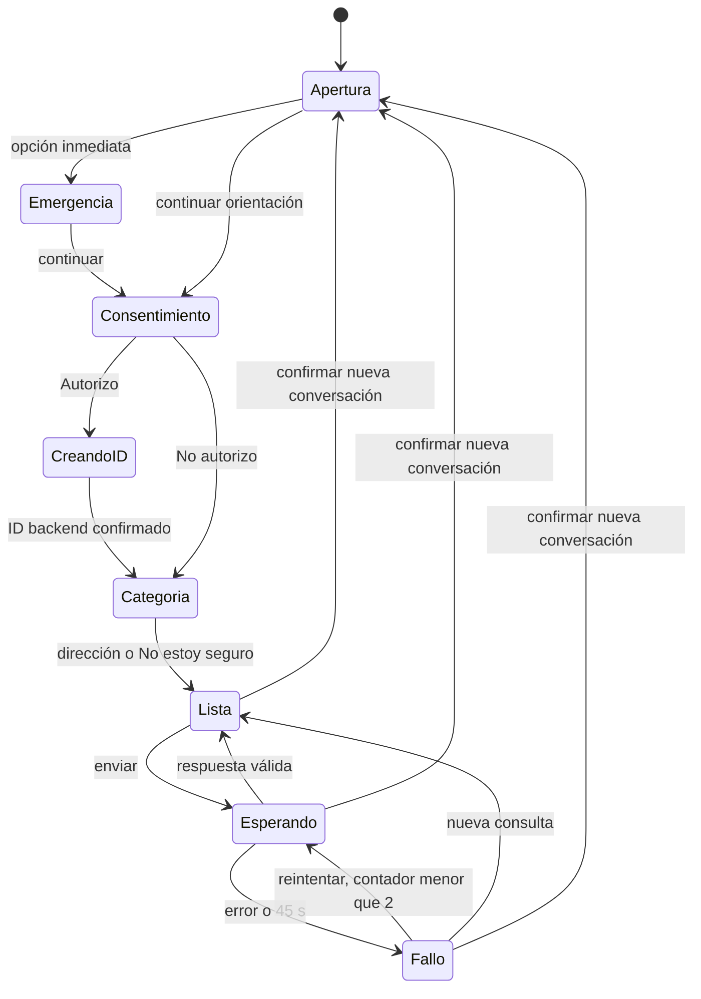

# Modelo de datos y estados — SPEC004

Diseño objetivo; no tablas/componentes ya creados. RF-C4-UI-01/05/06/07/08, RF-C4-DC-01..04, RF-C4-IN-01..06, RNF-C4-IN-01, RF-C3-IN-09 y RNF-C3-IN-01.

## Estado volátil del iframe

| Entidad | Campos | Reglas |
| --- | --- | --- |
| PanelSession | epoch entero local, startup, decision, categoria, conversationId?, policyVersion?, transcript[], successfulPairs[], contacts?, activeAttempt?, feedbackByResponse | Solo memoria. `epoch` sirve para descartar callbacks obsoletos, no identifica ciudadano ni se envía/persiste. Ocultar no destruye contexto. Recarga destruye todo. |
| Startup | apertura, consentimiento, creandoConversacion, categoria, lista, emergencia, bloqueada | Apertura exacta de config; decisión excluyente; categoría tres direcciones o null. No habilitar consulta antes de decisión/categoría; emergencia accesible antes del consentimiento. Configuración institucional incompleta impide consulta, no la salida oficial. |
| ConsentDecision | pendiente / autorizo / no_autorizo | Token técnico no la sustituye. ID únicamente tras Autorizo+política válida; si falla creación, permanece bloqueada con salida, sin degradar silenciosamente a anónimo. |
| VisibleMessage | role ciudadano/geobot/sistema, content, tipo?, sources?, responseId?, successful | Consultas texto plano; mensajes fijos/fallos no tienen responseId ni forman pares. Anónimo permite transcripción volátil sin envío como historial. |
| SuccessfulPair | pregunta, respuesta | Solo respuestas válidas actuales de C3; orden cronológico. Todos los tipos de éxito, incluida aclaración, admiten par. Envío autorizado: últimos diez; primera/anónimo omite campo. |
| QueryAttempt | epoch, sequence local, question, frozenPayload, retryCount0..2, start/deadline, AbortController, phase | IDs locales técnicos no salen al servidor. Snapshot de historial/categoría/ID anterior al envío se reutiliza en reintentos. Un intento activo; bloquear simultaneidad síncronamente además de disabled. |
| ContactState | absent/loading/ready/failed, snapshot?, revision?, requestedEpoch | Máximo5 s cliente. Snapshot validado íntegro en memoria. Sin datos de contacto en storage/URL ni números fijos. Solo respuesta de epoch vigente modifica estado. |
| FeedbackState | responseId, selected?, reason?, phase idle/choosing/sending/confirmed/failed | Elegible solo autorizado+ID auténtico. Confirmed tras 201 commit; failed conserva respuesta. Sin selección múltiple ni texto libre. |

La transcripción completa durante la sesión no es el contexto remitido. No truncar consultas/respuestas para crear pares, y no unir intentos fallidos con respuestas de otras preguntas. No agregar bienvenida/política/canales UI al historial.

## Transiciones

- Diálogo de nueva conversación es un estado superpuesto, sin parar el reloj ni perder resultados actuales mientras el usuario decide. Cancelar preserva sesión; si se completa una respuesta mientras diálogo abierto, se conserva en conversación existente.
- Confirmar incrementa epoch ANTES de abortar, limpia intentos/feedback/pares/transcripción/decision/categoría/ID y reinicia apertura. Mantiene solo configuración institucional vigente reutilizable; nueva carga verifica contactos. Si la política cambió, solicitar versión nueva antes de autorización. Retorno de foco a apertura/consentimiento del flujo nuevo.
- Ocultar/mostrar cambia visibilidad en host; no cambia epoch, solicitud ni estado. Al ocultar, quitar iframe del foco/árbol accesible; no desmontarlo.
- Expirar sesión técnica no renueva autorización silenciosamente. No reenvío de generación tras401; nueva credencial no hereda ID ligado a credencial anterior. Mantener transcripción visible, deshabilitar contexto anterior y conducir al reinicio confirmado; autorización y nuevo ID se solicitan de nuevo. Una futura renovación autenticada que preserve identidad requeriría contrato explícito adicional, no asumirla.
- Anónimo nunca crea ID ni transmite pares; categoría puede viajar para priorización pero no persistirse. Recarga solo reinicia.

## Persistencia reutilizada de C3

SPEC002 define `chat.conversacion` y `chat.interaccion`: UUID backend autorizado, vínculo de portador, versión política; interacción con `row_id` interno, `response_id` público solo tras commit, pregunta/respuesta saneadas y metadatos. No crear duplicados de estas entidades en004 ni creer que existen por estar descritas. Consultar el catálogo real y completar prerequisitos002.

## Valoración nueva

`chat.valoracion` — dependencia implementada por004, RF-C3-IN-09.

| Campo | Tipo/restricción | Propósito |
| --- | --- | --- |
| interaction_row_id | FK no nula a chat.interaccion.row_id, UNIQUE | Una valoración por interacción; fila interna no se expone al ciudadano |
| valoracion | texto CHECK: Útil / No útil | Selección exacta |
| motivo | texto nullable, CHECK de cinco motivos | Útil→NULL; No útil→exactamente uno válido |
| created_at | timestamptz servidor, no nulo | Fecha de registro |

Motivos literales: Información incorrecta, Información desactualizada, No responde mi pregunta, Difícil de entender, Otro. La unicidad se impone en PostgreSQL además de controles UI.

Resolver responseId a interacción autorizada no depurada y conversación de la sesión técnica. Transacción comprueba propiedad/vigencia y escribe; bloquear interacción de forma compatible con purga para evitar carrera. Respuesta ajena/inexistente o duplicado→VALIDACION sin escrituras, sin distinguir existencia públicamente. No guardar texto libre, IP, token, conversación/responseId duplicados ni payload.

**Retención**: Reutilizar purga002 al cumplir12 meses calendario +≤24 h: textos y IDs públicos eliminados, relación de conversación descartada; impedir nuevas valoraciones sobre depuradas. FK interna permite conservar únicamente estadísticas de valoración/motivo/fecha sin identificadores públicos o texto. La migración debe preservar purga y permisos; si se borra físicamente interacción, FK con borrado compatible y sin huérfanos. No añadir una retención de90 días ni ID ciudadano para estadísticas.

**Permisos**: chat_app resuelve pertenencia e inserta mediante procedimiento limitado/search_path seguro o permisos mínimos equivalentes; sin UPDATE/DELETE de valoraciones. admin_app no obtiene escritura ciudadana por defecto. chat_maint ejecuta purga restringida. Pruebas negativas directas además de API. Migrador propietario separado; ningún DDL runtime.

**Migración**: catálogo actual `backend/migrations/chat/`, registro `chat.schema_migrations`; hoy existen001 contactos y002 identidad. Conversaciones/interacciones/purga previas deben reconciliarse primero con este catálogo. Asignar a valoración siguiente ordinal realmente libre DESPUÉS de prerequisitos; no inventar003 antes de conocerlos ni renumerar migraciones aplicadas. Migración transaccional probada en base limpia/existente y segunda ejecución idempotente.
