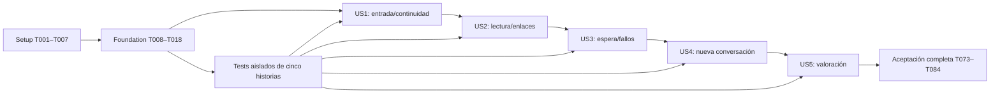

# Tasks: SPEC004 — Interfaz de la plataforma Geobot

**Input**: [plan.md](plan.md), [spec.md](spec.md), [research.md](research.md), [data-model.md](data-model.md), [contracts](contracts/acceptance.md) y [quickstart.md](quickstart.md). Fecha: 2026-10-08.
**Prerequisites**: Constitución 1.0.0; SPEC001 publicado; contratos/servicios pertinentes SPEC002 y flujo SPEC003, que se verifican/completan en foundation.
**Tests**: Solicitadas por spec/plan y obligatorias por constitución X. Se incluyen automatización y verificaciones manuales explícitas con evidencia. Dobles permiten independencia local; no acreditan aceptación real. No se exige TDD adicional ni desactivar pruebas para integrar.
**Organization**: Setup → foundation → US1/US2/US3 P1 → US4/US5 P2 → cierre completo. Todas las tareas están pendientes; esta lista no implementa código ni ejecuta pruebas.

## Format: `[ID] [P?] [Story] Description`

- ID único y secuencial; `[USn]` únicamente en fases de historias. `Dep.:` identifica predecesoras directas dentro del SPEC004; dependencias transitivas también aplican.
- `[P]` permite ejecutar tareas habilitadas en archivos disjuntos después de sus prerequisitos; no elimina dependencias ni autoriza ediciones concurrentes del mismo archivo. Las fases se integran en orden aun cuando sus pruebas aisladas se preparen juntas.
- Cada tarea cita requisitos y rutas concretas. Restricciones entre comillas proceden del modelo/contratos y se verifican literalmente.

## Path Conventions

Raíz: `/Users/geotrends/Desktop/DEV_LAOR/agente`. Rutas documentadas relativas a esa raíz. Se extienden `frontend/app`, `shared`, `smart` y `backend/src/chat`, sin construir otro `frontend/src` o un segundo chat. Directorios nuevos: `frontend/chat`, `widget`, `scripts`, `test`, `backend/test/ui-integracion`; evidencia bajo `specs/004-interfaz-plataforma/evidencias/aceptacion/`.

Estado observado al generar tareas: SPEC001 89/91 marcadas, SPEC002 17/100, SPEC003 0/27. Hay más código parcial del SPEC002 sin cierre: `routes/conversations.ts`, registro/retención y migraciones chat 001..006; la ruta activa `routes/chat.ts` aún usa `message/provider/model/autoRoute/history`. Actualizar inventario en T001 antes de ejecutar, no confiar en estos números como aceptación.

Equivalencia física actual: entidades lógicas `chat.conversacion`/`chat.interaccion` del modelo004 corresponden a `chat.conversation`/`chat.interaction` en migraciones002. La nueva `chat.valoracion` referencia `chat.interaction.row_id`, manteniendo restricciones del modelo. No crear tablas duplicadas para traducir nombres. Ruta propuesta de migración: `backend/migrations/chat/007_valoracion.sql` solo si sigue siendo el siguiente ordinal libre después de prerequisitos; T009/T065 verifican catálogo y registran ruta definitiva sin renumerar aplicadas.

## Phase 1: Setup — Base reproducible

**Purpose**: Preparar infraestructura de pruebas y convergencia, preservando trabajo local.

- [X] T001 Registrar commit, hash/cambios locales, lockfiles, rutas/API montadas, migraciones y evidencia disponible de SPEC001–003 en `specs/004-interfaz-plataforma/evidencias/aceptacion/baseline.md`; distinguir archivos existentes, pruebas reales y marcas de tarea. Reqs: RF-C4-PR-01/03, constitución IX/X. Dep.: ninguna.
- [X] T002 Crear tabla de equivalencias y propietarios en `specs/004-interfaz-plataforma/evidencias/aceptacion/convergencia.md`; actualizar `specs/003-diseno-conversacional/contracts/conversational-api.md`, `plan.md` y destinos de `tasks.md` a contrato español del SPEC002/GET config/layout real, conservando requisitos/historias/marcas. Citar las tareas002 que se reutilizan y las brechas que004 completará; no marcar previas por existencia de archivo. Reqs: RF-C4-DC-01/02/03/04, RF-C4-IN-01/02/06. Dep.: T001.
- [X] T003 Añadir unified/remark-parse/remark-gfm, esbuild, Vitest/jsdom/Testing Library, Playwright y axe-core compatibles con Node 22/lockfile en `frontend/package.json` y `frontend/package-lock.json`; fijar versiones auditadas sin actualización global de Next/React ni plugins de HTML bruto. Reqs: RF-C4-UI-03, RNF-C4-UI-01/02/03, constitución X. Dep.: T002.
- [X] T004 [P] Configurar tests unitarios en `frontend/vitest.config.ts`, `frontend/test/setup.ts` y navegador en `frontend/playwright.config.ts`; incluir Chromium/Firefox/WebKit y canales Chrome/Edge cuando disponibles, marcando emulación distinta de aceptación móvil real. Reqs: RF-C4-UI-01/02, RNF-C4-UI-02. Dep.: T003.
- [X] T005 [P] Crear fixture host/mapa y configuración local separada en `frontend/test/fixtures/observatorio.html` y `frontend/test/helpers/hostServer.ts`; capturar cámara/capas/controles y servir host/iframe separados, sin añadir localhost a CSP/origen producción. Reqs: RF-C4-UI-01/02/04, RNF-C4-IN-02. Dep.: T003.
- [X] T006 [P] Preparar harness PostgreSQL aislado reutilizando migrador002 y helpers001 en `backend/test/ui-integracion/harness.ts`; probar DB real con proveedor doble sin red y reloj, reportar adapter controlled/integrated y no usar volúmenes del usuario. Reqs: RF-C3-IN-09/10, RNF-C3-IN-01, constitución III/X. Dep.: T003.
- [X] T007 Exponer `typecheck`, `build:widget`, `test:ui`, `test:ui:e2e` en `frontend/package.json` y `test:ui-integration` en `backend/package.json`; este último ejecuta `node --import tsx --test --test-concurrency=1 test/ui-integracion/*.test.ts`. Referenciar comandos en `specs/004-interfaz-plataforma/quickstart.md` y distinguir scripts preparados de implementados. Reqs: RNF-C4-UI-01/02/03, RF-C4-PR-01. Dep.: T004, T005, T006.

## Phase 2: Foundational — Prerequisitos comunes bloqueantes

**Purpose**: Un único contrato/estado/flujo con identidad oficial y servicios realmente verificables. Completar antes de implementar historias. Reutilizar código vigente cuando sus pruebas satisfacen el contrato; corregir únicamente brechas acreditadas.

- [X] T008 Crear pruebas del contrato español, autorización/propiedad, doce consultas con diez pares, config completa/no-store y anonimato en `backend/test/ui-integracion/prerequisites.test.ts` y `frontend/test/contracts.test.ts`; incluir bypass sin consentimiento, UUID ajeno, mensaje incompleto, respuesta sin ID y versión de política inválida. Reqs: RF-C4-DC-02, RF-C4-IN-01/02/05/06, RF-C3-IN-03/07/08/10. Dep.: T007.
- [X] T009 Reconciliar migraciones pendientes002 con catálogo real en `backend/src/chat/migrate.ts`, `backend/migrations/chat/003_conversacion.sql`, `004_registro_tarifas.sql`, `005_retencion.sql` y `specs/004-interfaz-plataforma/evidencias/aceptacion/catalogo-migraciones.md`; comprobar limpio/existente y permisos, sin modificar SQL ya aplicado ni numeración. Registrar equivalencia conversation/interaction y siguiente ordinal disponible para valoración; nuevos ajustes mediante migración adicional si hace falta. Reqs: RF-C3-IN-01/05/09, RNF-C3-IN-01, constitución III/VII. Dep.: T008.
- [X] T010 Definir entidades/tipos base y reducer en `frontend/chat/types.ts` y `frontend/chat/sessionReducer.ts`: PanelSession con epoch entero local, startup, decision, categoria, conversationId?, policyVersion?, transcript[], successfulPairs[], contacts?, activeAttempt?, feedbackByResponse; “Solo memoria”; epoch “no identifica ciudadano ni se envía/persiste.”; “Ocultar no destruye contexto. Recarga destruye todo.”; Startup “apertura, consentimiento, creandoConversacion, categoria, lista, emergencia, bloqueada” y “categoría tres direcciones o null.”; ConsentDecision “pendiente / autorizo / no_autorizo” y “Token técnico no la sustituye.”; VisibleMessage “role ciudadano/geobot/sistema, content, tipo?, sources?, responseId?, successful”; “Consultas texto plano; mensajes fijos/fallos no tienen responseId ni forman pares. Anónimo permite transcripción volátil sin envío como historial.”; SuccessfulPair “pregunta, respuesta”, “Solo respuestas válidas actuales de C3; orden cronológico.” y “Todos los tipos de éxito, incluida aclaración, admiten par.”; No mensajes fijos/fallos como pares; “Envío autorizado: últimos diez; primera/anónimo omite campo.” Reqs: RF-C4-DC-01/02/03/04, RF-C4-IN-01/02, RNF-C4-IN-01. Dep.: T009.
- [X] T011 Migrar `frontend/shared/session.ts`, `frontend/shared/chatContracts.ts`, `frontend/shared/chatClient.ts` y `frontend/shared/agentConfig.ts` a token solo memoria y contrato002/004; separar token/autorización, no reenviar generación tras 401 ni reutilizar conversationId con portador nuevo. Validar JSON/types/fuentes/modo antes de usar, omitir historial/ID anónimo y proveedor/modelo/autoRoute; retirar límite cliente arbitrario de 2500 caracteres y truncación. Reqs: RF-C4-IN-01/02/04, RNF-C4-IN-01, RNF-C3-IN-06. Dep.: T010.
- [X] T012 Verificar/completar endpoints y registro previos en `backend/src/routes/conversations.ts`, `routes/chatConfig.ts`, `chat/conversations.ts`, `chat/validateRequest.ts`, `chat/records.ts`, `chat/retention.ts`; ID backend ligado a portador/política, responseId solo tras commit, escritura fallida entrega respuesta sin ID, anónimo sin textos/IDs/categoría/valoración; config snapshot≤2 s y purga de 12 meses calendario+≤24 h. Usar T008 contra DB real y reutilizar002 T043/T044/T063/T064/T068 sin duplicar esquemas. Reqs: RF-C3-IN-01/03/05/07/08/10, RF-C4-IN-01/02/05, RNF-C3-IN-01. Dep.: T011.
- [X] T013 Integrar contrato español/errores/plazo y proveedor autorizado de002 en `backend/src/routes/chat.ts`, `backend/src/index.ts`, `backend/src/chat/orchestrator.ts` y `backend/src/bedrock/askBedrock.ts`; reutilizar/completar002 T056/T058/T070, montar conversaciones/config, rechazar campos legacy y retirar proveedores públicos. Mantener C3 ≤40 s, no-store, saneamiento antes de salida/registro y KB publicada; no habilitar ruta legacy para demostrar UI. Evidencia local con dobles, validación real en cierre. Reqs: RF-C3-IN-03/04/06/07/08/10, RNF-C3-DI-01/02, RF-C4-IN-04. Dep.: T012.
- [X] T014 Implementar único flujo003 en `frontend/chat/ChatContext.tsx`, `StartupFlow.tsx` y `frontend/smart/SmartAgentPanel.tsx`: apertura exacta/config→Autorizo/No autorizo→cuatro categorías; ID solo tras Autorizo; sin ID confirmado no habilitar consulta ni degradar silenciosamente. Emergencia sin decisión/modelo, canales del snapshot y continuación normal. Reutilizar003 T007/T011/T015/T022/T024/T025 sobre rutas mapeadas en T002. Reqs: RF-C4-DC-01/02/03/04, RF-C4-IN-01/02. Dep.: T013.
- [X] T015 Implementar carga base/estado de contactos en `frontend/chat/contactState.ts` y configuración institucional en `.env.example`: ContactState “absent/loading/ready/failed”, snapshot?, revision?, requestedEpoch; “Máximo5 s cliente”, “Snapshot validado íntegro en memoria”, “Solo respuesta de epoch vigente modifica estado”. Obtener bloque en primer montajeiframe; “Sin datos de contacto en storage/URL ni números fijos.”; sin contactos/config no inventar valores/apertura/política y mantener salida con enlace oficial HTTPS autorizado, nunca números/correos de reserva. Reqs: RF-C4-IN-06, RF-C3-IN-10, RF-C4-DC-04. Dep.: T014.
- [X] T016 Obtener CSS/logo/fuente oficiales identificados en research R12 y crear `specs/004-interfaz-plataforma/guia-estilo.md`, `frontend/chat/brandTokens.css` y `frontend/public/brand/logo-envigado.png`; registrar URL/fecha/hash/selectores/hex/fuentes/contrastes y comparar computed styles, no copiar avatar ni inventar palette. Si falta insumo, dejar tarea pendiente sin aprobar N04. Reqs: RNF-C4-UI-04/02. Dep.: T015.
- [X] T017 Añadir pruebas del flujo, token/ID en memoria y doce consultas en `frontend/test/startup.test.tsx`, `frontend/test/history.test.ts` y `backend/test/ui-integracion/privacy.test.ts`; comprobar no_autorizo transcripción visible volátil sin contexto/registro, versión de política/bypass de UUID rechazados, expiración sin reenvío, tres recorridos storage Chrome/Firefox preparados. Reqs: RF-C4-DC-01/02/03/04, RF-C4-IN-01/02, RNF-C4-IN-01. Dep.: T016.
- [X] T018 Ejecutar tipos y suites foundation de T008/T017, comprobar config ≤2 s/purga/IDs con DB real y registrar puerta en `specs/004-interfaz-plataforma/evidencias/aceptacion/foundation.md`; distinguir proveedor doble de habilitación integrada Bedrock, consignar tareas previas reutilizadas con evidencia y prerequisitos reales de cierre. Reqs: RF-C3-IN-01/03/07/08/10, RF-C4-DC-02, RF-C4-IN-01/02/06, constitución IX/X. Dep.: T017.

**Checkpoint**: Contratos/estado/flujo común verificados. Los dobles no habilitan entrega ciudadana; servicios y portal reales se aceptan en fase final.

## Phase 3: US1 — Abrir, ocultar y continuar (P1) — MVP interno

**Goal**: Botón liviano, iframe persistente, geometría correcta, cierre/foco y convivencia con mapa.
**Independent Test**: Host/iframe con respuestas preparadas: dos consultas, cinco ciclos, tres cargas caché vacía, cinco anchos y origen permitido. Aceptación final añade cinco entornos/dispositivos reales.

### Tests

- [X] T019 [P] [US1] Crear pruebas launcher/red/continuidad en `frontend/test/widget-launcher.spec.ts`: tres cargas solo script antes del clic, un iframe tras primer clic, dos consultas/cinco ciclos preservados, hidden no enfocable, botón visible y mapa intacto; medir export real. Reqs: RF-C4-UI-01, RNF-C4-UI-01, RNF-C4-IN-01. Dep.: T018.
- [X] T020 [P] [US1] Crear pruebas responsive/foco/protocolo en `frontend/test/widget-viewport.spec.ts`:320/375/767/768/1366,400/min640,85 %, visualViewport superior, cierre/campo, modalidad móvil/desktop; mensajes origin/source/version/esquema inválidos ignorados, sin textos/IDs. Reqs: RF-C4-UI-02, RNF-C4-UI-02, RNF-C4-IN-01/02. Dep.: T018.
- [X] T021 [P] [US1] Crear pruebas CSP/archivo exportado en `frontend/test/widget-csp.spec.ts`: dos válidas/tres orígenes bloqueados/una cabecera, ausencia de XFO conflictivo/meta-only; configuración de test separada. Reqs: RNF-C4-IN-02. Dep.: T018.

### Implementation

- [X] T022 [US1] Crear protocolo tipado en `frontend/widget/protocol.ts` y puente en `frontend/chat/hostBridge.ts`: namespace geobot-widget/version1; READY/CLOSE/FOCUS_START sin datos, VISIBILITY booleano, VIEWPORT números finitos no negativos/width/height positivos, FOCUS_BOUNDARY forward/backward móvil. Validar origin/source/schema y targetOrigin exacto, sin wildcard/config ciudadano ni conversación/token/IDs. Reqs: RF-C4-UI-01/02, RNF-C4-IN-01/02. Dep.: T019, T020, T021.
- [X] T023 [US1] Implementar `frontend/widget/launcher.ts`: botón nativo fijo inferior derecho/aria-expanded/controls, CSS mínimo inline prefijado, un iframe creado al primer clic con title; hidden sin cambiar src/unmount. Sin React/import de app/prefetch/preconnect/assets/fuentes antes del clic; ajustes geométricos para no cubrir controles del mapa sin modificarlos. Reqs: RF-C4-UI-01, RNF-C4-UI-01/04, RNF-C4-IN-01. Dep.: T022.
- [X] T024 [US1] Implementar geometría en `frontend/widget/viewport.ts` y `frontend/chat/viewport.ts`: breakpoint por ancho del host<768/fullscreen;>=768 ancho400/altura min640,85 %; VisualViewport del host con resize/scroll/offset y fallback innerSize, safearea y clamp visible. Iframe recibe geometría sin datos de consulta. Reqs: RF-C4-UI-02, RNF-C4-IN-01. Dep.: T023.
- [X] T025 [US1] Implementar foco/modalidad en `frontend/widget/focus.ts` y `frontend/chat/panelFocus.ts`: desktop región no modal; móvil dialog con exterior inert restaurado exactamente y foco contenido; abrir enfoca inicio tras READY, cerrar vuelve al botón, hidden fuera árbol/foco, Escape respeta el nivel. Reqs: RF-C4-UI-01/02, RNF-C4-UI-02. Dep.: T024.
- [X] T026 [US1] Crear shell/ruta `frontend/chat/ChatPanel.tsx`, `frontend/chat/panel.css` y `frontend/app/chat/page.tsx`, delegado al mismo ChatContext/flujo T014; encabezado Geobot/logo/cierre, historial flex vertical/campo visible con teclado; no segundo estado ni CSS global al Observatorio. Reqs: RF-C4-UI-01/02, RNF-C4-UI-04/02. Dep.: T025.
- [X] T027 [US1] Crear build independiente en `frontend/scripts/build-widget.mjs` que genera `frontend/public/embed/geobot-launcher.js`, incrusta tokens de guía y rechaza archivos >10.000 bytes sin comprimir; sin red extra pre-clic ni fuente externa. Vincular `build:widget` al build/imagen en `frontend/package.json` y `frontend/Dockerfile`. Reqs: RNF-C4-UI-01/04. Dep.: T026.
- [X] T028 [US1] Configurar HTML `/chat` y export real en `frontend/nginx.conf`/`frontend/next.config.mjs`: frame-ancestors únicamente https://observatorioenvigado.geotrends.co, sin self/wildcard/http/XFO conflictivo, route no fallback legacy; si script-src restringido, hashes inline desde build con `frontend/scripts/build-csp.mjs`. Variante fixture test nunca amplía producción. Reqs: RNF-C4-IN-02, RNF-C4-UI-01. Dep.: T027.
- [X] T029 [US1] Probar montaje único y consulta básica en `frontend/test/widget-startup.spec.ts`, integrando launcher→bridge→flujo003→cliente español002; dos consultas/cinco ciclos de ocultar y mostrar preservan estado y no emiten sesiones/IDs adicionales, consulta en curso sigue al ocultar. Reqs: RF-C4-UI-01/02, RF-C4-IN-01/02, RNF-C4-IN-01. Dep.: T028.
- [X] T030 [US1] Ejecutar T019–T021/T029 con export/nginx y registrar bytes/HAR sanitizado/dimensiones/foco/orígenes en `specs/004-interfaz-plataforma/evidencias/aceptacion/us1-local.md`; reservar prueba teclado Android/iOS real y portal para cierre. Reqs: RF-C4-UI-01/02, RNF-C4-UI-01/02/04, RNF-C4-IN-02. Dep.: T029.

**Checkpoint**: Entrada/continuidad demostrables con host controlado; MVP interno no exime seguridad, anonimato ni servicios reales para entrega pública.

## Phase 4: US2 — Leer respuestas y fuentes seguras (P1)

**Goal**: Render semántico por allowlist, tablas sin desbordar y enlaces externos uniformes.
**Independent Test**: Nueve respuestas: 3 de pasos/3 tablas/3 de prosa, diez citas+política, diez maliciosas/tres preguntas marcadas; no requiere modelo vivo para verificar presentación.

### Tests

- [X] T031 [P] [US2] Crear pruebas nueve formatos/énfasis/anidados/tablas/enlaces con paréntesis en `frontend/test/markdown.test.tsx` con fixtures `frontend/test/fixtures/respuestas.json`; DOM exacto ol/ul/table/th scope=col, ninguna marca visible, scroll de tabla a 320 sin mover el panel. Reqs: RF-C4-UI-03, RF-C3-DI-07/10/25. Dep.: T018.
- [X] T032 [P] [US2] Crear pruebas diez maliciosas y tres consultas HTML/Markdown en `frontend/test/markdown-security.test.tsx`; verificar DOM final allowlist/atributos/protocolos, cero ejecución/eventos y conservación del formato normal, incluido HTML bruto y Markdown malformado. Reqs: RNF-C4-UI-03. Dep.: T018.
- [X] T033 [P] [US2] Crear pruebas diez respuestas con enlaces+aviso/política/canales en `frontend/test/external-links.spec.ts`; nueva pestaña target/rel exactos, nombre/indicador visibles, mapa/conversación intactos mediante ratón/toque/teclado. Reqs: RF-C4-UI-04, RNF-C4-UI-02/03. Dep.: T018.

### Implementation

- [X] T034 [US2] Sustituir parser regex por AST unified/remark-parse/GFM en `frontend/shared/ChatMarkdown.tsx` y `frontend/shared/markdownRenderer.tsx`; lista p/br/strong/em/ul/ol/li/table/thead/tbody/tr/th/td/h3/h4/a; H1/H2→h3,H5/H6→h4, code/pre→texto, hr omitido, nodos HTML eliminados sin dangerouslySetInnerHTML. Preservar contenido permitido/citas/fechas, sin etiquetas o eventos ajenos. Reqs: RF-C4-UI-03, RNF-C4-UI-03. Dep.: T031, T032, T033, T030.
- [X] T035 [US2] Implementar `frontend/shared/ExternalLink.tsx` y `frontend/shared/safeUrl.ts`: URL absoluta HTTPS validada, target=_blank/rel=noopener noreferrer/nombre con «(se abre en una pestaña nueva)» e indicador textual; dentro respuesta sin span/svg, fuera, icono decorativo permitido. Rechazar http/mailto/tel/javascript/data, conservar teléfonos/correos como texto sin inventar canales. Reqs: RF-C4-UI-04, RNF-C4-UI-03/02. Dep.: T034.
- [X] T036 [US2] Implementar tablas/atributos en `frontend/shared/markdownRenderer.tsx` y `frontend/chat/panel.css`: th scope=col, contenedor horizontal propio fuera del subtree de contenido restringido, varias tablas independientes, atributos solo allowlist/controlados; sin scroll horizontal del panel a 320. Reqs: RF-C4-UI-03, RNF-C4-UI-03/02. Dep.: T035.
- [X] T037 [US2] Integrar renderer y ExternalLink en `frontend/shared/MessageContent.tsx`, `frontend/chat/StartupFlow.tsx`, `ChatPanel.tsx` y `frontend/smart/SmartAgentPanel.tsx`; texto plano ciudadano, citas/fuentes/política/canales uniformes, sin proveedor/meta/error técnico ni fuentes/fechas inventadas. Reqs: RF-C4-UI-03/04, RNF-C4-UI-03, RF-C3-DI-07/08. Dep.: T036.
- [X] T038 [US2] Añadir revisión teclado/lector de listas/tablas/enlaces y zoom 200 % con pasos explícitos en `specs/004-interfaz-plataforma/evidencias/aceptacion/us2-manual.md`; ejecutar axe de estadoslectura en `frontend/test/reading-a11y.spec.ts` y documentar pendientes de lector/dispositivo real, sin aprobarlos poraxe. Reqs: RNF-C4-UI-02, RF-C4-UI-03/04. Dep.: T037.
- [X] T039 [US2] Comparar estilos de diezelementos de botón/panel/header/respuesta contra guía en `frontend/test/brand.spec.ts` y `specs/004-interfaz-plataforma/evidencias/aceptacion/identidad-local.md`; medir contrastes≥4,5texto/≥3controlgrande y registrar100 % tokens/fuentes/estilos; corregir con valoresinstitucionales antes de aprobación. Reqs: RNF-C4-UI-04/02. Dep.: T038.
- [X] T040 [US2] Ejecutar T031–T033/T038/T039 y guardar resultados U03/U04/N03/N04 controlados en `specs/004-interfaz-plataforma/evidencias/aceptacion/us2-local.md`; mantener regresiones renderer previas del SPEC002 y no confundir revisión local con citas/portal/lectores reales. Reqs: RF-C4-UI-03/04, RNF-C4-UI-02/03/04. Dep.: T039.

**Checkpoint**: Presentación segura verificable independientemente con respuestas preparadas; las fuentes reales se validan además sobre KB publicada al cierre.

## Phase 5: US3 — Espera y recuperación de fallos (P1)

**Goal**: Indicador accesible, bloqueo de duplicados, plazo cancelable, canales oficiales y dos reintentos manuales.
**Independent Test**: Cinco consultas con demora 5 s y una falla, seis fallas de tres causas, cuatro límites de tiempo, seis errores y cuatro casos de contactos usando servidor controlado.

### Tests

- [X] T041 [P] [US3] Crear pruebas estado/plazo en `frontend/test/query-attempt.test.ts`: una solicitud activa ante doble clic/teclado, demora 5 s, respuesta a los 40 s, tardía a los 50 s descartada, fallo entre 45–46 s, reintento con plazo propio, hidden no reinicia reloj y fallo no entra en pares. Reqs: RF-C4-UI-07/08, RF-C4-IN-02/03. Dep.: T018.
- [X] T042 [P] [US3] Crear pruebas de errores/contactos en `frontend/test/contact-recovery.test.ts` y fixtures `frontend/test/fixtures/fallos.json`: dos VALIDACION sin reintento, dos ERROR_INTERNO con reintento, HTTP 502 HTML y JSON incompleto; cuatro variantes de IN-06, snapshot disponible sin solicitud extra y máximo 5 s en ausencia. Reqs: RF-C4-UI-08, RF-C4-IN-04/06. Dep.: T018.
- [X] T043 [P] [US3] Crear pruebas de interfaz U07/U08 en `frontend/test/query-failures.spec.ts`: texto literal, indicador ≤500 ms, sin cambio de foco, campo/envío bloqueados, seis salidas habilitadas, tres canales exactos, pregunta/payload original en reintento, control oculto tras dos fallos y recuperación exitosa sin valoración del fallo. Reqs: RF-C4-UI-07/08, RNF-C4-UI-02. Dep.: T018.

### Implementation

- [X] T044 [US3] Implementar QueryAttempt y transiciones en `frontend/chat/queryAttempt.ts` y `sessionReducer.ts`: campos epoch, sequence local, question, frozenPayload, “retryCount0..2”, start/deadline, AbortController, phase; “IDs locales técnicos no salen al servidor”, “Snapshot de historial/categoría/ID anterior al envío se reutiliza en reintentos”, “Un intento activo; bloquear simultaneidad síncronamente además de disabled”. Pares únicamente de respuesta válida actual, nunca de fallos o tardías. Reqs: RF-C4-UI-07/08, RF-C4-IN-02/03, RNF-C4-IN-01. Dep.: T041, T042, T043, T040.
- [X] T045 [US3] Extender `frontend/shared/chatClient.ts` y `frontend/chat/queryAttempt.ts` con reloj de 45 s desde envío hasta lectura/validación, AbortController y guardas epoch/sequence antes de cada callback; no reiniciar al ocultar, abrir diálogo o recibir headers. Descartar tardías, no interpretar HTTP200 incompleto como éxito; C3 ≤40 s permanece separado. Reqs: RF-C4-IN-03/04, RF-C4-UI-08. Dep.: T044.
- [X] T046 [US3] Implementar región status estable y bloqueo en `frontend/chat/QueryStatus.tsx`, `ChatPanel.tsx` y `panel.css`: «Geobot está buscando en la información institucional…» anunciado sin mover foco, visible ≤500 ms, campo/control deshabilitados y rehabilitados al terminar; reduced-motion conserva anuncio, retirar polling de indexación y textos técnicos heredados. Reqs: RF-C4-UI-07, RNF-C4-UI-02. Dep.: T045.
- [X] T047 [US3] Implementar mapeo seguro y `frontend/chat/QueryFailure.tsx`/`frontend/shared/chatErrors.ts`: mensaje «En este momento no puedo responder. Puede intentarlo de nuevo o comunicarse por los canales oficiales.»; mostrar recepción PQRSD/WhatsApp/correo del snapshot con ExternalLink; VALIDACION sin Reintentar, internas/no interpretable/red/plazo recuperables; ninguna ruta/modelo/SQL/campo/código visibles y sin valoración. Reqs: RF-C4-UI-08, RF-C4-IN-04, RNF-C4-UI-03. Dep.: T046.
- [X] T048 [US3] Implementar recuperación de config en `frontend/chat/contactState.ts`, `ContactChannels.tsx` y `StartupFlow.tsx`: primera apertura ≤5 s, si falta snapshot repetir al elegir emergencia y al mostrar fallo, agrupar solicitud en vuelo y guardas de epoch; literal «No pudimos cargar los canales de atención. Consulte los canales oficiales del Municipio de Envigado.» más enlace oficial configurado. Snapshot presente no hace request extra por fallo, ni valores de reserva o inferidos. Reqs: RF-C4-IN-06, RF-C4-UI-08, RF-C4-DC-04, RF-C3-IN-10. Dep.: T047.
- [X] T049 [US3] Implementar reintento manual en `frontend/chat/queryAttempt.ts` y `QueryFailure.tsx`: payload congelado, un inicial + máximo dos reintentos, 45 s cada uno, sin duplicar pregunta visible ni pares; dos reintentos fallidos ocultan control conservando canales/mensaje. 429 respeta Retry-After, 401 bloquea contexto anterior sin autorizar o reenviar automáticamente; nueva consulta inicia presupuesto separado solo sin intento activo. Reqs: RF-C4-UI-08, RF-C4-IN-01/02/03/04. Dep.: T048.
- [X] T050 [US3] Verificar errores/red/45 s y estado de foco contra nginx/export en `frontend/test/query-integration.spec.ts`; incluir seis fallas UI-08, cuatro casos IN-03, seis IN-04, cuatro IN-06 y ocultar con consulta pendiente; confirmar recuperación con una única respuesta/par y ninguna tardía. Reqs: RF-C4-UI-07/08, RF-C4-IN-02/03/04/06. Dep.: T049.
- [X] T051 [US3] Ejecutar B10 con edición de contacto real y tres llamadas en `backend/test/ui-integracion/contact-config.test.ts`, reusando panel seguro del SPEC002; nuevos valores sin redespliegue, exactos al registro, cero LLM y ≤2 s. Añadir fallo de DB/registro no presentado como ausencia documental ni datos inventados. Reqs: RF-C3-IN-10/08, RF-C4-IN-06, RF-C4-UI-08. Dep.: T050.
- [X] T052 [US3] Ejecutar T041–T043/T050/T051 y documentar tiempos/solicitudes/canales/reintentos/foco en `specs/004-interfaz-plataforma/evidencias/aceptacion/us3-local.md`; marcar qué observaciones son con reloj controlado y cuáles de navegador tiempo real, sin afirmar lectura manual no efectuada. Reqs: RF-C4-UI-07/08, RF-C4-IN-03/04/06, RF-C3-IN-10, RNF-C4-UI-02. Dep.: T051.

**Checkpoint**: Espera y salida segura independientes con fallos controlados; datos administrables y portal reales vuelven a comprobarse al cierre.

## Phase 6: US4 — Nueva conversación consciente (P2)

**Goal**: Confirmar o cancelar sin mezclar sesiones ni recibir resultados anteriores.
**Independent Test**: Seis recorridos con dos preguntas previas, dos autorizados/reinicio, dos anónimos/reinicio y dos cancelaciones; añadir reinicio durante consultas/configuración y diálogos con resultados llegando.

### Tests

- [X] T053 [P] [US4] Crear pruebas del reducer en `frontend/test/new-conversation.test.ts`: limpiar todos los campos ciudadanos tras confirmación, epoch antes de abortar, resultados viejos ignorados, cancelar conserva estado e intento y recibe respuesta actual; política nueva requiere versión actual antes de autorizar. Reqs: RF-C4-UI-05, RF-C4-IN-01/02/03, RNF-C4-IN-01. Dep.: T018.
- [X] T054 [P] [US4] Crear prueba de los seis recorridos y teclado en `frontend/test/new-conversation.spec.ts`: diálogo/opciones literales, foco Cancelar, Tab contenido/Escape cancela, retorno al control, flujo apertura→datos→categoría y primera consulta cero pares/ID nuevo según modo. Reqs: RF-C4-UI-05, RF-C4-DC-01/02/03, RNF-C4-UI-02. Dep.: T018.

### Implementation

- [X] T055 [US4] Crear `frontend/chat/NewConversationDialog.tsx` y control del encabezado en `ChatPanel.tsx`; texto «¿Desea iniciar una conversación nueva? La conversación actual dejará de mostrarse.», opciones «Iniciar nueva»/«Cancelar», diálogo modal dentro iframe con foco/Tab/Escape; diálogo no congela 45 s ni pierde respuesta que llega durante decisión. Reqs: RF-C4-UI-05, RNF-C4-UI-02. Dep.: T053, T054, T052.
- [X] T056 [US4] Implementar reset en `frontend/chat/sessionReducer.ts` y `ChatContext.tsx`: “Confirmar incrementa epoch ANTES de abortar”, limpiar intentos/feedback/pares/transcripción/decision/categoría/ID, reiniciar apertura sin borrar registros institucionales; mantener solo config reutilizable, verificar política/contacts nuevos y focalizar flujo nuevo. Cancelar no altera conversación ni reloj. Reqs: RF-C4-UI-05, RF-C4-IN-01/02/03, RNF-C4-IN-01. Dep.: T055.
- [X] T057 [US4] Coordinar cancelación de clientes/bridges en `frontend/shared/chatClient.ts`, `frontend/chat/contactState.ts`, `queryAttempt.ts` y `hostBridge.ts`: ninguna consulta/config/promesa antigua altera nueva epoch, VISIBILITY/CLOSE solo ocultan y no reinician; expiración token requiere nuevo flujo confirmado sin reasociar historial o portador. Reqs: RF-C4-UI-05, RF-C4-IN-01/02/03/06, RNF-C4-IN-01. Dep.: T056.
- [X] T058 [US4] Integrar control de reinicio con categorías/consentimiento y mensajes de sesión en `frontend/chat/StartupFlow.tsx` y `ChatPanel.tsx`; primera consulta tras reinicio omite historial, anónimo sin ID ni emisión, autorizado ID del backend nuevo tras política válida; código no solicita purga de conversación anterior. Reqs: RF-C4-UI-05, RF-C4-DC-01/02/03, RF-C4-IN-01/02. Dep.: T057.
- [X] T059 [US4] Ejecutar T053/T054 y carreras de respuesta/config/abort/diálogo en `frontend/test/new-conversation-races.spec.ts`; añadir lector/axe diálogo y zoom 200 %, distinguir cancelación de hide/show, comprobar ausencia de textos/IDs en storage/URL. Reqs: RF-C4-UI-05, RF-C4-IN-03, RNF-C4-UI-02, RNF-C4-IN-01. Dep.: T058.
- [X] T060 [US4] Registrar seis recorridos/IDs/payload/foco y pruebas de carreras en `specs/004-interfaz-plataforma/evidencias/aceptacion/us4-local.md`; el estado visible/cancelado se compara semánticamente, no contra un screenshot arbitrario; pendientes de lector real permanecen explícitos. Reqs: RF-C4-UI-05, RF-C4-IN-01/02/03, RNF-C4-UI-02. Dep.: T059.

**Checkpoint**: Nueva conversación aisla memoria/solicitudes sin borrar registros; cancelación e historial anterior funcionan independientemente de valoración.

## Phase 7: US5 — Valorar una respuesta (P2)

**Goal**: Valoración autorizada única, motivos cerrados, commit antes del agradecimiento y servicio protegido.
**Independent Test**: Diez respuestas autorizadas valoradas, tres anónimas y seis variantes de ID; doce envíos API, siete válidos/cinco inválidos, DB real/concurrencia/purga.

### Tests

- [X] T061 [P] [US5] Crear pruebas de validación/servicio en `backend/test/ui-integracion/feedback-api.test.ts`: B09 doce envíos: 7 válidos/5 inválidos, UUID inexistente/ajeno/depurado, motivo ausente/indebido/fuera lista, sesión inválida, body extra sin guardar y cache no-store; preparar seed de interacción autorizada real. Reqs: RF-C3-IN-09, RF-C4-IN-05, RF-C4-UI-06. Dep.: T018.
- [X] T062 [P] [US5] Crear pruebas de concurrencia/permisos/purga/migración en `backend/test/ui-integracion/feedback-database.test.ts`: dos envíos una fila/201 y VALIDACION, runtime sin UPDATE/DELETE/DDL, FK interna no bloquea purga de 12 meses+≤24 h, limpio/existente y segunda ejecución idempotente. Reqs: RF-C3-IN-09, RNF-C3-IN-01, constitución VII. Dep.: T018.
- [X] T063 [P] [US5] Crear pruebas de UI en `frontend/test/feedback.test.tsx` y `frontend/test/feedback.spec.ts`: cinco útiles/cinco no útiles uno por motivo, tres anónimas sin controles/filas, seis variantes IN-05, teclado/lector, doble clic, pérdida de acuse y resultado tras nueva epoch; gracias solo commit 201. Reqs: RF-C4-UI-06, RF-C4-IN-05, RNF-C4-UI-02. Dep.: T018.

### Implementation

- [X] T064 [US5] Definir FeedbackState en `frontend/chat/feedbackState.ts` y selección de motivos en `frontend/shared/feedbackContracts.ts`: responseId, selected?, reason?, “phase idle/choosing/sending/confirmed/failed”, “Elegible solo autorizado+ID auténtico”, “Confirmed tras 201 commit; failed conserva respuesta”, “Sin selección múltiple ni texto libre”. Motivos “Información incorrecta, Información desactualizada, No responde mi pregunta, Difícil de entender, Otro.” y valoracion Útil/No útil; no esconder controles enfocables en respuestas no elegibles. Reqs: RF-C4-UI-06, RF-C4-IN-05. Dep.: T061, T062, T063, T060.
- [X] T065 [US5] Registrar nombre libre y crear migración `backend/migrations/chat/007_valoracion.sql` (ajustar ordinal si T009/catálogo ya reservaron 007), anotando destino final en `specs/004-interfaz-plataforma/evidencias/aceptacion/catalogo-migraciones.md`. Tabla chat.valoracion: interaction_row_id “FK no nula a chat.interaccion.row_id, UNIQUE” con equivalencia física chat.interaction; valoracion “texto CHECK: Útil / No útil”; motivo “texto nullable, CHECK de cinco motivos” y “Útil→NULL; No útil→exactamente uno válido”; created_at “timestamptz servidor, no nulo”. Permisos mínimos sin UPDATE/DELETE/DDL runtime, sin texto/IP/token/IDs públicos duplicados. Reqs: RF-C3-IN-09, RNF-C3-IN-01, constitución VII. Dep.: T064.
- [X] T066 [US5] Implementar validación/repositorio en `backend/src/chat/feedback.ts`: responseId UUID auténtico con interacción autorizada no depurada, conversación del portador y una valoración; transacción/bloqueo compatible con purga y UNIQUE. Rechazar ID ajeno/inexistente/duplicado/motivo indebido/extra sin distinguir existencia ni guardar campos; Útil motivo OMITIDO, incluso null inválido; No útil uno válido. Reqs: RF-C3-IN-09, RF-C4-IN-05, RF-C4-DC-02. Dep.: T065.
- [X] T067 [US5] Exponer POST `/api/ratings` en `backend/src/routes/feedback.ts` y montar en `backend/src/index.ts`; extender `backend/src/chat/perimeter.ts` para ruta exacta antes de parser general con Bearer/origen/tasa/cuerpo 128 KiB y no-store. 201{responseId,registrada:true} solo commit; duplicado 400 VALIDACION,401/503/500 seguros; cero LLM/meta/SQL. Reqs: RF-C3-IN-09, RNF-C3-IN-04/05/06/12, RF-C4-UI-06. Dep.: T066.
- [X] T068 [US5] Comprobar/ajustar purga y grants nuevos en `backend/src/chat/retention.ts` y la migración de valoración asignada en T065; mantener fila estadística interna, purgar textos/conversationId/responseId según SPEC002, impedir nuevas valoraciones sobre depuradas y probar carrera purga/valoración, sin retención de 90 días ni enlaces ciudadanos residuales. Reqs: RNF-C3-IN-01, RF-C3-IN-09. Dep.: T067.
- [X] T069 [US5] Implementar cliente y controles en `frontend/shared/feedbackClient.ts`, `frontend/chat/FeedbackControls.tsx`, `feedbackState.ts` y `ChatPanel.tsx`; validar condición autorización+responseId, un único motivo obligatorio solo No útil, sin texto libre, enviar vinculado; guardar solo memoria y renderizar «Gracias por su valoración»/disabled exclusivamente por 201 registrada. Error conserva respuesta con aviso accesible, no reenvía consulta. Reqs: RF-C4-UI-06, RF-C4-IN-05, RNF-C4-UI-02, RNF-C4-IN-01. Dep.: T068.
- [X] T070 [US5] Integrar cancelación/epoch en `frontend/chat/ChatContext.tsx`, `feedbackState.ts` y `frontend/shared/feedbackClient.ts`: nueva conversación descarta promesa vieja sin mover asociación en el servidor, hidden conserva estado; reintento tras acuse perdido nunca interpreta duplicado VALIDACION como éxito ni permite cambiar valoración. Reqs: RF-C4-UI-05/06, RF-C3-IN-09, RF-C4-IN-05. Dep.: T069.
- [X] T071 [US5] Ejecutar T061–T063 contra DB real/API/UI, añadir prueba store/logs anónimos y axe/teclado de todos estados de valoración en `frontend/test/feedback-a11y.spec.ts`; obtener prueba de siete válidos/cinco inválidos+extras/concurrencia/permisos/purga y seis respuestas IN-05 sin ocultos enfocables. Reqs: RF-C4-UI-06, RF-C4-IN-05, RF-C3-IN-09, RNF-C4-UI-02, RNF-C3-IN-01. Dep.: T070.
- [X] T072 [US5] Guardar resultados U06/I05/B09 y migración/propiedad/acuse/purga en `specs/004-interfaz-plataforma/evidencias/aceptacion/us5-local.md`; confirmar ningún ID de respuesta se fabrica y ninguna persistencia anónima/segunda valoración se produce; evidenciar recepción 201 después del commit. Reqs: RF-C4-UI-06, RF-C4-IN-05, RF-C3-IN-09. Dep.: T071.

**Checkpoint**: Valoración completa con persistencia real, no solo botones; cinco historias integradas listas para aceptación global.

## Phase 8: Polish & Cross-Cutting Concerns — Cierre contractual completo

**Purpose**: Completar evidencia de los 22 casos, pruebas manuales, CI, portal y servicios reales. Ningún requisito Importante queda fuera. Estas tareas también son trabajo futuro, no verificaciones ya realizadas.

- [X] T073 [P] Crear manifest/runner de 22 casos y revisión manual en `frontend/test/fixtures/ui-manifest.json`, `frontend/scripts/report-ui.mjs` y `specs/004-interfaz-plataforma/evidencias/aceptacion/matriz.md`; conservar cantidades/umbrales/IDs del contrato acceptance, commit+hash local/bundle/launcher/CSS/logo/corpus/contactos/política/browser/OS/lector/adapter y resultado por caso; marcar ausencia de evidencia como pendiente, sin grabar conversaciones reales/secretos. Reqs: RF-C4-PR-01/03/04, constitución IX/X. Dep.: T072.
- [X] T074 [P] Implementar revisión automática completa en `frontend/test/all-states-a11y.spec.ts`; axe separadamente host/iframe en todos estados del contrato, incluyendo loading/config ausente/dialog/valoración/fallos/anonimato; cero A/AA, y preparar pasos manuales de teclado/foco/reflow/lectores/contraste con criterio no aplica justificado. Reqs: RNF-C4-UI-02, RF-C4-PR-04. Dep.: T072.
- [X] T075 [P] Consolidar export/headers/hashes/build del launcher e imagen en `frontend/Dockerfile`, `frontend/nginx.conf`, `frontend/scripts/build-csp.mjs` y `docker-compose.yml`; verificar `/chat` real/CSP/no-store API y bundle independiente≤10.000 bytes, con fallback frontend sin ruta legacy. No publicar ni instalar en portal durante preparación local; producir artefacto revisable. Reqs: RNF-C4-UI-01, RNF-C4-IN-02, RNF-C3-IN-12. Dep.: T072.
- [X] T076 Ampliar `.github/workflows/ci.yml` con tipos frontend/backend, test UI/unitarias/DB real/e2e/axe, auditoría sin altas e imágenes backend/frontend; ejecutar comandos de quickstart y mantener KB/scraper/DI gates, browsers/config de test aislados, sin uso AWS en CI ni desactivar tests. Reqs: constitución X, RNF-C4-UI-02/03, RF-C4-PR-01. Dep.: T073, T074, T075.
- [X] T077 Ejecutar suite automatizada completa y regresiones002/001 sobre servicios reales de prueba, generar `specs/004-interfaz-plataforma/evidencias/aceptacion/integracion-local.md`; comprobar 12 UI + 8 C4-IN + 2 servicios, doce consultas/registro de IDs/purga y no-store; confirmar rechazo legacy multivendor y destino autorizado antes de marcar gate publicable. Reqs: RF-C4-PR-01/03, RNF-C3-DI-02, RF-C3-IN-09/10, todos RF/RNF-C4-UI e IN del spec. Dep.: T076.
- [ ] T078 Preparar y revisar snippet/configuración de instalación y rollback en `specs/004-interfaz-plataforma/integracion-portal.md`, referenciando `frontend/public/embed/geobot-launcher.js`; instalar en entorno de aceptación del Observatorio dentro autorización operativa disponible, sin publicar a producción por inferencia. Verificar botón inferior derecho sin colisionar/mapa intacto, origen exacto y assets después del clic. Falta de acceso a portal mantiene tarea pendiente, no se sustituye por fixture. Reqs: RF-C4-UI-01/02/04, RNF-C4-UI-01/04, RNF-C4-IN-02. Dep.: T077.
- [ ] T079 Ejecutar matrix real de cinco entornos y cinco anchos sobre bundle identificado, teclado Android/iOS/rotación/safe areas, 2 consultas/5 ciclos, 3 cargas network, diez enlaces+aviso,6 reinicios y bloqueos CSP móviles; registrar vídeo/capturas/headers/HAR sanitizado en `specs/004-interfaz-plataforma/evidencias/aceptacion/navegadores.md`. Emulación/WebKit CI no equivalen a Chrome Android/Safari iOS. Reqs: RF-C4-UI-01/02/04/05, RNF-C4-UI-01, RNF-C4-IN-02. Dep.: T078.
- [ ] T080 Completar revisión manual firmada de 100 % criterios A/AA aplicables en `specs/004-interfaz-plataforma/evidencias/aceptacion/accesibilidad.md` y actualizar `guia-estilo.md`: teclado/zoom 200 %, lector escritorio+móvil, tabla/encabezados/status/foco/modal/enlaces y todos estados, contrastes 4,5/3 y diez estilos computados/100 % valores coincidentes con portal. Reqs: RNF-C4-UI-02/04, RF-C4-UI-03/04/06/07. Dep.: T079.
- [ ] T081 Ejecutar aceptación con C3/DB/KB publicada reales y panel de contactos seguro en `specs/004-interfaz-plataforma/evidencias/aceptacion/servicios-reales.md`: tres llamadas de contactos≤2 s/edición sin redespliegue/0 LLM, diez valoraciones/tres anónimas/12 envíos B09, propiedad/purga/sin ID tras fallo de registro y 12 consultas/10 pares. Inspeccionar tráfico/anonimato/storage/logs y proveedor Bedrock; retrasos/fallas inducidos se marcancontrolled aparte, no sustituyen servicio real. Reqs: RF-C3-IN-09/10/08, RF-C4-IN-01/02/05/06, RF-C4-UI-06, RNF-C4-IN-01, RNF-C3-DI-02. Dep.: T080.
- [ ] T082 Resolver hallazgos reales en archivos de implementación correspondientes y `specs/004-interfaz-plataforma/evidencias/aceptacion/hallazgos.md`; registrar requisito/caso/causa/prioridad/antes/después y reejecutar T077–T081 completos tras cambio relevante. Si cambia prompt/recuperación/base, repetir matriz002 ambos modelos/calibración conforme constitución IX; no cerrar con un subconjunto verde ni cambiar prioridades/muestras. Reqs: RF-C4-PR-03, RF-C3-VA-03, constitución IX/X. Dep.: T081.
- [ ] T083 Consolidar 22/22 casos con evidencia en `specs/004-interfaz-plataforma/informe-validacion.md`, `diagnostico.md` y `evidencias/aceptacion/matriz.md`; registrar 12/12 UI + 8/8 C4-IN + 2 servicios cumplidos solo si evidencia íntegra, guía/portal/versiones/revisores y gatesI–X. Pendientes quedan explícitos; aceptación formal H4-C4 sigue Bloque 6, no convertir esta lista en acta firmada. Reqs: RF-C4-PR-01/04, todos RF/RNF del spec, constitución IX. Dep.: T082.
- [ ] T084 Actualizar comandos/instalación/operación/reintentos/privacy/CSP/valoración/rollback y handoff en `specs/004-interfaz-plataforma/quickstart.md`, `README.md` y `docs/arquitectura-sistema.md`; verificar que comandos existen y enlazan evidencia, sin secretos ni defaults inventados; marcar tarea completa únicamente tras ejecutar trabajo y aceptación correspondiente. Reqs: RF-C4-PR-04, RF-C4-UI-01/05/06/08, RNF-C4-IN-01/02, constitución IX/X. Dep.: T083.

## Dependencies & Execution Order

### Phase Dependencies

1. Setup T001–T007 precede foundation T008–T018; esta última bloquea todas historias.
2. US1 T019–T030 integra launcher/shell. US2 T031–T040 integra lectura sobre shell. US3 T041–T052 integra espera/canales sobre cliente/renderer. US4 T053–T060 agrega reinicio sobre reducer/solicitudes. US5 T061–T072 integra persistencia/controles de valoración sobre sesiones/reinicio.
3. Tests aislados `[P]` de cada historia se preparan tras T018 sin esperar implementación de historias anteriores, pero integración de superficies compartidas conserva orden: T034 espera T030, T044 espera T040, T055 espera T052, T064 espera T060.
4. Polish T073–T084 depende de cinco historias completas. Portal/dispositivos/contactos/servicios reales son insumos para aceptación; no inventar evidencia ni considerar timeout de espera por usuario como autorización.
5. Cambios a archivos compartidos se serializan: `ChatPanel`, reducer, client, CSS, nginx, Dockerfile, package.json y migraciones. Reutilización de SPEC002/003 se coordina según T002; IDs Tnnn de esta lista son siempre del SPEC004.

### User Story Dependency Graph

El grafo describe integración, no dependencia conceptual de todos los componentes. Renderer US2 se prueba con respuestas preparadas, reducer US3 con reloj/servidor controlados, reinicio US4 con contexto controlado, valoración US5 con seed DB/autorización y API independientes. Desarrollar esas pruebas no acredita portal o proveedor real.

### Within Each User Story

Preparar/verificar pruebas → modelos/estado → servicios/componentes → endpoint/integración → evidencia. No es requisito TDD: la constitución pide pruebas de comportamiento antes de integrar, no necesariamente antes de escribir código. No ajustar tests para aceptar incumplimientos de privacidad/seguridad/cantidades.

### Parallel Execution Examples

Cada fila puede ejecutarse después de su prerequisito común y con archivos distintos. `[P]` nunca autoriza trabajo simultáneo en archivos compartidos ni dispensa dependencias.

| Grupo | Tareas paralelas | Prerequisito | Límite |
| --- | --- | --- | --- |
| Setup | T004 configuración tests, T005 fixture host, T006 harness DB | T003 | No modificar package.json; T007 lo integra |
| US1 | T019 red/continuidad, T020 viewport/foco, T021 CSP | T018 | Tests/fixtures separados; mutaciones de launcher/nginx secuenciales |
| US2 | T031 formato, T032 seguridad, T033 enlaces | T018 | Archivos test distintos; implementación del renderer espera T030 |
| US3 | T041 reloj/retry, T042 errores/contactos, T043 interfaz | T018 | No modificar reducer/client mientras se editan historias anteriores |
| US4 | T053 reset del reducer, T054 diálogo/teclado | T018 | Helpers de test comunes se acuerdan primero, integración espera T052 |
| US5 | T061 API, T062 DB/purga, T063 UI | T018 | DB aislada por suite, no editar migración/rutas en paralelo |
| Cierre | T073 manifest/reporte, T074 axe/manual, T075 export/imagen | T072 | Ficheros disjuntos; T076 CI integra después |

## Implementation Strategy

### MVP First — US1 interna

Completar setup/foundation y US1 para demostrar apertura/panel/flujo inicial con dos consultas y cinco ciclos de ocultar y mostrar, presupuesto de red/dimensiones y origen seguro. Este MVP es demostración interna; no exime US2–US5 ni permite entregar con proveedor heredado, privacidad incompleta o dependencias simuladas.

### Incremental Delivery

US2 añade lectura/citas/enlaces; US3 espera/salida/canales; US4 reinicio confirmado; US5 valoración con DB real. Preservar estado/comportamientos de historias anteriores y sus regresiones. Cada checkpoint entrega evidencia local. Cierre incluye íntegramente 12 UI, 8 dependencias C4 y 2 servicios, casos manuales y servicios/portal reales.

## Notes

- Contratos: widget-host→US1; citizen-api→foundation/US2/US3/US4; feedback-api→US5; acceptance→todas/fase final. PanelSession/Startup/Consent/VisibleMessage/SuccessfulPair compartidas foundation; QueryAttempt→US3; FeedbackState/valoración persistente→US5.
- Secuencia y formato se validan documentalmente al generar. Todas casillas permanecen pendientes hasta ejecución; no se ejecutaron suites, migraciones, instalación o publicación al crear este archivo.
- Rutas de evidencia y scripts propuestos se crearán en tareas; no simular resultados previos. Hooks before_tasks/after_tasks se verifican en generación según `.specify/extensions.yml`.
