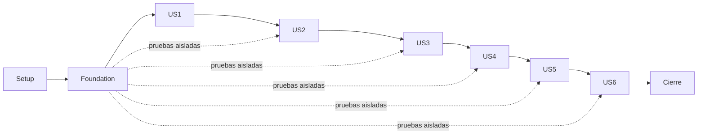

# Tasks: SPEC005 — Integración C3–C4 y continuidad del Observatorio

**Input**: [spec.md](spec.md), [plan.md](plan.md), [research.md](research.md), [data-model.md](data-model.md), [contracts/acceptance.md](contracts/acceptance.md) y [quickstart.md](quickstart.md).

**Tests**: Incluidos porque spec/plan piden regresiones y la constitución X las exige. Crear las pruebas de cada incremento antes de modificar su comportamiento; comprobar que detectan la contradicción actual cuando existe. Ninguna prueba se desactiva para integrar.

**Estado**: Todas las tareas pendientes; este documento no ejecuta cambios, aceptación ni despliegue.

## Format: `[ID] [P?] [Story] Description`

Cada tarea tiene ID secuencial, archivo(s), requisitos y dependencias anteriores explícitas. [P] permite trabajar en archivos distintos una vez cumplidas sus dependencias; no significa ejecutar efectos externos simultáneamente. US1–US6 corresponden a las seis historias P1 del spec.

## Path Conventions

Rutas relativas a la raíz: `backend/src/`, `backend/test/`, `frontend/chat/`, `frontend/shared/`, `frontend/test/`. No crear un `frontend/src` duplicado. Rutas de evidencia bajo `specs/005-integracion-c3-c4/`. Los archivos nuevos citados son entregables futuros, no existentes por inferencia. Migración 008 solo si sigue libre; preservar migraciones aplicadas 001–007.

Cumplimiento: 31 IDs trazados, 30 activos y 1 descartado; N309 no implica rotación. Ninguna marca previa o archivo de prueba es aceptación. Evidencia real comparte versión/corrida con specs anteriores cuando cumple sus cantidades propias.

## Phase 1: Setup — inventario y arnés

**Goal**: Congelar la línea base y preparar validación sin modificar marcas de SPEC001–004.

**Independent Test**: Inventario identificado, manifiesto completo y arnés aislado con componentes reales/controlados explícitos.

- [X] T001 Registrar commit, cambios relevantes incluidos archivos no versionados, digests de imágenes, lockfiles, matriz publicada/calibración/prompt/configuración pública y hash del PDF en `specs/005-integracion-c3-c4/evidencias/aceptacion/baseline.md`; contrastar con `diagnostico.md` y evidencia de specs previos sin copiar secretos ni dar por aceptadas sus tareas. Reqs: RF-C3-IN-05, RNF-C3-IN-02, RNF-C3-IN-13. Dep.: ninguna.

- [X] T002 Documentar propietarios de corrección, equivalencia de tablas/rutas reales, siguientes números de migración y referencias de evidencia compartida en `specs/005-integracion-c3-c4/evidencias/aceptacion/continuidad.md`; mantener `chat.conversation`, `chat.interaction`, `chat.valoracion` y API de SPEC002/004; no crear rutas o registros paralelos. Reqs: RF-C3-IN-01, RF-C3-IN-03, RF-C3-IN-09. Dep.: T001.

- [X] T003 [P] Crear `backend/test/fixtures/in/acceptance-manifest.json` con los 31 casos C301–C310/C401–C406/N301–N313/N401–N402 y todas las cantidades de `contracts/acceptance.md`; estados pendiente/controlado_conforme/real_conforme/fallo/descartado; N309 descartado por fuente sin trabajo de rotación. Etiquetar componentes por entorno y datos sintéticos. Reqs: RNF-C3-IN-09, RF-C3-IN-01, RNF-C3-IN-13. Dep.: T002.

- [X] T004 [P] Crear `backend/test/in-integracion/harness.ts` sobre arnés DI/UI existente con DB/Qdrant aislados, Origin explícito, reloj/proveedor controlados y contadores seguros; añadir demoras de cuerpo/pool/commit/contactos, cierre/limpieza y terminal único sin acceder a volúmenes del usuario. Reqs: RF-C3-IN-04, RF-C3-IN-08, RNF-C3-IN-04. Dep.: T002.

- [X] T005 [P] Preparar `frontend/test/in-fixtures.ts` para seis historias usando el host/iframe y mocks existentes, con tráfico/historial/epoch observables sin almacenar texto ciudadano; distinguir emulación y nginx/dispositivo reales. Reqs: RF-C4-IN-01, RF-C4-IN-03, RNF-C4-IN-01. Dep.: T002.

- [X] T006 Registrar `test:in-integration` en `backend/package.json` para la suite IN, conservar suites DI/UI/KB y actualizar `specs/005-integracion-c3-c4/quickstart.md` con comandos comprobados; no actualizar todo el stack ni habilitar dobles en runtime productivo. Reqs: RF-C3-IN-04, RNF-C3-IN-13. Dep.: T003, T004, T005.

**Checkpoint**: Verificar el incremento y su evidencia; el cierre real global requiere las tareas finales.

---

## Phase 2: Foundational — recepción, seguridad y persistencia compartidas

**Goal**: Establecer la infraestructura que bloquea las seis historias; reusar servicios actuales.

**Independent Test**: Guardas, reloj, DB acotada y errores seguros son ejercitables desde entrada real; las expectativas heredadas incompatibles deben fallar antes de corregirse.

**CRITICAL**: Completar todas las tareas fundacionales antes de implementar historias.

- [X] T007 [P] Añadir regresiones en `backend/test/in-integracion/reception-perimeter.test.ts`: Origin ausente/preflight ajeno 403 antes CORS, preflight permitido 204 sin cuota, falta de sesión y error no-store; medir inicio previo a lectura/auth/cola y mostrar las contradicciones actuales sin desactivar pruebas previas. Reqs: RNF-C3-IN-04, RNF-C3-IN-12, RF-C3-IN-04. Dep.: T006.

- [X] T008 [P] Añadir pruebas en `backend/test/in-integracion/db-budget.test.ts` de pool ocupado/adquisición tardía/query/lock/commit lentos, cancelación/rollback y commit indeterminado; conexión liberada o descartada, sin UUID público sin confirmación y sin replay de texto. Reqs: RF-C3-IN-04, RF-C3-IN-08. Dep.: T006.

- [X] T009 Crear `backend/src/chat/requestContext.ts` y adaptar `backend/src/chat/deadline.ts` con restricciones literales del modelo: receivedAt «Creado al llegar headers al backend, antes de body/auth; fecha persistida en éxito y evento seguro»; startedMonotonicMs «Inicio monotónico para plazos y duración, sin depender de ajustes de reloj»; expiresMonotonicMs «started+40000 ms como máximo; objetivo de finalización 39000 ms»; signal «Propaga cancelación a lectura/cola/búsqueda/SDK/DB y composición de error»; terminalState «activa→respuesta o error o desconectada; solo una salida; cleanup en todas». Nunca serializarlo ni identificar anónimas. Reqs: RF-C3-IN-04, RF-C3-IN-05, RNF-C3-IN-02. Dep.: T007, T008.

- [X] T010 Corregir `backend/src/index.ts`, `backend/src/chat/perimeter.ts` y `backend/src/services/diConfig.ts`: contexto/no-store antes de guardas; POST chat/conversations/ratings y OPTIONS exigen Origin HTTPS exacto productivo, validan método/headers de preflight antes de CORS; GET config mismo origen admite ausencia. Separar cuota de 60 consultas/min de preparación/config/valoración; fixtures localhost aislados y tests DI con Origin explícito, no ampliar configuración productiva. Reqs: RNF-C3-IN-04, RNF-C3-IN-05, RNF-C3-IN-12. Dep.: T009.

- [X] T011 Añadir acceso acotado en `backend/src/chat/boundedDb.ts` y adaptar `backend/src/chat/db.ts`: presupuesto restante para adquisición/statement/lock/commit, cancelación efectiva y cleanup observado, ninguna Promise.race que abandone conexión/escritura; persistenceState «no_iniciada→en_curso→confirmada, fallida/cancelada o indeterminada; responseId público solo confirmada». Resultado indeterminado no demuestra fila inexistente; omitir ID/no replay/descartar conexión insegura. Reqs: RF-C3-IN-04, RF-C3-IN-08. Dep.: T010.

- [X] T012 Adaptar `backend/src/chat/errors.ts` y `backend/src/routes/auth.ts` para errores tempranos con catálogo seguro y no-store, contactos con presupuesto y lista vacía si no pueden leerse a tiempo; redactar logs por códigos seguros, no mensaje/objeto arbitrario. Mantener servicio de sesión técnica sin convertirlo en consentimiento. Reqs: RF-C3-IN-04, RNF-C3-IN-10, RNF-C3-IN-12. Dep.: T011.

- [X] T013 Corregir `frontend/nginx.conf` para transmitir cuerpo de API sin buffering previo, HTTP1.1 y límite 128 KiB, timeout con margen del servidor y errores 413/502/503/504 genéricos; no-store always en cada ubicación efectiva con headers propios. Validar configuración renderizada sin interceptar errores JSON del backend innecesariamente. Reqs: RNF-C3-IN-06, RNF-C3-IN-12, RF-C3-IN-04, RF-C4-IN-04. Dep.: T012.

- [X] T014 Propagar RequestContext por `backend/src/routes/chat.ts`, `backend/src/chat/runtime.ts`, `backend/src/chat/handleChat.ts` y rutas conversations/config/feedback hasta cuerpo/auth/admisión/servicios sin reiniciar reloj; mantener API española y fechas desde recepción. Preparar servicios para presupuesto de DB/contactos sin duplicar lógica de las historias. Reqs: RF-C3-IN-01, RF-C3-IN-04, RF-C3-IN-05. Dep.: T013.

- [X] T015 Ejecutar pruebas fundacionales e integración DI/UI existente; registrar fallos/soluciones/versiones en `specs/005-integracion-c3-c4/evidencias/aceptacion/foundation.md`, exigir expectativas corregidas y cleanup observado. Ninguna historia comienza antes de este gate; dobles no acreditan aceptación real. Reqs: RF-C3-IN-04, RNF-C3-IN-04, RNF-C3-IN-12. Dep.: T014.

**Checkpoint**: Verificar el incremento y su evidencia; el cierre real global requiere las tareas finales.

---

## Phase 3: User Story 1 — continuidad y decisión de datos (P1)

**Goal**: Aislar conversaciones y permitir anonimato sin historial ni identificadores.

**Independent Test**: C301/C302/C401/C402: tres conversaciones×tres turnos, cinco anónimas, tres IDs falsos, 12 entradas 8/4, seis recorridos y 12 turnos con 10 pares en último.

- [X] T016 [P] [US1] Extender `backend/test/di-integracion/consent.test.ts` con C301/C302 exactos, IDs ajenos/no emitidos/depurados, 15→10 pares y validación antes de modelo/registro; sesión técnica no sustituye elección explícita. Reqs: RF-C3-IN-01, RF-C3-IN-02. Dep.: T015.

- [X] T017 [P] [US1] Añadir `frontend/test/in-continuity.spec.ts` con seis recorridos C401 y tres C402: doce turnos autorizados, anonimato, fallo fuera de historial, reinicio/recarga, expiración sin replay y race de creación; no IDs de frontend ni storage. Reqs: RF-C4-IN-01, RF-C4-IN-02, RNF-C4-IN-01. Dep.: T015.

- [X] T018 [US1] Revisar/corregir `backend/src/chat/conversations.ts`, `backend/src/chat/validateRequest.ts` y `backend/src/chat/contracts.ts` sin tabla nueva: «`conversation_id` UUID v4 PK, created_at, authorized_at, policy_version, transport_binding_hash, clarification_pending, last_active_at»; «Solo elección explícita Autorizo; propietario por bindingHash de sesión técnica. Sin pregunta/respuesta/historial. No recuperar sesión vieja tras expiración.» Mantener UUID v4 de C3 y categorías literales; pregunta obligatoria/ID, categoría, historial opcionales, pares completos últimos 10. Reqs: RF-C3-IN-01, RF-C3-IN-02. Dep.: T016, T017.

- [X] T019 [US1] Integrar `backend/src/routes/conversations.ts` y `backend/src/chat/handleChat.ts`: ID solo tras autorización/política vigentes y commit; modo explícito en éxito, historial sin ID inválido, identificador ajeno/no emitido rechazado sin inferencia/registro, sin cambio silencioso a anónimo si DB de propiedad falla. Reqs: RF-C3-IN-01, RF-C3-IN-02, RF-C4-IN-01. Dep.: T018.

- [X] T020 [US1] Ajustar `frontend/chat/sessionReducer.ts`, `frontend/chat/StartupFlow.tsx` y `frontend/shared/chatClient.ts` conservando restricciones: «Historial: pares completos cronológicos, slice(-10) al enviar; primera autorizada y toda anónima omiten historial.» «Pendiente→creación confirmada→autorizo; pendiente→no_autorizo sin creación. Campo de consulta solo después de apertura/datos/categoría.» IDs solo memoria, una creación por autorización y decisiones/epoch independientes. Reqs: RF-C4-IN-01, RF-C4-IN-02. Dep.: T019.

- [X] T021 [US1] Verificar/corregir `frontend/shared/session.ts` y `frontend/chat/ChatContext.tsx` para expiración/reinicio/recarga: no renovar y repetir generación automáticamente, no reasociar contexto previo; «Ocultar conserva iframe/estado; recarga/cierre destruye estado. Nada en storage/cookies/URL/postMessage.» No alterar apertura/categorías oficiales de SPEC003. Reqs: RF-C4-IN-01, RF-C4-IN-02, RNF-C4-IN-01. Dep.: T020.

- [X] T022 [US1] Ejecutar pruebas de US1 y registrar cantidades, modos, tráfico sintético, aislamiento y matriz de IDs sin secretos en `specs/005-integracion-c3-c4/evidencias/aceptacion/us1-local.md`; evidencia real queda para cierre, no marcar T035 de SPEC003 ni tareas previas por existencia de código. Reqs: RF-C3-IN-01, RF-C3-IN-02, RF-C4-IN-01, RF-C4-IN-02. Dep.: T021.

**Checkpoint**: Verificar el incremento y su evidencia; el cierre real global requiere las tareas finales.

---

## Phase 4: User Story 2 — respuestas registradas y valoración (P1)

**Goal**: Relacionar resultado, fuentes, consumo y utilidad solo en respuesta autorizada confirmada.

**Independent Test**: C303/C305/C309/C405: 10 consultas 6/4, 8 registros, 12 valoraciones 7/5 y seis respuestas 2/2/2; concurrencia/propiedad/purga.

- [X] T023 [P] [US2] Crear `backend/test/in-integracion/results-records.test.ts` con diez éxitos 6 autorizados/4 anónimos, cuatro tipos, fuentes exactas/únicas/vacías en no respondidas, ocho registros completos y fallo/commit indeterminado sin ID; comprobar timestamp previo a cola y duración según modelo. Reqs: RF-C3-IN-03, RF-C3-IN-05. Dep.: T015.

- [X] T024 [P] [US2] Extender `frontend/test/feedback.spec.ts` y `frontend/test/feedback.test.tsx` con seis respuestas 2 con ID/2 autorizadas sin ID/2 anónimas, controles ocultos no enfocables y confirmación perdida sin agradecimiento falso ni duplicación. Reqs: RF-C4-IN-05, RF-C3-IN-09. Dep.: T015.

- [X] T025 [US2] Corregir `backend/src/chat/records.ts` y `backend/src/chat/handleChat.ts` reutilizando interaction: «row_id bigint interno; conversation_id FK; response_id UUID v4 UNIQUE; received_at UTC; mode; category; question_text/answer_text; result_type; cited_documents; duration_ms; visible_output_tokens; model; input_tokens/output_tokens; tariff_version; estimated_cost; purged_at». «Solo éxito autorizado. ID público después de commit confirmado.» Fecha desde RequestContext; duración hasta preparación INSERT, latencia completa aparte; fuente catálogo allowlist y DI16 modelo efectivo/tokens/costo sin tarifa cero inventada. Respetar tarifa: «Misma tarifa de SPEC002, sin períodos solapados. Costo según modelo efectivo/consumo; no inventar tarifa ni costo cero si falta.» Reqs: RF-C3-IN-03, RF-C3-IN-05. Dep.: T023, T024, T022.

- [X] T026 [US2] Verificar/corregir `backend/src/chat/sources.ts`, `backend/src/chat/contracts.ts` y `frontend/shared/chatContracts.ts` para cuatro tipos literales, Markdown/citas/fuentes{id, nombre, enlace HTTPS, fecha}, únicos por documento citado tras DI08 y [] en no respondida; exigir modo/conversationId coherentes y no aceptar 200 malformado. Reqs: RF-C3-IN-03, RF-C4-IN-05. Dep.: T025.

- [X] T027 [US2] Extender `backend/test/ui-integracion/feedback-api.test.ts` y `backend/test/ui-integracion/feedback-database.test.ts`: 12 envíos 7 válidos/5 inválidos, IDs ajenos/depurados, texto libre, concurrencia y carrera de purga; exactamente una fila por respuesta y error uniforme sin diferencias de propiedad. Reqs: RF-C3-IN-09, RF-C4-IN-05. Dep.: T026.

- [X] T028 [US2] Verificar/corregir `backend/src/chat/feedback.ts`, `backend/src/routes/feedback.ts` y función de migración 007 mediante migración incremental solo si necesaria: «interaction_row_id FK a interaction.row_id UNIQUE; valoracion, motivo, created_at»; «Útil→motivo omitido en petición/NULL persistido; No útil→uno de 5 motivos.» Usar cinco literales del contrato, sin campos adicionales, confirmar escritura antes 201, preservar lock de purga y no emitir respuesta tardía. Reqs: RF-C3-IN-09. Dep.: T027.

- [X] T029 [US2] Integrar `frontend/chat/FeedbackControls.tsx`, `frontend/chat/feedbackState.ts` y `frontend/shared/feedbackClient.ts` según «responseId solo de C3 confirmado; sin él no hay control de valoración ni elemento oculto enfocables.» Solo confirmar tras respuesta válida; no texto libre, sin guardar UUID públicamente fuera memoria ni segundo rating en carrera. Reqs: RF-C4-IN-05, RF-C3-IN-09. Dep.: T028.

- [X] T030 [US2] Ejecutar pruebas US2 y conciliar respuestas/registros/valoraciones sintéticos en `specs/005-integracion-c3-c4/evidencias/aceptacion/us2-local.md`, preservando campos/cantidad y distinción DB real/proveedor doble. Reqs: RF-C3-IN-03, RF-C3-IN-05, RF-C3-IN-09, RF-C4-IN-05. Dep.: T029.

**Checkpoint**: Verificar el incremento y su evidencia; el cierre real global requiere las tareas finales.

---

## Phase 5: User Story 3 — privacidad, registro degradado y retención (P1)

**Goal**: Conservar solo datos permitidos, orientar aunque falle registro y depurar sin perder fuentes/estadísticas.

**Independent Test**: C306/C307/C308/N301/N312/N401: 14 PII 9/5, 6 anónimas, 6 fallos/2 recuperadas, 2 purgas, memoria y caché.

- [X] T031 [P] [US3] Extender `backend/test/di-integracion/privacy.test.ts` con 14 consultas 9 con PII/5 sin, códigos/normas/decretos/fechas conservados y respuesta ciudadana sin alteración por saneamiento de registro; seis anónimas con inspección de todas tablas/logs/avisos y exactamente seis campos técnicos. Reqs: RF-C3-IN-06, RF-C3-IN-07. Dep.: T015.

- [X] T032 [P] [US3] Crear `backend/test/in-integracion/registry-episode.test.ts` con 6 escrituras fallidas/2 recuperadas, aviso único fecha/modo, estado normal al primer éxito, segundo episodio nuevo sin revisar primero y drenaje concurrente sin duplicación mientras cae admin DB. Reqs: RF-C3-IN-08. Dep.: T015.

- [X] T033 [US3] Actualizar `backend/test/di-integracion/consumption.test.ts` y tests de purga/valoración para 11 m 29 d/12 m 1 d y 2 ejecuciones: comparación exacta de campos conservados incluidos cited_documents y valoraciones, 0 textos/UUID depurados; eliminar expectativa heredada de fuentes vacías, no desactivar test. Reqs: RNF-C3-IN-01, RF-C3-IN-05, RF-C3-IN-09. Dep.: T030.

- [X] T034 [US3] Corregir `backend/src/chat/records.ts`, `backend/src/services/pii.ts` y `backend/src/chat/handleChat.ts` por allowlist: «Solo received_at, mode, model, input_tokens, output_tokens, estimated_cost»; «Un éxito anónimo=una fila. Sin PK ciudadano, UUID, categoría, resultado, documentos, duración, texto, historial, IP, token, hash ni valoración.» En registro autorizado etiquetas exactas[CÉDULA]/[TELÉFONO]/[CORREO], fuentes solo catálogo sin datos ciudadanos y sin alterar entrega por persistencia. Reqs: RF-C3-IN-06, RF-C3-IN-07. Dep.: T031, T032, T033.

- [X] T035 [US3] Crear metadatos de episodio en `backend/src/chat/registryEpisode.ts` y adaptar hooks de `backend/src/chat/records.ts`: «episodeId operativo aleatorio sin vínculo ciudadano, firstFailureAt, mode (`conversación`/`anónima`), state (`abierto`/`cerrado`), aviso (`pendiente`/`persistido`), recoveredAt opcional.» «No texto, categoría, responseId, conversationId, IP, token ni hash.» Modo se conoce antes del episodio de registro; primer fallo notifica una vez, primer éxito cierra, segundo episodio identidad operativa nueva. Reqs: RF-C3-IN-08. Dep.: T034.

- [X] T036 [US3] Adaptar `backend/src/chat/runtime.ts` y `backend/src/admin/operations.ts` para aviso fecha/hora/modo y recuperación normal; estado: «El registro recupera normal en primer éxito; estado observado, no «credenciales configuradas». Razones permitidas sin contenido/secretos.» Además, serializar drenaje de buffer seguro y separar episodio de revisión administrativa. «Avisos de registro agrupados por episodio operativo, no ID ciudadano. Primer fallo incluye fecha/modo; continuaciones no incrementan avisos. Revisar no significa recuperar servicio.» Reusar panel autenticado sin webhook ni spool de textos; no prometer buffer persistente tras muerte del proceso. Reqs: RF-C3-IN-08. Dep.: T035.

- [X] T037 [US3] Corregir `backend/src/chat/retention.ts`: «A los 12 meses calendario se ponen a NULL question_text, answer_text, conversation_id, response_id; purged_at marca ejecución.» «Se conservan exactamente received_at, mode, category, result_type, cited_documents, duration_ms, visible_output_tokens, model, tokens, tarifa, costo y row_id.» Mantener FK interna valoración, depuración dentro 24 h e idempotencia; no reescribir migraciones aplicadas. Reqs: RNF-C3-IN-01, RF-C3-IN-05. Dep.: T036.

- [X] T038 [US3] Verificar/corregir `backend/src/chat/purgeCli.ts` y servicio chat-purge en `docker-compose.yml`; «en_curso→ok/error. Dos ejecuciones horarias observadas; inicio/fin reales e idempotencia.» Registrar dos ejecuciones del programador identificado en `specs/005-integracion-c3-c4/evidencias/aceptacion/purga-controlada.md`, no presentar dos llamadas manuales como programación. Reqs: RNF-C3-IN-01. Dep.: T037.

- [X] T039 [US3] Extender `frontend/test/storage.spec.ts` y corregir `frontend/chat/ChatContext.tsx` solo si falla N401: 3 recorridos Chrome/Firefox, 5 ocultaciones conservan, recarga/cierre pierden, 0 texto/IDs en localStorage/sessionStorage/IndexedDB/cookies/URL/host; reusar iframe actual. Reqs: RNF-C4-IN-01, RF-C4-IN-01. Dep.: T038.

- [X] T040 [US3] Añadir `backend/test/in-integracion/cache-entrypoint.test.ts` que ejercite imagen nginx con cuatro clases N312 y rechazos 401/403/413/429/proxy 502/503/504, no-store en todas y repetición de consulta generada 2 invocaciones; fixture Node no sustituye nginx efectivo. Corregir frontend/nginx.conf o errors.ts si falla sin exponer detalles. Reqs: RNF-C3-IN-12, RF-C4-IN-04. Dep.: T039.

- [X] T041 [US3] Ejecutar batería US3 completa y registrar evidencias/episodios/purga/saneamiento/anonimato/caché y límites del buffer en `specs/005-integracion-c3-c4/evidencias/aceptacion/us3-local.md`; no atribuir calidad de proveedor real al doble. Reqs: RF-C3-IN-06, RF-C3-IN-07, RF-C3-IN-08, RNF-C3-IN-01, RNF-C3-IN-12, RNF-C4-IN-01. Dep.: T040.

**Checkpoint**: Verificar el incremento y su evidencia; el cierre real global requiere las tareas finales.

---

## Phase 6: User Story 4 — tiempos, fallos y contactos (P1)

**Goal**: Cada intento termina con salida comprensible y contactos vigentes dentro del plazo integral.

**Independent Test**: C304/C310/C403/C404/C406: 9 errores C3≤40 s, 4 plazos cliente 45 s, 6 malformados y 3 lecturas contactos≤2 s más 4 recuperaciones.

- [X] T042 [P] [US4] Crear `backend/test/in-integracion/end-to-end-deadline.test.ts` para cuerpo/auth/cola/pool/búsqueda/registro/error lentos desde recepción; nueve clases 3 validación/3 indisponibilidad/2 plazo/1 interno, terminal≤40 s sin detalles técnicos, con pruebas de cleanup y evento/aviso ante búsqueda/doble modelo. Reqs: RF-C3-IN-04, RF-C3-IN-08. Dep.: T015.

- [X] T043 [P] [US4] Extender `frontend/test/query-integration.spec.ts` y `frontend/test/query-attempt.test.ts` con 4 casos 40 s/50 s/plazo propio/reinicio, 6 respuestas 2 validación/2 internos/502 HTML/JSON incompleto y 4 contactos caída/recuperación; sin pares fallidos/tardíos ni mensajes técnicos. Reqs: RF-C4-IN-03, RF-C4-IN-04, RF-C4-IN-06. Dep.: T015.

- [X] T044 [US4] Agregar próxima migración libre `backend/migrations/chat/008_eventos_servicio.sql` (renumerar si ocupado) y tipos en `backend/src/admin/serviceEvents.ts`: event_id interno, occurred_at, «code cerrado (`SERVICIO_NO_DISPONIBLE`), component cerrado (modelos/busqueda/plazo), mode opcional de contrato validado.» «Sin texto/IDs públicos ni métricas de consumo inventadas.» Permisos mínimos para evento operativo seguro; no crear otra interacción anónima ni modificar 001–007. Reqs: RF-C3-IN-04, RF-C3-IN-07. Dep.: T042, T043, T041.

- [X] T045 [US4] Completar `backend/src/chat/handleChat.ts`, `backend/src/chat/orchestrator.ts`, `backend/src/routes/chat.ts` y `backend/src/admin/serviceEvents.ts` con presupuesto común de todas etapas, cancelación efectiva y terminal único; disponibilidad registra evento seguro/aviso no bloqueante con buffer solo de metadatos, búsqueda fallida nunca sin información y reranker degradado conserva RRF. Resultado disponible tras fallo de registro sale completo sin responseId. Reqs: RF-C3-IN-04, RF-C3-IN-08. Dep.: T044.

- [X] T046 [US4] Verificar/corregir `backend/src/routes/chatConfig.ts`, `backend/src/admin/contacts.ts` y lecturas de error para snapshot transaccional actual de inmediatos/PQRSD/WhatsApp/correo/general; «Snapshot íntegro validado, solo oficiales; edición autorizada visible sin redespliegue. No duplicar contacto en chat.» Tres lecturas≤2 s, 0 LLM, cliente 5 s; errores sin espera extra. Reqs: RF-C3-IN-10, RF-C3-IN-04. Dep.: T045.

- [X] T047 [US4] Integrar `frontend/shared/chatClient.ts`, `frontend/chat/queryAttempt.ts` y `frontend/chat/sessionReducer.ts` con «Intento: payload congelado, sequence/epoch locales, retryCount 0..2, inicio/plazo; éxito agrega par autorizado, fallo no agrega.» Reloj 45 s incluye fetch/cuerpo/validación; fallo 45–46 s, descarte de resultado tardío y reinicio antes de abortar, sin replay automático ni doble pregunta por retry. Reqs: RF-C4-IN-03, RF-C4-IN-04, RF-C4-IN-02. Dep.: T046.

- [X] T048 [US4] Completar `frontend/chat/contactState.ts`, `frontend/chat/ContactChannels.tsx`, `frontend/chat/QueryFailure.tsx` y `frontend/shared/chatErrors.ts`: repetir contactos ausentes ante emergencia/fallo, enlace oficial/texto fijo literal, sin contactos hardcoded; VALIDACION sin Reintentar, interno/no interpretable con salida UI-08 y máximo 2 reintentos, 429 respeta Retry-After, 401 sin convertir a anónimo. Reqs: RF-C4-IN-04, RF-C4-IN-06. Dep.: T047.

- [X] T049 [US4] Ejecutar pruebas US4 y entrada nginx con demoras efectivas, registrar tiempos desde recepción y envío y 4 recuperaciones/tres lecturas en `specs/005-integracion-c3-c4/evidencias/aceptacion/us4-local.md`; distinguir fallos inducidos de disponibilidad real requerida al cierre. Reqs: RF-C3-IN-04, RF-C3-IN-10, RF-C4-IN-03, RF-C4-IN-04, RF-C4-IN-06. Dep.: T048.

**Checkpoint**: Verificar el incremento y su evidencia; el cierre real global requiere las tareas finales.

---

## Phase 7: User Story 5 — protección de servicio e identidad (P1)

**Goal**: Cerrar abuso y fuga de secretos con rol exclusivo y políticas exactas.

**Independent Test**: N304–N308/N310/N311/N402: matriz 8 orígenes, 62 consultas, 6 cuerpos, 8 fugas, 9 inyecciones, 6 CSP y 2 modelos/4 denegaciones.

- [X] T050 [P] [US5] Extender `backend/test/di-integracion/chat-perimeter.test.ts` con ocho orígenes exactos 2 válidos/6 rechazos incluida ausencia/preflight, 62 consultas 30 s=60/2, otra IP/falsificación/60/min durante 5 min sin 429 y 6 cuerpos 100 KB/20.000 caracteres/128 KiB/128 KiB+1/5 MB±longitud. Corregir expectativa heredada de 200 sin Origin, 0 LLM/registro en rechazos y memoria sin acumular 5 MB. Reqs: RNF-C3-IN-04, RNF-C3-IN-05, RNF-C3-IN-06. Dep.: T015.

- [X] T051 [P] [US5] Crear `backend/test/in-integracion/instance-role.test.ts` y `backend/test/in-integracion/secret-redaction.test.ts` con proveedor metadatos controlado, rechazos de llaves/perfil/proceso/bearer key, 8 escenarios 4 fallos 2 éxitos 1 reinicio 1 revisión y señuelos para logs/avisos/DB/HTTP/frontend. Nunca imprimir coincidencias sensibles. Reqs: RNF-C3-IN-07, RNF-C3-IN-08, RNF-C3-IN-10. Dep.: T015.

- [X] T052 [US5] Corregir `backend/src/index.ts`, `backend/src/services/diConfig.ts` y `backend/src/chat/perimeter.ts`: TRUST_PROXY como número validado o proxies/subredes exactos identificados, no string numérico malinterpretado ni trust all; proxies borran encabezados cliente/backend interno, resolver IP sin suplantación y ventana de 60 s solo consulta. Registrar topología segura en `.env.example` y `docs/arquitectura-sistema.md`. Reqs: RNF-C3-IN-04, RNF-C3-IN-05. Dep.: T050, T051, T049.

- [X] T053 [US5] Verificar/corregir `backend/src/chat/perimeter.ts` y `frontend/nginx.conf` para detección 131072 bytes exacta streaming/longitud, cuerpo multibyte, 413/no-store antes de invocación/registro y buffers/listeners liberados; preservar pregunta 20000 sin límite separado. Reqs: RNF-C3-IN-06, RNF-C3-IN-12. Dep.: T052.

- [X] T054 [US5] Sustituir cadena general en `backend/src/bedrock/client.ts` por fromInstanceMetadata explícito con timeout/reintentos acotados y renovación SDK; verificar export instalado y agregar dependencia directa específica a backend/package.json/lockfile solo si falta. Fortalecer `backend/src/services/diConfig.ts` y logging para rechazar fuentes alternas sin fugas, sin montar .aws ni variables de llaves. Reqs: RNF-C3-IN-07, RNF-C3-IN-08, RNF-C3-IN-10. Dep.: T053.

- [X] T055 [US5] Crear contrato ejecutable de policy y despliegue en `backend/config/iam-bedrock-policy.json` y `specs/005-integracion-c3-c4/evidencias/aceptacion/iam-configuracion.md`: solo `bedrock:InvokeModel` y 2 ARN foundation-model exactos de 20b/120b en us-east-1, sin comodines/streaming/perfiles regionales; revisar políticas efectivas, rol exclusivo, IMDSv2 y hop limit del contenedor. Documento no aplica cambios AWS automáticamente. Reqs: RNF-C3-IN-07, RNF-C3-IN-08. Dep.: T054.

- [X] T056 [US5] Corregir logs/manejadores de errores y proceso en `backend/src/index.ts`, `backend/src/chat/db.ts`, `backend/src/services/alerts.ts` y módulos afectados por 8 pruebas: lista permitida de códigos/fecha/modo, 0 objetos SDK/mensajes arbitrarios/tokens/autorización. Escanear repo/imagen/config/paquete frontend y registrar conteos/rutas sin valores en `specs/005-integracion-c3-c4/evidencias/aceptacion/secretos-controlados.md`. Reqs: RNF-C3-IN-10, RNF-C3-IN-07. Dep.: T055.

- [X] T057 [US5] Extender `backend/test/di-provider-privacy.test.ts` y `backend/test/fixtures/di/` con 9 inyecciones 3 pregunta/3 historial falso/3 fragmento; mantener prompt/respaldo/alcance/leyenda de SPEC002, sin tratar instrucciones como órdenes. Verificar doble y preparar misma matriz para ambos modelos reales, sin cambiar prompt para aprobar un subconjunto. Reqs: RNF-C3-IN-11. Dep.: T056.

- [X] T058 [US5] Verificar/corregir `frontend/scripts/build-csp.mjs`, `frontend/widget/protocol.ts` y `frontend/test/widget-csp.spec.ts` con 6 casos 2 válidos/3 bloqueos/1 cabecera; único ancestor https://observatorioenvigado.geotrends.co distinto del Origin API, sin contacto ni texto al host, fixtures separados, nginx efectivo sin X-Frame-Options contradictorio. Reqs: RNF-C4-IN-02. Dep.: T057.

- [X] T059 [US5] Ejecutar pruebas US5 y registrar decisiones HTTP/IP/cuerpos, redacción/proveedor controlado, CSP nginx y ninguna excepción en `specs/005-integracion-c3-c4/evidencias/aceptacion/us5-local.md`; rol/dos modelos/denegaciones y dispositivos reales siguen pendientes de tareas finales, sin presentarlos conformes. Reqs: RNF-C3-IN-04, RNF-C3-IN-05, RNF-C3-IN-06, RNF-C3-IN-07, RNF-C3-IN-08, RNF-C3-IN-10, RNF-C3-IN-11, RNF-C4-IN-02. Dep.: T058.

**Checkpoint**: Verificar el incremento y su evidencia; el cierre real global requiere las tareas finales.

---

## Phase 8: User Story 6 — capacidad y no degradación (P1)

**Goal**: Medir carga real completa con muestras exactas, conciliación y continuidad del anfitrión.

**Independent Test**: N302/N303/N313: 100 secuenciales 40/30/30, 10 historiales/10 largas, 3×25 con 15 de 5 conversaciones+10 anónimas en 2 días y 180 muestras anfitrión≤120%.

- [X] T060 [P] [US6] Extender `backend/test/di-integracion/load-runner.test.ts` para 100 casos 40/30/30, 10 historiales efectivos autorizados, 10 respuestas largas validadas, oleadas de 15 autorizadas de 5 conversaciones+10 anónimas, Origin/token preparados sin cuota y validación de 200 antes de éxito; demostrar arnés viejo con 5 historiales/todas las oleadas anónimas falla. Reqs: RNF-C3-IN-02, RNF-C3-IN-03. Dep.: T015.

- [X] T061 [P] [US6] Crear `backend/test/in-integracion/host-runner.test.ts` con 180 muestras, baseline inválida, error/timeout, configuración de caché y demostración de solapamiento; comparar p95 por destino/condición, no promedio/CPU sustituta. Reqs: RNF-C3-IN-13. Dep.: T015.

- [X] T062 [US6] Crear `backend/test/fixtures/in/load-manifest.json` contra corpus publicado identificado: 100 preguntas sintéticas 40/30/30, diez autorizadas con 10 pares válidos y 10 respuestas largas≥700 tokens visibles/≤2200 como convención de arnés explícita, no requerimiento nuevo del producto. Congelar IDs/muestras y registrar base/calibración. Reqs: RNF-C3-IN-02, RNF-C3-IN-03. Dep.: T060, T061, T059.

- [X] T063 [US6] Corregir `backend/scripts/lib/loadRunner.ts` y `backend/scripts/eval-di-load.ts`: medir hasta cuerpo completo válido, Origin/sesión/conversaciones preparadas fuera del cronómetro, cada oleada de 15 de 5 conversaciones+10 anónimas, 3 oleadas pausas de 120000 ms y 2 fechas distintas; todos los casos/errores en denominador, p95 nearest-rank por día/oleada, cero éxitos ficticios con 200 sin contrato o respuestas fijas degeneradas. Reqs: RNF-C3-IN-02, RNF-C3-IN-03, RF-C3-IN-04. Dep.: T062.

- [X] T064 [US6] Agregar conciliación en `backend/scripts/lib/loadReconciliation.ts`: registros autorizados cruzados por IDs solo evidencia sintética restringida, anónimos multiset de «received_at, mode, model, input_tokens, output_tokens, estimated_cost» y ventana exclusiva verificada; no agregar traceId/hash/IP a tabla, payload o logs. 75 registros/día 45+30, 150 total 90+60; tráfico ajeno no separable deja criterio pendiente. Reqs: RNF-C3-IN-03, RF-C3-IN-05, RF-C3-IN-07. Dep.: T063.

- [X] T065 [US6] Crear `backend/scripts/lib/hostRunner.ts` y `backend/scripts/eval-di-host.ts` para 30 peticiones a cada uno de 2 destinos en 3 condiciones=180: Observatorio y Geoportal referencia, método/URL/cuerpo sintético/esquema validado, cuerpo completo, timestamps de carga y solapamiento real, reindexación completa/25 consultas. Timeout de 120000 ms/error se cuenta; cada p95 de carga/p95 de baseline≤1.2 y 0 errores, no línea base 0 inválida; oleadas extra de N313 documentadas no sustituyen N303. Reqs: RNF-C3-IN-13. Dep.: T064.

- [X] T066 [US6] Registrar `eval:di-host` en `backend/package.json` y comandos efectivos de load/reconciliation/host en `specs/005-integracion-c3-c4/quickstart.md`; ensayar con endpoints controlados y reportes reales de corrida sin atribuir AWS/portal al fixture. Esperar acceso operativo antes de cargas externas. Reqs: RNF-C3-IN-02, RNF-C3-IN-03, RNF-C3-IN-13. Dep.: T065.

- [X] T067 [US6] Revisar `docker-compose.yml` y `backend/src/services/chatTraffic.ts` según carga controlada y medición real posterior, mantener worker separado/alias atómico/25 admitidas y límites contractuales; preparar ajustes de recursos compartidos si N313 falla sin detener chat/relajar cuota. Documentar decisiones en `specs/005-integracion-c3-c4/evidencias/aceptacion/recursos.md`. Reqs: RNF-C3-IN-03, RNF-C3-IN-13. Dep.: T066.

- [X] T068 [US6] Ejecutar pruebas del arnés/conciliación/host y registrar cantidades/fechas/timeouts/errores/componentes en `specs/005-integracion-c3-c4/evidencias/aceptacion/us6-local.md`; corregir falsos positivos del runner antes de medición real, dejar N302/N303/N313 pendientes de dos días/180 medidas reales. Reqs: RNF-C3-IN-02, RNF-C3-IN-03, RNF-C3-IN-13. Dep.: T067.

**Checkpoint**: Verificar el incremento y su evidencia; el cierre real global requiere las tareas finales.

---

## Phase 9: Polish — CI, aceptación real y cierre

**Goal**: Consolidar evidencia íntegra y resolver hallazgos de todos los requisitos sin cierres ficticios.

**Independent Test**: 31 casos trazados, 30 activos con evidencia requerida+1 descartado; dos días reales, portal/móviles/lectores/IAM y 180 medidas anfitrión; ninguna aceptación por existencia de archivo.

- [X] T069 [P] Crear `backend/test/in-integracion/report-in.test.ts` para rechazar resultados ausentes/cantidades insuficientes/versiones distintas/archivos solos/real sustituido por controlado; estados del contrato y N309 excluido del denominador activo, hash del árbol incluye untracked relevantes sin leer secretos. Reqs: RNF-C3-IN-02, RNF-C3-IN-09, RNF-C3-IN-13. Dep.: T068.

- [X] T070 [P] Preparar guías de revisión en `specs/005-integracion-c3-c4/evidencias/aceptacion/guia-manual.md` para rol/policy/proxies/contactos/costos/fuentes, Chrome y Firefox/móviles/lectores/storage/CSP y registros, condiciones/criterios para no declarar conforme una fixture. Usar 31 casos y cantidades exactas. Reqs: RF-C3-IN-10, RNF-C3-IN-08, RNF-C4-IN-01, RNF-C4-IN-02. Dep.: T068.

- [X] T071 Crear `backend/scripts/report-in.ts` y registrar `report:in` en `backend/package.json` contra manifiesto 31 casos, artefactos de ejecución/hashes incluido untracked/digests/configuración pública y revisión manual; componentes C/DB/A/P/H/B, no archivo existente como PASS. Informe por caso pendiente/controlado_conforme/real_conforme/fallo/descartado, 30 activos+N309. Reqs: RNF-C3-IN-09, RNF-C3-IN-02, RNF-C3-IN-13. Dep.: T069, T070.

- [X] T072 Actualizar `.github/workflows/ci.yml` para IN y regresiones DI/UI/KB/frontend existentes, tipos, auditoría sin vulnerabilidades altas y builds de imágenes con dependencias nativas; validar manifiesto/generador de informe y resultados efectivos, sin passWithNoTests aceptado como prueba ni desactivar tests origin/retención para integrar. Reqs: RNF-C3-IN-04, RNF-C3-IN-10, RNF-C3-IN-12. Dep.: T071.

- [X] T073 Ejecutar quickstart completo controlado, CI cuando accesible, builds de imágenes/tipos/auditoría y corregir hallazgos en módulos responsables; registrar evidencia identificada en `specs/005-integracion-c3-c4/evidencias/aceptacion/integracion-local.md` y `specs/005-integracion-c3-c4/evidencias/aceptacion/hallazgos.md`. Sin credenciales/acciones externas sin autorización operativa; pendientes externos no equivalen a pass. Reqs: RF-C3-IN-04, RNF-C3-IN-04, RNF-C3-IN-12. Dep.: T072.

- [ ] T074 Identificar entorno AWS/producción, autorizaciones operativas, destinos Observatorio/Geoportal, proxy/nginx, rol exclusivo, política/contactos/tarifas/base/calibración/modelos y dispositivos en `specs/005-integracion-c3-c4/evidencias/aceptacion/entorno-real.md`; ejecutar instalación de aceptación dentro del alcance operativo existente, sin inferir publicación productiva. Si falta acceso conservar tareas dependientes pendientes y continuar trabajo independiente. Reqs: RNF-C3-IN-07, RNF-C3-IN-13, RNF-C4-IN-02. Dep.: T073.

- [ ] T075 Ejecutar N307/N308/N310/N311 en entorno autorizado y guardar `specs/005-integracion-c3-c4/evidencias/aceptacion/iam-modelos-reales.md`: 2 modelos con rol de instancia, 4 denegaciones, políticas efectivas sin comodines/llaves/otros proveedores, IMDSv2/hop limit, retiro/restauración de rol solo con autorización operativa y aviso seguro; 9 inyecciones en ambos modelos, 8 fugas controladas con proveedor simulado+escaneo seguro. No usar sesión local como aceptación del servidor. Reqs: RNF-C3-IN-07, RNF-C3-IN-08, RNF-C3-IN-10, RNF-C3-IN-11. Dep.: T074.

- [ ] T076 Ejecutar C301–C310/C401–C406/N301/N304–N306/N312 con servicios DB/KB/Bedrock/entrada nginx/panel reales y datos sintéticos en `specs/005-integracion-c3-c4/evidencias/aceptacion/servicios-reales.md`; conservar todas cantidades del manifiesto, 3 lecturas≤2 s/edición, 12 historiales/10 pares, valoración 7/5, 14 casos PII, 6 anónimas, episodios y 2 purgas automáticas. Fallos inducidos/demoras explícitos como controlados, sin sustitución de parte real. Reqs: RF-C3-IN-01, RF-C3-IN-02, RF-C3-IN-03, RF-C3-IN-04, RF-C3-IN-05, RF-C3-IN-06, RF-C3-IN-07, RF-C3-IN-08, RF-C3-IN-09, RF-C3-IN-10, RF-C4-IN-01, RF-C4-IN-02, RF-C4-IN-03, RF-C4-IN-04, RF-C4-IN-05, RF-C4-IN-06, RNF-C3-IN-01, RNF-C3-IN-04, RNF-C3-IN-05, RNF-C3-IN-06, RNF-C3-IN-12. Dep.: T075.

- [ ] T077 Ejecutar revisión real Chrome/Firefox, móviles Chrome Android/Safari iOS, teclado/lector, CSP/storage/cinco ciclos y reinicio sobre portal/versión identificados; guardar evidencia sanitizada en `specs/005-integracion-c3-c4/evidencias/aceptacion/navegadores-reales.md`. N401 tres recorridos, N402 seis pruebas y bloqueos en ambos móviles; emulación no acredita; revisiones 003/004 referenciadas no se marcan completas automáticamente. Reqs: RNF-C4-IN-01, RNF-C4-IN-02, RF-C4-IN-01, RF-C4-IN-03, RF-C4-IN-05. Dep.: T076.

- [ ] T078 Ejecutar N302/N303 con runner corregido en producción dos días distintos (America/Bogota), 100 secuenciales/día 40/30/30 incluidas 10 con historial y 10 respuestas largas y 3 oleadas de 25/día 15 de 5 conversaciones+10 anónimas/pausas de 2 min; registrar `specs/005-integracion-c3-c4/evidencias/aceptacion/rendimiento/` con manifiesto, datos seguros, p95≤20 s por cada día/oleada, 0 errores en oleadas/150 registros 90+60 conciliados. Si faltan muestras/aislamiento/tráfico extra no declarar PASS. Reqs: RNF-C3-IN-02, RNF-C3-IN-03, RF-C3-IN-05, RF-C3-IN-07. Dep.: T077.

- [ ] T079 Ejecutar N313 y guardar `specs/005-integracion-c3-c4/evidencias/aceptacion/no-degradacion.md`: 180 medidas: 30 por cada uno de los dos destinos en las tres condiciones con versión/caché/método fijo, reindexación completa y 25 consultas efectivas; solapamiento demostrado, 0 errores y cada p95 de carga≤120 % de su baseline propia. Ajustar recursos según resultado sin relajar umbral y repetir condición total, no sustituir con CPU/health. Reqs: RNF-C3-IN-13. Dep.: T078.

- [ ] T080 Resolver hallazgos REAL en módulos correspondientes y `specs/005-integracion-c3-c4/evidencias/aceptacion/hallazgos.md`: fallo antes del cambio/causa/tipo REAL/prioridad de fuente/corrección/versiones; repetir tareas de aceptación afectadas y batería integrada completa, incluyendo dos días/180 muestras si cambios invalidan rendimiento. Si cambia prompt/base/recuperación, repetir matriz congelada 002 completa en ambos modelos; no cerrar con subconjunto positivo. Reqs: RF-C3-IN-04, RNF-C3-IN-02, RNF-C3-IN-03, RNF-C3-IN-13. Dep.: T079.

- [ ] T081 Generar informe 31 casos en `specs/005-integracion-c3-c4/informe-validacion.md` y `specs/005-integracion-c3-c4/evidencias/aceptacion/matriz.md`: 30 activos íntegros según componente requerido y N309 descartado, con hashes/resultados/revisores, hallazgos resueltos y principios I–X; caso incompleto mantiene estado pendiente. No convertir en acta firmada del Bloque 6 ni cerrar tareas anteriores por referencia. Reqs: RNF-C3-IN-09, RNF-C3-IN-02, RNF-C3-IN-03, RNF-C3-IN-13. Dep.: T080.

- [ ] T082 Actualizar `specs/005-integracion-c3-c4/quickstart.md`, `README.md`, `docs/arquitectura-sistema.md` y `specs/005-integracion-c3-c4/diagnostico.md` con comandos existentes, configuración pública, roles/proxies/memoria/caché/retención/alertas/mediciones/rollback y evidencia de cierre; preservar pendientes de otros specs. Marcar tarea solo tras verificar handoff y criterio propio, nunca por agotamiento de acceso/tiempo. Reqs: RF-C3-IN-08, RNF-C3-IN-01, RNF-C3-IN-04, RNF-C4-IN-01. Dep.: T081.

**Checkpoint**: Verificar el incremento y su evidencia; el cierre real global requiere las tareas finales.

---

## Dependencies & Execution Order

Preparación → fundamento → US1 → US2 → US3 → US4 → US5 → US6 → cierre. Esta secuencia ordena los cambios a módulos compartidos; las pruebas aisladas de cada historia pueden prepararse después del fundamento con sus dependencias indicadas. El orden de IDs es topológico y las dependencias de cada tarea son obligatorias.

No paralelizar ediciones a index.ts/perimeter/errors/records/runtime/handleChat/ChatContext o package.json de diferentes incrementos. Ninguna tarea externa puede declararse cumplida sin acceso y resultados: continuar trabajo independiente y mantener pendientes reales. La falta de acceso no autoriza publicación productiva ni relajar matriz, tiempos o privacidad.

## Parallel Examples

- Setup: T003, T004, T005. Completar sus dependencias antes de iniciar; archivos distintos y sin cambios compartidos.

- Foundational: T007, T008. Completar sus dependencias antes de iniciar; archivos distintos y sin cambios compartidos.

- US1: T016, T017. Completar sus dependencias antes de iniciar; archivos distintos y sin cambios compartidos.

- US2: T023, T024. Completar sus dependencias antes de iniciar; archivos distintos y sin cambios compartidos.

- US3: T031, T032. Completar sus dependencias antes de iniciar; archivos distintos y sin cambios compartidos.

- US4: T042, T043. Completar sus dependencias antes de iniciar; archivos distintos y sin cambios compartidos.

- US5: T050, T051. Completar sus dependencias antes de iniciar; archivos distintos y sin cambios compartidos.

- US6: T060, T061. Completar sus dependencias antes de iniciar; archivos distintos y sin cambios compartidos.

- Polish: T069, T070. Completar sus dependencias antes de iniciar; archivos distintos y sin cambios compartidos.

## Implementation Strategy

MVP interno: Setup + Foundational + US1, verificando identidad/decisión/historial con proveedor controlado y DB real. Entrega valor para revisión interna; no acredita cumplimiento del Bloque 5 ni autoriza despliegue público.

Continuar con US2 (trazabilidad/valoración), US3 (privacidad/retención/registro), US4 (salida/tiempo/contactos), US5 (protección/rol) y US6 (carga/no degradación). Todas las historias son P1 y obligatorias. El cierre exige aceptación real donde corresponde, cantidades completas, hallazgos corregidos, CI y handoff.

La evidencia controlada es suficiente solo para partes que la fuente exige simuladas; AWS/IAM, producción en dos días, portal/Geoportal, nginx y móviles/lectores reales permanecen explícitos. Compartir una evidencia no cierra automáticamente tareas 002/003/004. Cambios en prompt/base/recuperación repiten la matriz congelada íntegra de ambos modelos.
