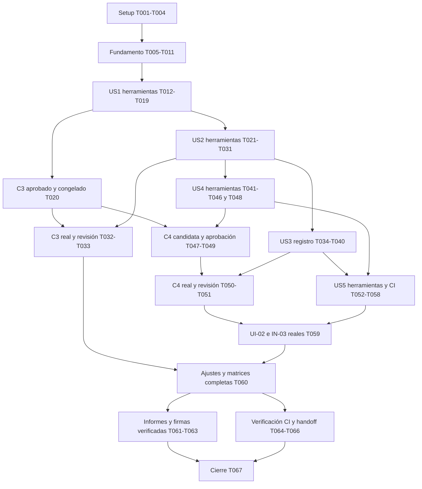

# Tasks: SPEC006 — Validación y pruebas C3–C4

**Input**: [plan.md](plan.md), [spec.md](spec.md), [research.md](research.md), [data-model.md](data-model.md), [contracts/](contracts/), [quickstart.md](quickstart.md) y [continuidad.md](continuidad.md).

**Fecha**: 2026-10-10. Feature activa `specs/006-validacion-pruebas`; rama Git `develop`.

**Tests**: Incluidos por el diseño de validación del spec y el principio X de la constitución; negativos contractuales primero, luego implementación y verificación. No se exige TDD general del producto ni inferencia en CI. Ninguna prueba vacía, archivo existente o doble cuenta como aceptación real.

**Organization**: Cinco historias P1; fases compartidas sin etiqueta US, fases de historia con etiqueta obligatoria y cierre transversal sin etiqueta. Toda tarea cita requisito fuente, ruta concreta y dependencias. Las marcas empiezan pendientes; generar esta lista no ejecuta el trabajo.

## Format: `[ID] [P?] [Story] Description`

- `[P]`: puede prepararse/ejecutarse con otra marcada de su grupo una vez completas sus dependencias, en archivos distintos; no habilita tocar archivos compartidos simultáneamente.
- `[US1]`–`[US5]`: historias del spec, no prioridades nuevas.
- Rutas relativas a raíz; nombres nuevos del plan se crean durante implementación. Comandos nuevos se registran y verifican antes de usarse.
- `Dep.` refiere exclusivamente IDs de esta lista; requisitos/tareas previas se describen con su spec dueño, nunca como IDs ambiguos.
- Trabajo humano/externo conserva evidencia real y queda pendiente si falta acceso/aprobación/firma. Eso no impide ejecutar herramientas independientes cuyas dependencias técnicas ya están completas.

## Path Conventions

Núcleo offline `backend/scripts/lib/validation/`, pruebas `backend/test/validation-*.test.ts` y `backend/test/validation-integracion/`, PR `frontend/test/pr/` con configuración de aceptación separada. Entregables bajo `specs/006-validacion-pruebas/aceptacion/` o raíz privada equivalente autorizada, original firmado fuera de publicación. Sin nuevas tablas operativas, panel de matrices ni endpoints públicos.

## Phase 1: Setup — inventario y coordinación

**Goal**: Confirmar superficies reutilizables, criterios previos y acceso operativo sin duplicar servicios.

**Independent Test**: Inventario identifica código real, herramientas existentes/propuestas y propietario de cada brecha; no contiene secretos ni aceptación inferida.

- [X] T001 Registrar commit, cambios locales relevantes, lockfiles, scripts actuales y estado real de SPEC001–005 en `specs/006-validacion-pruebas/evidencias/aceptacion/baseline.md`; contrastar continuidad histórica con archivos/corridas presentes y conservar pendientes anteriores sin cambiar sus marcas. Reqs: RF-C3-VA-01, RF-C3-VA-03, RF-C4-PR-01. Dep.: ninguna.

- [X] T002 [P] Crear `specs/006-validacion-pruebas/evidencias/aceptacion/dependencias.md` con propietario/requisito/evidencia para base001, modelos/calibración002, flujo003, UI-02/N02/T080 de004 y rol/load N303/T063/T064/T078 de005; verificar prerequisitos vigentes contra código, no asumir tarea marcada o runner existente suficiente. Reqs: RF-C3-VA-03, RF-C4-PR-04, RNF-C4-UI-02, RNF-C3-IN-03. Dep.: T001.

- [X] T003 [P] Preparar `specs/006-validacion-pruebas/evidencias/aceptacion/entorno.md`: entorno de aceptación autorizado, contactos/política/base/modelos, responsables humanos, dispositivos/lectores y ubicación privada de evidencia/actas; anotar accesos disponibles y pendientes sin llaves ni ejecutar cargas/despliegues. Reqs: RF-C3-VA-05, RF-C3-VA-06, RF-C4-PR-04. Dep.: T001.

- [X] T004 Registrar suites `test:validation` y `test:validation-integration` en `backend/package.json` y crear `backend/test/validation-integracion/harness.ts` reutilizando harness DI/KB/IN con PostgreSQL/Qdrant aislados y AWS doble; sin nueva DB operativa ni red de inferencia en CI. Mantener lockfile existente salvo cambio directo necesario. Reqs: RF-C3-VA-03, RF-C3-VA-06, RF-C4-PR-02. Dep.: T002, T003.

**Checkpoint**: Verificar incremento y evidencia descritos; estado de herramientas/local no reemplaza aprobación humana ni aceptación real del hito.

---

## Phase 2: Foundational — contratos e integridad compartida

**Goal**: Implementar infraestructura offline que todas las historias usan; bloquea implementación de historias hasta su verificación.

**Independent Test**: Tipos/lecturas/hashes/refs/identidad/eventos rechazan datos ambiguos, secretos y sobrescritura; futuros tests de historias usan contratos sintéticos válidos.

- [X] T005 [P] Crear `backend/test/validation-core.test.ts` con negativos de versión desconocida, null/vacío/TODO, enum inválido, clave JSON duplicada/desconocida, fecha sin zona, ID duplicado, SHA malformado, número no finito y JSON ejecutable; verificar restricciones citadas en data-model y contratos, sin replicar solo tipos. Reqs: RF-C3-VA-01, RF-C4-PR-01. Dep.: T004.

- [X] T006 [P] Crear `backend/test/validation-identity.test.ts` con expectativa/fecha/aprobación/paso alterados cambiando hash canónico, claves reordenadas, arrays conservados, untracked relevante incluido, symlink/traversal/secretos rechazados y outputs excluidos para evitar autorreferencia; evidencia ausente/alterada nunca pasa. Reqs: RF-C3-VA-01, RF-C3-VA-05, RF-C4-PR-04. Dep.: T004.

- [X] T007 Crear `backend/scripts/lib/validation/types.ts` y `readJson.ts` con tipos comunes y validadores explícitos sin dependencia nueva; aplicar literalmente «schemaVersion: entero 1 para esta versión de contrato; versiones desconocidas se rechazan», «id, version: cadenas no vacías estables; IDs únicos dentro de su colección», «fecha/hora ISO8601 con zona, guardada en UTC», «SHA-256 hexadecimal de 64 caracteres», «PersonRef: {name, role} reales, no marcador» y «RequirementId: ID aprobado RF/RNF; no IDs inventados»; rechazar duplicados antes de JSON.parse. Restricciones adicionales literales: «cadenas no vacías estables; IDs únicos dentro de su colección, nunca emitidos como identificadores ciudadanos»; «Fechas civiles del documento se conservan como YYYY-MM-DD; dos días de carga se distinguen en America/Bogota»; «aprobación/revisión requiere persona y fecha verificables». Reqs: RF-C3-VA-01, RF-C4-PR-01. Dep.: T005, T006.

- [X] T008 Implementar `backend/scripts/lib/validation/artifacts.ts` y `hash.ts`: ArtifactRef `{path, sha256, mediaType}` con «No traversal/symlink a secretos; comprobación de contenido, no solo existencia»; serialización canónica por puntos de código, arrays/cadenas preservadas, números finitos/UTF-8 sin BOM y hashes completos; archivo temporal+rename y rechazo de sobrescritura de IDs existentes, ledger append-only e índices regenerables. Restricción literal de ubicación: «ubicación autorizada dentro de raíz de evidencia o referencia externa explícita». Reqs: RF-C3-VA-01, RF-C3-VA-05, RF-C4-PR-04. Dep.: T007.

- [X] T009 Implementar `backend/scripts/lib/validation/identity.ts`: ReleaseManifest con todos los campos de data-model (commit/tree incl. untracked permitidos, digests C3/C4, bundle/launcher/lockfiles, prompt/config/modelos, base/calibración/contactos/política/tarifas públicas/matrices/entorno); aplicar «Todos exigidos para aceptación real y comprobados con entorno» y «Identidad pública no contiene .env, tokens, contraseñas, credenciales, prompt completo ni datos ciudadanos»; hash de bytes de cada ref y lista permitida sin outputs/caches. Reqs: RF-C3-VA-02, RF-C3-VA-03, RF-C3-VA-05, RF-C4-PR-04. Dep.: T008.

- [X] T010 Crear dispatcher `backend/scripts/validation.ts` y lector de eventos `backend/scripts/lib/validation/events.ts` para operación offline permitida: argumentos validados, códigos seguros, sin ejecutar comandos desde JSON; AdjustmentEvent con «scope:prompt|retrieval|base|c3|c4|matrix|config» y campos anterior/nueva release, requisitos, propietario/invalidatedRunIds/requiredReruns; registrar inicio/cierre/interrupción/cambio sin escoger éxito antiguo. Subcomandos se habilitan al implementarse, no placeholders que retornen éxito. Reqs: RF-C3-VA-02, RF-C4-PR-02, RF-C3-VA-05. Dep.: T009.

- [X] T011 Ejecutar tipos y tests core/identity y guardar resultados efectivos en `specs/006-validacion-pruebas/evidencias/aceptacion/foundation.md`; verificar no secrets/no AWS, conservar baseline/refs y marcar fundamento completo solo al pasar todos los negativos y confirmar comandos existentes. Reqs: RF-C3-VA-01, RF-C4-PR-01, RF-C4-PR-04. Dep.: T010.

**Checkpoint**: Verificar incremento y evidencia descritos; estado de herramientas/local no reemplaza aprobación humana ni aceptación real del hito.

---

## Phase 3: User Story 1 — matriz C3 confiable y congelada (P1) — MVP

**Goal**: Entregar validación de matriz C3, candidata documental y congelamiento humano íntegro.

**Independent Test**: Check detecta falta de cobertura/campos y freeze rechaza aprobación falsa/tardía; matriz real completa y aprobada queda congelada antes de cualquier corrida de aceptación. No necesita inferencia.

- [X] T012 [P] [US1] Crear `backend/test/validation-matrix-c3.test.ts` con ≥30 filas insuficientes por GT-P/dirección/tipo, ordinario respondido sin gtpCode, fuentes/fechas inválidas, historial anónimo, solo dos ataques por superficie y quinto tipo rechazado; validar cobertura con seis GT-P→≥39 y crecimiento del inventario. Reqs: RF-C3-VA-01, RF-C3-VA-06. Dep.: T011.

- [X] T013 [P] [US1] Crear `backend/test/validation-freeze.test.ts` para aprobación sin evidencia, posterior a freeze, hash alterado, ciclo de hashes, persona inventada y sobrescritura; verificar `matrixContentHash` completo y `matrixRef.sha256` de bytes, aprobación/verificación documental ordenadas y nueva versión sin retrofechar. Reqs: RF-C3-VA-01, RF-C3-VA-06. Dep.: T011.

- [X] T014 [US1] Implementar MatrixC3/CaseC3 en `backend/scripts/lib/validation/matrixC3.ts` con todos los campos de data-model: dirección «Ecosistemas/Bienestar Animal/Gestión Ambiental», «family:ordinary|manipulation», «consent:authorized|anonymous», «historial solo autorizado», tipos «respondida / sin información / fuera de alcance / aclaración», «gtpCode obligatorio para ordinario respondido», sourceDate/dateKind actualizado/acceso y verifiedBy/verifiedAt/author/approvedAt; FactExpectation «si aplica, valor no vacío y fuente; si no, motivo explícito. No N/A sin razón» y ataques «surface:question|history|fragment» con documento para fragmento. Restricciones literales adicionales: «history por pares completos sintéticos si corresponde», «category opcional», «dateKind:updated|accessed», «gtpCode obligatorio para ordinario respondido; otros casos pueden enlazarlo si corresponde», «Fragmento exige documento y evidencia de exposición/retiro» y «si aplica, valor no vacío y fuente; si no, motivo explícito. No «N/A» sin razón». Reqs: RF-C3-VA-01, RF-C3-VA-06. Dep.: T012, T013.

- [X] T015 [US1] Implementar cobertura/vista Markdown C3 en `backend/scripts/lib/validation/coverage.ts`: «≥30 ordinary; ≥8 ordinary por dirección; ≥3 ordinary/respondida por cada GT-P de inventario; ≥4 ordinary por cada otro tipo; ≥9 manipulation, ≥3 por superficie», familias disjuntas y N total; verificar códigos/versiones contra base y reporte por requisito/caso/campo. Reqs: RF-C3-VA-01, RF-C3-VA-06. Dep.: T014.

- [X] T016 [US1] Implementar `backend/scripts/lib/validation/freeze.ts` con ApprovalReceipt externo (matrixRef/hash/aprobador/fecha/evidencia) y FreezeReceipt (matrixRef/hash/frozenAt/by/base/coverage/approvalReceiptRef), matriz approval `{by,at,humanEvidenceId}` sin ciclo; aplicar «candidate → approved → frozen → superseded», «congelamiento estrictamente anterior a ejecución de validación» e inmutabilidad/versionado completo, sin simular autoridad del aprobador. Restricciones literales adicionales: «ambos obligatorios y comprobados», «Aprobación posterior a verificación documental y no posterior a congelamiento» y «Cambios crean versión nueva, conservan vieja y requieren aprobación/congelamiento nuevos». Reqs: RF-C3-VA-01, RF-C3-VA-06. Dep.: T015.

- [X] T017 [US1] Habilitar `validation:check` y `validation:freeze` en `backend/scripts/validation.ts` y `backend/package.json` según contracts/matrices: kind=c3/base/output validados (kind=c4 se completa en T043), exit0 operación/exit1 incumplimiento/exit2 configuración; check admite candidata y jamás acredita aprobación. Freeze verifica recibo humano íntegro y fecha efectiva; registrar comandos reales en `specs/006-validacion-pruebas/quickstart.md`. Reqs: RF-C3-VA-01, RF-C4-PR-01. Dep.: T016.

- [ ] T018 [US1] Preparar `specs/006-validacion-pruebas/aceptacion/matrices/c3-candidata.json` y vista `c3-candidata.md` con expectativas cotejadas contra fuentes vigentes001/002, cobertura ordinaria/ataques, 8/8/14 distribución viable si siguen seis GT-P; ausencia/alcance referencia regla versionada y comprobación de base, no fuentes factuales inventadas. Mantener approval pendiente hasta persona real; diagnóstico de candidata no autoriza inferencia aceptada. Reqs: RF-C3-VA-01, RF-C3-VA-06. Dep.: T017.

- [ ] T019 [US1] Ejecutar pruebas/CLI con fixtures sintéticas completas y candidata real, registrar `specs/006-validacion-pruebas/evidencias/aceptacion/us1-local.md` con fallos y pendientes humanos; probar nueva versión por cambio de expectativa. No convertir recibos de test en aprobación real. Reqs: RF-C3-VA-01, RF-C3-VA-06. Dep.: T018.

- [ ] T020 [US1] Obtener revisión documental y aprobación humana verificable de candidata, crear matriz versionada aprobada y recibos en `specs/006-validacion-pruebas/aceptacion/matrices/c3-v1.json`, `c3-v1.approval.json` y `c3-v1.freeze.json` con personas/fechas reales; check/freeze deben pasar antes de primera validación. Si revisión/acceso falta, conservar tarea pendiente y continuar herramientas independientes. Reqs: RF-C3-VA-01, RF-C3-VA-06. Dep.: T019.

**Checkpoint**: Verificar incremento y evidencia descritos; estado de herramientas/local no reemplaza aprobación humana ni aceptación real del hito.

---

## Phase 4: User Story 2 — C3 integrado y modelos independientes (P1)

**Goal**: Adaptar evaluadores a matriz externa, llamada privada única, ataques aislados y revisión ligada a resultados.

**Independent Test**: Un fixture congelado permite demostrar cobertura/forzado/cleanup sin AWS; aceptación real ejecuta íntegra la misma matriz integrada y en ambos modelos, cada corrida≥ceil90 %, tipos protegidos / ataques al 100 %, evidencia de modelo efectivo y retiro.

- [X] T021 [P] [US2] Crear `backend/test/validation-runs.test.ts` con bruto inmutable, recibo humano ligado a hash erróneo rechazado, fallo automático no salvado por firma y agregado derivado sin reinferencia; N=39 → 36 por corrida, modelos agregados falsamente, evidencia/revisión ausente, delegados como filas, IDs faltantes/duplicados, --only y run posterior interrumpido/cambio que invalida antiguo éxito; esquema Run «suite:c3|c4», «mode:integrated|independent|functional», «adapter:aws|double|controlled», «status:running|complete|interrupted|invalid». Reqs: RF-C3-VA-02, RF-C3-VA-03, RF-C4-PR-02. Dep.: T011, T017.

- [X] T022 [P] [US2] Crear `backend/test/validation-integracion/independent-model.test.ts`: reproducir defecto forcing actual (router/breaker/reintento) y exigir bypass real, una tentativa al ID permitido, falla sin respaldo, deadline/cancelación conservados; local=0 intentos/effectiveModel null y routing normal de producción intacto. Reutilizar harness y adaptador doble, sin inferencia externa. Reqs: RF-C3-VA-03, RF-C3-VA-02. Dep.: T011, T017.

- [X] T023 [P] [US2] Crear `backend/test/validation-integracion/attack-cleanup.test.ts` con PostgreSQL/Qdrant aislados: fragmento no recuperado no aprueba, prueba recuperada/expuesta, retiro catálogo/puntos/consulta, error/cancelación/SIGTERM y evento abrupto pendiente reconciliado al reiniciar; proteger alias oficial y no alterar parámetros/prompt. Reqs: RF-C3-VA-06. Dep.: T011, T017.

- [X] T024 [US2] Añadir puerto interno opcional `modelCall(req, deadline)` en `backend/src/chat/handleChat.ts` con implementación predeterminada callWithRouting.result y función privada de llamada directa en `backend/scripts/lib/validation/modelPolicy.ts`; deadline/signal/errores/resultado compartidos, ID habilitado y SDK maxAttempts1, sin clasificar/breaker/fallback en independiente. `backend/src/chat/runtime.ts`/rutas públicas nunca aceptan modo/selector ciudadano. Reqs: RF-C3-VA-03, RF-C3-VA-02. Dep.: T022.

- [X] T025 [US2] Implementar captura acotada en `backend/scripts/lib/validation/invocations.ts` sobre sender/adaptador de `backend/src/bedrock/askBedrock.ts` y `client.ts`: Attempt con requested/sent/effectiveModel solo éxito, «status:success|failure», hora/requestId seguro/usage oficial/errorCode; registrar llamada realmente completada, no target copiado. No guardar prompt de sistema completo / razonamiento / cuerpo SDK / tokens de autenticación ni agregar IDs a registros anónimos. Restricciones literales adicionales: «effectiveModel solo éxito real», «requestId seguro si existe», «usage oficial si hubo respuesta», «errorCode seguro sin cuerpo», «independiente exactamente una tentativa por respuesta generada» y «Respuesta local: cero intentos, effectiveModel nulo y explicación; se mantiene targetModel de la suite». Reqs: RF-C3-VA-03, RF-C3-VA-06. Dep.: T024.

- [X] T026 [US2] Implementar `backend/scripts/lib/validation/runs.ts`: todos campos Run/CaseResult de data-model, «targetModel solo independiente», bruto inmutable «automaticVerdict:pass|fail|pending», checks/manualChecksRequired/observed/evidence/attempts/localReason; «complete requiere todos los IDs exactamente una vez, resultado/evidencia y tiempos; puede contener fail o pending». Escribir checkpoints/events y cierre atómico; parcial/controlado no acredita real. Restricciones literales adicionales: «environment y executionEnvironmentRef para C4», «checks[] con estado pass/fail/pending», «localReason opcional» y «Ninguna doble/controlada se convierte en aceptación real por editar un campo adapter». Reqs: RF-C3-VA-02, RF-C3-VA-03, RF-C4-PR-02. Dep.: T021, T025.

- [X] T027 [US2] Implementar `backend/scripts/lib/validation/evaluation.ts` y `review.ts`: ReviewReceipt por hash bruto/matriz/release/persona/fecha/checks/razón, EvaluatedResult separado «finalVerdict:pass|fail|pending»; no mutar bruto, no reejecutar inferencia para añadir juicio. Veredictos por corrida/modelo, techo90 %, protegidos al 100 %, no compensar falla automática con firma ni contar pendiente como aprobado; checks de datos/citas/tipo/salvaguardas con revisión humana. Restricciones literales adicionales: «caseId o scope de revisión», «executionEnvironmentRef si incorpora revisión de dispositivo/lector» y «contradicción con fallo automático no puede convertirlo en aprobado sin corrección/revalidación». Reqs: RF-C3-VA-02, RF-C3-VA-03, RF-C3-VA-06, RF-C4-PR-02. Dep.: T026.

- [X] T028 [US2] Implementar `backend/scripts/lib/validation/attackBase.ts` y guía `specs/006-validacion-pruebas/evidencias/aceptacion/base-ataques.md`: copia identificada de base publicada con DB/alias aislados sin ciudadanos, mismo pipeline de normalización/recuperación; documento/IDs/hash, evidencia de exposición y cleanup/reconciliación antes de nueva corrida. Guardar recibo de retiro catálogo/puntos/no recuperable en run; nunca publicar ataque en alias oficial. Reqs: RF-C3-VA-06. Dep.: T023, T027.

- [X] T029 [US2] Ampliar `backend/scripts/lib/diAcceptance.ts` y `diRunner.ts` para suiteVA con casos/esperadas externos y modos integrated/independent; conservar catálogo y criterios DI. Integrado usa HTTP de servicio real/cableado productionDeps; independiente usa mismo handleChat/deps equivalentes y política privada. Validar release/base estables durante corrida, intentos observados/localReason, exposición/retiro y diagnóstico sin aceptar subconjuntos. Reqs: RF-C3-VA-01, RF-C3-VA-02, RF-C3-VA-03, RF-C3-VA-06. Dep.: T028.

- [X] T030 [US2] Ampliar `backend/scripts/eval-di.ts` con --suite=va --mode --matrix --freeze --release --base-url/--origin integrado y --models=both independiente; both produce dos runs separados y resumen por modelo. Rechazar flags/adapter/model desconocidos/force-cut en aceptación VA, conservar DI; habilitar `validation:review` en `backend/scripts/validation.ts`/`backend/package.json`. Exit0 solo aceptación conforme/revisada, exit1 falla/pendiente, exit2 configuración; outputs completos siempre que posible. Reqs: RF-C3-VA-02, RF-C3-VA-03, RF-C3-VA-06. Dep.: T029.

- [X] T031 [US2] Ejecutar contratos/política/cleanup con servicios aislados y AWS doble; probar integrated HTTP contra harness y ambos independientes, conservar regresiones DI y guardar `specs/006-validacion-pruebas/evidencias/aceptacion/us2-local.md`. Actualizar guía con comandos existentes, etiquetar todo double/controlado sin atribuir conformidad AWS. Reqs: RF-C3-VA-02, RF-C3-VA-03, RF-C3-VA-06. Dep.: T030.

- [ ] T032 [US2] Con acceso autorizado y prerrequisitos001/002/005 verificados en dependencias.md, emitir ReleaseManifest en `specs/006-validacion-pruebas/aceptacion/releases/` y ejecutar matriz real C3 congelada: una integrated HTTP y dos independent completas en ambos modelos con rol del servidor; guardar `aceptacion/runs/` y constatación de exposición/retiro. Repetir matriz/versionar si cambió fuente/config, no inferir producción/despliegue por esta tarea. Mantener pendiente si falta revisión/base/AWS. Reqs: RF-C3-VA-02, RF-C3-VA-03, RF-C3-VA-06. Dep.: T031, T020.

- [ ] T033 [US2] Recibir revisión humana completa datos clave/documento/fecha/tipo/salvaguardas, crear recibos en `specs/006-validacion-pruebas/aceptacion/reviews/c3/` y EvaluatedResults/summary por run/modelo; cotejar modelo enviado/usage y locales sin llamada. Clasificar fallos sin arreglar antes de US3; corrida conforme requiere≥ceil90 % y100 % tipos protegidos/manipulación sin Críticos abiertos, nunca promedio de modelos. Reqs: RF-C3-VA-02, RF-C3-VA-03, RF-C3-VA-06. Dep.: T032.

**Checkpoint**: Verificar incremento y evidencia descritos; estado de herramientas/local no reemplaza aprobación humana ni aceptación real del hito.

---

## Phase 5: User Story 3 — hallazgos y comprobación de correcciones (P1)

**Goal**: Construir registro completo y transiciones verificadas sin perder historia ni rebajar severidades.

**Independent Test**: Con runs sintéticos completos C3/C4 se verifican campos/rúbricas/REAL/cierre; hallazgos reales se cargan al producirse sus runs y solo se cierran tras reejecución completa posterior.

- [X] T034 [P] [US3] Crear `backend/test/validation-findings.test.ts` con prioridades exactas C3/C4 y regla de mayor severidad, revisión individual Crítica/Alta, modelo/entorno exigidos, causa REAL no inventada, duplicados/reapertura y casos no aprobados sin vínculo; verificación pendiente no se disfraza de falla del modelo. Reqs: RF-C3-VA-04, RF-C4-PR-03. Dep.: T011, T027.

- [X] T035 [P] [US3] Crear `backend/test/validation-finding-transitions.test.ts` que rechace Ajustada→Cerrada directo, falta de corrida completa/posterior, caso sin pass, conjunto C3 de un solo modelo, historia borrada y Crítico Ajustada al cierre; validar posterior run pendiente/interrumpido no se sustituye por éxito viejo. Reqs: RF-C3-VA-04, RF-C4-PR-03. Dep.: T011, T027.

- [X] T036 [US3] Implementar `backend/scripts/lib/validation/findings.ts` con todos los campos Finding y eventos inmutables: modelo o entorno, descripción/responsable/fecha estimada/requisitos/origen/refs; «priority:Crítica|Alta|Media|Baja», «failureType:Datos|Recuperación|Modelo», «Registrada → En análisis → En ajuste → Ajustada → Validada → Cerrada». Registrar causa razonada y recibos de revisión Crítica/Alta; reapertura En análisis sin borrar histórico ni añadir cuarto tipo REAL. Aplicar literalmente «Permitir reabrir mediante evento En análisis si regresa; no borrar historia ni cerrar directo desde Ajustada», «Críticos Cerrada al cierre» y «Si falta causa inicialmente, permanece pendiente de clasificación y no se declara hallazgo completo». Reqs: RF-C3-VA-04, RF-C4-PR-03. Dep.: T034, T035.

- [X] T037 [US3] Implementar estados/verificación posterior en `backend/scripts/lib/validation/findingValidation.ts` e integrar events/evaluation: cada caso no aprobado por run/modelo/entorno vinculado, Validada/Cerrada solo case conforme en matriz completa posterior al ajuste (C3 ambos modelos pertinentes); requisito/causa/owner y evidencia conservados. Reutilizar hallazgos DI/UI/IN por refs, no cerrar listas previas por enlace. Reqs: RF-C3-VA-04, RF-C4-PR-03. Dep.: T036.

- [X] T038 [US3] Añadir operaciones privadas de registro/revisión/transición de hallazgos al dispatcher `backend/scripts/validation.ts` mediante archivos tipados, sin nuevo panel/API, y vistas Markdown en `backend/scripts/lib/validation/findingViews.ts`; documentar nombres reales de comandos en `specs/006-validacion-pruebas/quickstart.md`, con exit1 en transición inválida, datos incompletos o causa pendiente. Reqs: RF-C3-VA-04, RF-C4-PR-03. Dep.: T037.

- [X] T039 [US3] Ejecutar pruebas con fixtures C3/C4 fallados y revalidados, ledger/transition/view íntegros y negativos de severidad/cierre; guardar `specs/006-validacion-pruebas/evidencias/aceptacion/us3-local.md`. Demostrar US3 sin depender de firma ni corrida AWS disponible. Reqs: RF-C3-VA-04, RF-C4-PR-03. Dep.: T038.

- [ ] T040 [US3] Importar hallazgos existentes001–005 y fallos/pendientes producidos por últimas corridas disponibles en `specs/006-validacion-pruebas/aceptacion/hallazgos/registro.json` y vista `registro.md`: conservar fuente/run/modelo/entorno y campos completos, revisar Crítica/Alta, asignar responsables/fechas reales y tareas dueñas; no atribuir cerrado al caso sin evidencia posterior. Resultados posteriores C4 se incorporan sin esperar para crear el ledger. Reqs: RF-C3-VA-04, RF-C4-PR-03. Dep.: T039.

**Checkpoint**: Verificar incremento y evidencia descritos; estado de herramientas/local no reemplaza aprobación humana ni aceptación real del hito.

---

## Phase 6: User Story 4 — flujos C4 escritorio y móvil (P1)

**Goal**: Crear matriz funcional y ejecutor por caso conectado al C3; completar evidencia física/manual con identidad.

**Independent Test**: Validar candidata≥20 casos / ocho flujos/ambos entornos y ensayar ejecución/reportes con fixtures; aceptación real completa≥ceil90 %, emergencia/límite al 100 % y evidencia de cada entorno.

- [X] T041 [P] [US4] Crear `backend/test/validation-matrix-c4.test.ts` con flujo/entorno ausente, FAQ sin tres direcciones o C3 case inválido, variantes de decisión/radicación/espera faltantes, runnerCase ejecutable/arbitrario rechazado, casos duplicados y conteoM=22 → 20; probar ≥20,≥2/flujo y desktop/mobile con campos completos. Reqs: RF-C4-PR-01, RF-C4-PR-02. Dep.: T011, T017.

- [X] T042 [P] [US4] Crear `frontend/test/pr/runner.spec.ts` y `backend/test/validation-c4-results.test.ts` para reporte sin resultados, JSON alterado, entorno emulado etiquetado físico, stub como real, lector sin ficha y móvil sin recibo; variantes incompletas no aprueban caso y perfiles no ejecutados no multiplican M. Reqs: RF-C4-PR-01, RF-C4-PR-02. Dep.: T011, T026.

- [X] T043 [US4] Implementar `backend/scripts/lib/validation/matrixC4.ts` y ampliar coverage/check: MatrixC4/CaseC4 completos, «environment:desktop|mobile», ocho flujos opening-consent/category/faq/emergency/functional-limit/c3-failure/rating/new-conversation, sourceCaseIds opcional, «c3CaseId y direction obligatorios en FAQ», runnerCase permitido y variants; «todos deben pasar para aprobarlo», «Referencia C3 apunta a matriz aprobada/congelada, no catálogo DI». Restricciones literales adicionales: «sourceCaseIds[] opcionales del catálogo004», «runnerCase (función permitida)», «variants[] opcionales», «≥20 filas, ≥2 por flujo y ambos entornos por flujo; apertura cubre ambas decisiones; FAQ cubre tres direcciones y referencia casos existentes C3 respondidos; límite cubre radicar/decidir y fallo cubre indisponibilidad/espera» y «No contar la misma fila dos veces ni generar producto cartesiano de entornos no ejecutados». Reqs: RF-C4-PR-01, RF-C4-PR-02. Dep.: T041, T042.

- [X] T044 [US4] Implementar `backend/scripts/lib/validation/environments.ts` y importación de resultados manuales en review.ts: ExecutionEnvironment todos campos OS/browser/versiones/device/viewport/lector/host/chat/evidencia, «deviceKind:physical|emulated», «connection:real|stub»; CaseResult y recibo lector/dispositivo referencian ficha por entorno usado. Comprobar recibos humanos/hash/release y conexión real, no atribuir dispositivo físico por perfil. Aplicar literalmente «screenReader y versión si aplica» y «Ficha por entorno efectivamente usado; no convierte un perfil emulado en dispositivo físico». Reqs: RF-C4-PR-02, RF-C4-PR-04, RNF-C4-UI-02. Dep.: T043, T027.

- [X] T045 [US4] Crear `frontend/test/pr/steps.ts` y `flows.spec.ts` reutilizando pasos/componentes/selectores de SPEC004 para los ocho flujos, JSON sin código: ambas decisiones y pregunta anónima sin historial, categorías/No estoy seguro, FAQ de tres direcciones, emergencia, radicar/decidir, indisponibilidad/espera, valoración autorizada/ausencia anónima y reinicio confirmado/cancelado. Cada variante tiene checks explícitos y evidencia sintética saneada por caseId. Reqs: RF-C4-PR-01, RF-C4-PR-02. Dep.: T044.

- [X] T046 [US4] Implementar `frontend/scripts/run-pr.mjs` y `frontend/playwright.acceptance.config.ts`: leer matriz/freeze/release/target con validadores compartidos sin cambiar configuración CI, host/C3 HTTPS reales sin hostServer/stubApi y sin CSP/origen relajado; producir resultados/evidencia por ID/entorno con eventos/checkpoints, importer móvil/manual conserva runId. Registrar `test:pr:e2e` en `frontend/package.json`; parcial/stub/emulación no acredita aceptación real. Reqs: RF-C4-PR-02. Dep.: T045.

- [ ] T047 [US4] Preparar `specs/006-validacion-pruebas/aceptacion/matrices/c4-candidata.json` y vista.md con 22 casos como distribución revisable: 4 apertura, 6 FAQ tres direcciones × dos entornos, 2 por cada uno de los otros 6 flujos; enlazar sourceCaseIds de SPEC004 y matriz C3 congelada / casos de FAQ, steps/expected/requisitos/author/approvedAt reales o pendiente sin inventar aprobación. Más casos conservan mínimos y M actualizado. Reqs: RF-C4-PR-01. Dep.: T046, T020.

- [X] T048 [US4] Ejecutar validadores/steps/reportes PR con fixtures controladas sin esperar aprobación de candidata real y configuración CI, regresiones de SPEC004 y veredicto M / grupos protegidos; guardar `specs/006-validacion-pruebas/evidencias/aceptacion/us4-local.md` con emulación/stub identificados y lista de pendientes reales. Confirmar runner/CLI existen antes de anunciar comandos disponibles. Reqs: RF-C4-PR-01, RF-C4-PR-02. Dep.: T046, T043.

- [ ] T049 [US4] Obtener aprobación humana de matriz funcional y emitir `specs/006-validacion-pruebas/aceptacion/matrices/c4-v1.json`, `c4-v1.approval.json`, `c4-v1.freeze.json` antes de validación; pasos/requisitos/FAQ/fuentes/C3 versionados revisados, cobertura ≥20 casos / ocho flujos / ambos entornos. Si aprobaciones/C3 congelada faltan, dejar pendiente sin bloquear trabajo independiente de tooling. Reqs: RF-C4-PR-01. Dep.: T048, T047.

- [ ] T050 [US4] Con acceso a portal/C3/dispositivos y prerrequisitos 003–005 completos, ejecutar matriz funcional completa congelada usando configuración de aceptación y release identificada, desktop y móviles físicos, en `specs/006-validacion-pruebas/aceptacion/runs/c4/`; registrar observados, capturas, recibos y fichas de SO, navegador y dispositivo y casos de fallo inducido explícitos. No ampliar origen/CSP ni sustituir casos normales por stub. Reqs: RF-C4-PR-02. Dep.: T049, T031, T039.

- [ ] T051 [US4] Incorporar revisiones humanas de cada caso/entorno en `specs/006-validacion-pruebas/aceptacion/reviews/c4/`, derivar veredicto completo ≥ceil(0,90 × M) y emergencia/límite al 100 %, registrar todos los no aprobados en registro de US3 con prioridad C4/causa REAL/responsable/fecha objetivo. Si faltan evidencias/móvil/revisión, queda pending; no cerrar por porcentaje ni tarea anterior marcada. Reqs: RF-C4-PR-02, RF-C4-PR-03. Dep.: T050, T040.

**Checkpoint**: Verificar incremento y evidencia descritos; estado de herramientas/local no reemplaza aprobación humana ni aceptación real del hito.

---

## Phase 7: User Story 5 — expedientes y actas de ambos hitos (P1)

**Goal**: Validar evidencias compartidas/vigencia y entregar informes y actas coherentes con firmas humanas.

**Independent Test**: Fixtures completos permiten rechazar actas/informes incoherentes; cierre real exige último C3 por modelo/integrado, C4 completo, hallazgos/revisión, UI-02/IN-03 misma versión y ambas firmas auténticas posteriores.

- [X] T052 [P] [US5] Crear `backend/test/validation-shared-evidence.test.ts`: accesibilidad sin estado/iframe/manual/lector/contraste/zoom y carga con cinco oleadas/una fecha/25 anónimas/p95 promedio/149 registros/otra release/hash alterado se rechazan; importar archivo PASS sin resultados nunca basta. Reqs: RF-C4-PR-04, RNF-C4-UI-02, RNF-C3-IN-03. Dep.: T011, T044.

- [X] T053 [P] [US5] Crear `backend/test/validation-delivery.test.ts` con último run interrumpido/obsoleto, revisión pendiente, Crítico no Cerrada, falta de cuatro elementos de H5 o seis de H4, matriz/modelos/bundle/informe hash diferente, firma anticipada/una parte/original inaccesible, draft marcado signed e incumplimiento DI/UI/IN oculto por el 90 %; firmas sintéticas solo fixture sin recepción oficial. Reqs: RF-C3-VA-05, RF-C4-PR-04. Dep.: T011, T037.

- [X] T054 [US5] Implementar `backend/scripts/lib/validation/sharedEvidence.ts`: SharedVerification con requirementId completo/ownerSpec/release/ejecución/report/result/manualRefs/verdict/quantities y validación hashes/entorno; UI-02 axe con 0 incumplimientos / manual al 100 %, escritorio/móvil/zoom al 200 %/contraste 4,5:1 / 3:1; IN-03 seis oleadas en dos días de America/Bogota, 25 consultas con 15 de cinco conversaciones + 10 anónimas, pausas de 2 min, cero errores y p95 ≤20 s y 150 = 90 + 60 conciliados. Reusar SPEC004 N02/T080 y SPEC005 N303/T078, ningún medidor paralelo. Reqs: RF-C4-PR-04, RNF-C4-UI-02, RNF-C3-IN-03. Dep.: T052, T053.

- [X] T055 [US5] Implementar `backend/scripts/lib/validation/packages.ts` y `report.ts`: MilestonePackage todos los campos/hashes, «milestone:H5-C3|H4-C4», «status:draft|ready-for-signature|signed|invalidated», actaReceipt opcional; cada hito separado con últimas corridas completas vigentes, revisión/hallazgos/ajustes y puertas de requisitos fuente. Cuatro elementos de H5 más corrida integrada, ataques y retiro; seis elementos de H4 incluidos accesibilidad y carga; porcentaje no oculta incumplimiento previo ni firma sin evidencia. Aplicar literalmente «ready-for-signature solo puertas técnicas/humanas completas sin Críticos abiertos». Reqs: RF-C3-VA-05, RF-C4-PR-04. Dep.: T054.

- [X] T056 [US5] Implementar `backend/scripts/lib/validation/actas.ts`: ActaReceipt campos originales/hashes/matriz/modelos de C3 o versión del ChatBot C4/signatories/personas/fechas/verifiedBy/evidence; «Exactamente ambas partes contractuales; original verificado por persona», firmas después de últimas corridas pertinentes; generar borrador sin firmas, ready solo puertas completas, signed solo recibo humano verificable y coherente. No inferir autenticidad por OCR/nombre ni publicar/enviar. Aplicar literalmente «validatedModels (C3) o chatbotVersion (C4)», «signed requiere original y recibo verificado, firmas después de últimos runs pertinentes» y «Cambio posterior invalida recepción de la nueva release; no edita ni borra el acta histórica firmada». Reqs: RF-C3-VA-05, RF-C4-PR-04. Dep.: T055.

- [X] T057 [US5] Registrar `validation:report` y `validation:acta` en `backend/scripts/validation.ts`/`backend/package.json` con contratos: report draft exit0 solo generación, --require-ready: exit 0 con puertas completas / exit 1 pendiente o fallo / exit 2 configuración; acta: exit 0 solo con recibo verificado de original firmado, no firma automática. Emitir JSON+Markdown a outputs nuevos y guardar hashes de fuentes/reporte sin sobrescribir historia. Reqs: RF-C3-VA-05, RF-C4-PR-04. Dep.: T056.

- [ ] T058 [US5] Ampliar `.github/workflows/ci.yml` con pruebas offline/integración de validación y mantener regresiones DI/UI/IN/KB, tipos, auditoría sin altas y builds de imágenes nativas, sin AWS/firmas/cargas en CI. Ejecutar negativos/positivos sintéticos de shared/package/acta, todos CLI de informes y gates completos; guardar `specs/006-validacion-pruebas/evidencias/aceptacion/us5-local.md`; comprobar fixtures no se importan como originales reales y ningún draft/archivo suelto acredita cierre. Reqs: RF-C3-VA-05, RF-C4-PR-04. Dep.: T057, T019, T031, T039, T048.

- [ ] T059 [US5] Completar o recibir evidencia REAL SPEC004 N02/T080 y SPEC005 N303/T078 sobre la release C4/C3 validada y guardarla por refs en `specs/006-validacion-pruebas/aceptacion/expedientes/H4-C4/verificaciones.json`: revisar axe todos los estados del host e iframe / revisión manual al 100 %/lectores en dispositivos físicos/teclado, zoom y contraste; seis oleadas en dos fechas con composición/p95 y registros completos y conciliación. Corregir runner de SPEC005 en su dueño antes de medir; accesos/fechas faltantes siguen pendientes, no se copia loadRunner ni se atribuye PASS por nombre. Reqs: RF-C4-PR-04, RNF-C4-UI-02, RNF-C3-IN-03. Dep.: T058, T051.

- [ ] T060 [US5] Resolver hallazgos con propietario en módulos existentes 001–005 o 006 y documentar ledger/events en `specs/006-validacion-pruebas/aceptacion/hallazgos/registro.json`: fallo/causa REAL/severidad/revisión Crítica y Alta antes de ajustar, tests pertinentes, release nueva; prompt/recuperación/base repite C3 integrado y ambos modelos independientes y C4 completo, C3/C4 repite C4 completo, matriz nueva requiere aprobación/freeze. Tras correcciones, ejecutar las pruebas/gates de CI de T058 pertinentes y los obligatorios de tipos, unitarias, auditoría sin altas e imágenes, sin desactivar ninguna prueba. Renovar UI/carga invalidadas y validar/cerrar solo tras run completo posterior que demuestra corrección; sin hallazgos adjuntar evidencia. Reqs: RF-C3-VA-02, RF-C3-VA-03, RF-C3-VA-04, RF-C4-PR-02, RF-C4-PR-03, RF-C4-PR-04. Dep.: T033, T051, T059.

- [ ] T061 [US5] Generar informes reales separados `specs/006-validacion-pruebas/aceptacion/expedientes/H5-C3/informe.md` y `H4-C4/informe.md`, insumos JSON y borradores de acta mediante --require-ready; últimos runs/revisiones/hashes/modelos/matrices/retirada/hallazgos y ajustes, cero Críticos sin Cerrada, accesibilidad/carga aprobadas misma versión C4. No cerrar tareas previas por referencia ni declarar signed. Reqs: RF-C3-VA-05, RF-C4-PR-04. Dep.: T060.

- [ ] T062 [US5] Poner informes/borradores a disposición para revisión contractual por supervisión y Geotrends dentro del canal autorizado; obtener originales auténticos con ambas firmas/fechas posteriores a últimos runs y registrar recibos verificados en `specs/006-validacion-pruebas/aceptacion/expedientes/H5-C3/acta-receipt.json` y `H4-C4/acta-receipt.json` con referencia a originales privados. No enviar mensajes por herramientas sin autorización explícita ni fabricar firmas; si falta una, tarea queda pendiente. Reqs: RF-C3-VA-05, RF-C4-PR-04. Dep.: T061.

- [ ] T063 [US5] Ejecutar validation:acta para ambos recibos y guardar `specs/006-validacion-pruebas/aceptacion/expedientes/H5-C3/validacion-acta.json` y `H4-C4/validacion-acta.json`: confirmar ambas partes / versiones / hash del informe / matriz / modelos o frontend / fechas / evidencia humana coherentes y estado signed real. Cambio posterior invalida nueva release sin editar recepción histórica. Reqs: RF-C3-VA-05, RF-C4-PR-04. Dep.: T062.

**Checkpoint**: Verificar incremento y evidencia descritos; estado de herramientas/local no reemplaza aprobación humana ni aceptación real del hito.

---

## Phase 8: Polish — CI, recorrido completo y entrega

**Goal**: Consolidar pruebas/gates y documentación operable preservando criterio individual y evidencia real.

**Independent Test**: Quickstart y CI pasan con comandos existentes, trazabilidad de 12 IDs íntegra y cierre de tareas únicamente con criterio propio; expedientes pendientes permanecen explícitos.

- [ ] T064 Verificar `.github/workflows/ci.yml` y evidencia de T058/T060: pruebas offline/integración aislada, regresiones DI/UI/IN/KB, tipos, auditoría sin vulnerabilidades altas y builds de imágenes nativas efectivamente pasaron para la versión recibida, sin pruebas vacías/desactivadas ni AWS/firmas en CI. Si falta evidencia o hubo cambios nuevos, ejecutar gates requeridos y registrar invalidación antes de mantener recepción; no modificar release firmada silenciosamente. Reqs: RF-C3-VA-02, RF-C3-VA-03, RF-C4-PR-02, RF-C4-PR-04. Dep.: T058, T060.

- [ ] T065 Verificar recorrido quickstart completo contra los resultados controlados y reales de la versión vigente, registrar comandos/resultados/refs en `specs/006-validacion-pruebas/evidencias/aceptacion/integracion-local.md`; ejecutar pasos faltantes o invalidados por cambios y corregir en módulos dueños sin desactivar tests. Un cambio que afecte aceptación obliga a las reejecuciones/expedientes de T060–T063; pendientes reales quedan explícitos. Reqs: RF-C3-VA-02, RF-C3-VA-03, RF-C4-PR-02, RF-C4-PR-04. Dep.: T064.

- [X] T066 Actualizar `specs/006-validacion-pruebas/quickstart.md`, `README.md` y `docs/arquitectura-sistema.md` con comandos realmente disponibles, contratos de matrices/runs/revisiones/entornos/hallazgos/expedientes, aislamiento/cleanup y versiones; diferenciar ensayos y aceptación, no ejemplos firmados o secretos. Se puede entregar guía operable con firmas pendientes explicitadas. Reqs: RF-C3-VA-05, RF-C4-PR-04. Dep.: T065.

- [ ] T067 Revisar 12 IDs y principios I–X/evidencia/revisores/criterios fuente en `specs/006-validacion-pruebas/evidencias/aceptacion/cierre.md`, actualizar continuidad con estado final real y confirmar ambos expedientes signed verificables; ninguna marca por agotamiento de acceso o referencia a archivo. Resolver cambios detectados con ledger/corridas requeridas antes de marcar completo; entregar ubicaciones privadas/referencias sin publicación. Reqs: RF-C3-VA-01, RF-C3-VA-02, RF-C3-VA-03, RF-C3-VA-04, RF-C3-VA-05, RF-C3-VA-06, RF-C4-PR-01, RF-C4-PR-02, RF-C4-PR-03, RF-C4-PR-04, RNF-C4-UI-02, RNF-C3-IN-03. Dep.: T066, T063.

**Checkpoint**: Verificar incremento y evidencia descritos; estado de herramientas/local no reemplaza aprobación humana ni aceptación real del hito.

---

## Dependencies & Execution Order

### Phase Dependencies

Setup T001–T004 → fundamento T005–T011 → herramientas por historia. Fundamento bloquea todas las historias; luego se permiten los incrementos cuyas dependencias específicas estén satisfechas. Todas las historias tienen prioridad P1 y son obligatorias para cierre, sin reemplazar criterios de los specs anteriores.

### User Story Dependencies

- **US1**: tooling T012–T019 parte de fundamento; aprobación/congelamiento real T020 necesita fuentes/revisor. US1 es demostrable sin AWS.
- **US2**: tooling T021–T031 requiere validadores US1, no aprobación humana T020; real T032–T033 requiere T020 y servicios/modelos/calibración reales. Sus pruebas locales son independientes de firmas.
- **US3**: T034–T040 requiere evaluación/eventos, se demuestra con fixtures completos C3/C4; importa corridas reales cuando estén disponibles, sin depender de que US4 haya terminado.
- **US4**: tooling T041–T046 y T048 requiere validadores/evaluación compartidos; T047 candidata documental depende de C3 congelada, T049 aprobación depende de esa candidata. Falta de revisión humana no bloquea tests/runner/CI locales. T050–T051 exige ambos entornos reales y registro US3.
- **US5**: tooling T052–T058 requiere tipos/evaluación/ledger/entornos y locales previos. T059–T063 requiere C3/C4 real, UI/carga compartidas, ajustes/reejecución y firmas externas. T058 comprueba CI/gates antes de preparación de recepción; T060 los repite si hubo correcciones.
- **Polish**: T064 verifica CI de la versión, T065 concilia el recorrido, T066 prepara handoff y T067 exige además recepción verificada T063. Ningún cambio de cierre evita la invalidación y revalidación necesarias.

El gráfico muestra dependencias de incrementos; las `Dep.` de cada tarea prevalecen para ejecución concreta. Los IDs están en orden topológico: toda dependencia interna apunta a una tarea anterior. Una corrección puede exigir repetir tareas ya completadas; registrar invalidación/evidencia nueva y no conservar marcas engañosas.

### Within Each User Story

Pruebas negativas → contratos/modelos → lógica/CLI → integración local → aprobación o corrida real → revisión de evidencias. Se verifica cada incremento por su Independent Test. Las tareas humanas/externas nunca se cierran por timeouts, documentos de ejemplo o porcentaje favorable de otra corrida.

### Parallel Opportunities

Las 15 tareas `[P]` están distribuidas en siete grupos de archivos diferentes. Completar todas las dependencias de un grupo antes de iniciarlo. Archivos `types.ts`, `coverage.ts`, `validation.ts`, `package.json`, `review.ts`, `diAcceptance.ts`, `diRunner.ts` y configuración CI requieren una edición coordinada; no paralelizar mutaciones a la misma superficie aunque pertenezcan a historias distintas.

## Parallel Examples

| Incremento | Tareas preparables juntas | Condición |
| --- | --- | --- |
| Setup | T002 / T003 | T001 completada; documentos distintos. |
| Fundamento | T005 / T006 | T004 completada; pruebas distintas. |
| US1 | T012 / T013 | T011 completada; cobertura y congelamiento en pruebas distintas. |
| US2 | T021 / T022 / T023 | T011 y T017 completas; resultados, política y cleanup en archivos distintos. |
| US3 | T034 / T035 | T011 y T027 completas; severidad y transiciones en pruebas distintas. |
| US4 | T041 / T042 | T011, T017 y T026 completas; matriz y resultados/runner separados. |
| US5 | T052 / T053 | T011, T044 y T037 completas; evidencia compartida y expedientes separados. |

Estos ejemplos no requieren agentes ni autorizan ejecución externa; describen oportunidades de trabajo una vez satisfechas sus dependencias.

## Implementation Strategy

### MVP First — User Story 1

Completar Setup + fundamento + US1 (T001–T020): matriz C3 validable, expectativas verificadas, aprobación y congelamiento íntegros. Si revisión humana falta, T001–T019 produce una demostración interna de herramientas y candidata pendiente, no una matriz contractual aprobada. El MVP no acredita H5-C3/H4-C4 ni autoriza despliegue público.

### Incremental Delivery

Continuar US2 para evaluar sin falsos positivos de forzado; US3 para registrar/validar hallazgos; US4 para flujos conectados en ambos entornos; US5 para importar UI/carga, repetir matrices tras ajustes y recibir informes/actas. Cada tooling se prueba con fixtures sintéticas aunque evidencia externa todavía esté pendiente. Corridas reales requieren prerequisitos de los specs dueños y aprobación humana de matrices.

Cuando aparece un defecto, clasificar y registrar antes de corregir; usar el propietario existente y su requisito. Después de cambios ejecutar las matrices completas correspondientes y renovar las verificaciones invalidadas, conservando el historial. El 90 % global no altera obligaciones específicas DI/UI/IN, ni Críticos/protegidos al 100 %.

## Coverage & Completion Summary

| Grupo | Tareas | Cantidad | Comprobación independiente |
| --- | --- | --- | --- |
| Setup | T001–T004 | 4 | Inventario/prerrequisitos/propietarios comprobados. |
| Fundamento | T005–T011 | 7 | Contratos/hashes/refs/eventos seguros. |
| US1 | T012–T020 | 9 | Cobertura/fuentes/aprobación/congelamiento anterior a validación. |
| US2 | T021–T033 | 13 | Integrado y ambos independientes completos, umbrales por corrida y ataques/retiro. |
| US3 | T034–T040 | 7 | Cada fallo tiene hallazgo íntegro; Validada/Cerrada exige corrida completa posterior. |
| US4 | T041–T051 | 11 | Ocho flujos/desktop+móvil, FAQ tres direcciones, ≥ceil90 % y protegidos100 %. |
| US5 | T052–T063 | 12 | Informes/versiones/UI/carga coherentes y ambas firmas reales posteriores. |
| Polish | T064–T067 | 4 | CI/handoff/evidencia y recepción vigentes sin cierres ficticios. |
| **Total** | **T001–T067** | **67** | **15 tareas paralelizables, cinco historias P1.** |

| Requisito | Tareas principales |
| --- | --- |
| RF-C3-VA-01 | T012–T020, T029, T067 |
| RF-C3-VA-02 | T021, T024–T027, T029–T033, T060, T064–T067 |
| RF-C3-VA-03 | T022, T024–T033, T060, T064–T067 |
| RF-C3-VA-04 | T034–T040, T060, T067 |
| RF-C3-VA-05 | T009, T052–T058, T061–T067 |
| RF-C3-VA-06 | T012–T020, T023, T025, T028–T033, T067 |
| RF-C4-PR-01 | T041, T043, T045, T047–T049, T067 |
| RF-C4-PR-02 | T021, T026–T027, T041–T046, T048, T050–T051, T060, T064–T067 |
| RF-C4-PR-03 | T034–T040, T051, T060, T067 |
| RF-C4-PR-04 | T044, T052–T063, T064–T067 |
| RNF-C4-UI-02 | T002, T044, T052, T054, T059, T067; propietario SPEC004. |
| RNF-C3-IN-03 | T002, T052, T054, T059, T067; propietario SPEC005. |

## Notes

Todas las tareas tienen checkbox pendiente, ID único/secuencial, ruta concreta, requisito fuente y dependencias anteriores; etiqueta US únicamente en su fase. La lista implementa el plan y sus contratos, no modifica aprobación/recepción ni expande alcance. Hooks de generación comprobados: no hay before_tasks/after_tasks registrados; cada tarea solo se marca tras su propio criterio y evidencia.

## Estado de ejecución — 2026-10-11

48/67 tareas completas con evidencia local. Permanecen pendientes T018–T020, T032–T033, T040, T047, T049–T051, T058–T065 y T067 por sus criterios reales o mixtos. T019 incluye candidata real; T058 incluye ese recorrido además de CI/ensayos ya implementados. T064–T065 no se cierran por los ensayos locales al depender de recepción/revalidación real. T066 entrega guía operable según su autorización expresa con firmas pendientes.

Resultados y límites en evidencias/aceptacion/integracion-local.md, us2-local.md, us3-local.md, us4-local.md y us5-local.md. El registro cierre.md conserva los 12 IDs como recepción pendiente; no es evidencia signed. No se modificaron marcas de specs previos ni del checklist.
