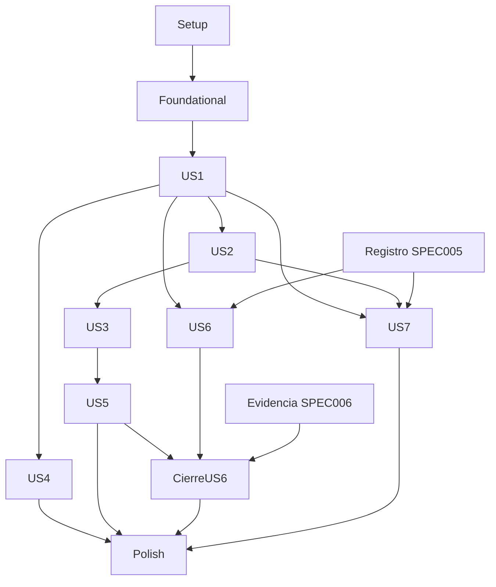

# Tasks: SPEC007 — Administración C3–C4

**Input**: `specs/007-administracion-c3-c4/` — spec, plan, investigación, modelo, seis contratos y quickstart.
**Prerequisites**: diseño validado en `evidencias/validacion-plan.md`, constitución vigente y continuidad 001–006. Rama real `develop`; feature `007-administracion-c3-c4`.
**Tests**: incluidos por solicitud explícita de `spec.md` (Assumptions / Verificación completa), plan y constitución X. Escribir pruebas específicas antes del comportamiento y comprobar fallos atribuibles al requisito; no exigir fallar por imports inexistentes ni suites vacías.
**Organization**: siete historias; P2 ordena entrega, todos los 62 requisitos son obligatorios. Los paths nuevos son archivos a crear, los existentes se amplían. No ejecutar producción al generar tareas.

## Format: `[ID] [P?] [Story] Description`

Todas las tareas parten pendientes. `[P]` permite concurrencia solo dentro del grupo de pruebas o del grupo de implementación de su fase, tras prerrequisitos; no autoriza empezar antes de sus dependencias. Paths relativos a raíz. IDs T pertenecen a007; no confundir con IDs iguales de001–006.

## Path Conventions

Backend `backend/src/`, migraciones `backend/migrations/`, tests `backend/test/`; frontend `frontend/app/admin/`, componentes `frontend/admin/`, tests `frontend/test/admin/`; scraper `web_scraper/`. Evidencias privadas saneadas bajo esta feature; conservar hashes/resultados seguros, nunca secretos/copias prohibidas.

## Phase 1: Setup — continuidad y herramientas

**Purpose / Goal**: Preparar el incremento sobre el repositorio existente, conservando cambios locales y pendientes previos.

### Implementation

- [X] T001 Registrar rama, feature, versiones, scripts, migraciones y pendientes 001–006 en specs/007-administracion-c3-c4/evidencias/baseline-implementacion.md; cotejar continuidad.md contra estado actual, conservar marcas previas y clasificar diferencias con REAL antes de corregir.
- [X] T002 Añadir Busboy 1.6.0 y ExcelJS 4.4.0 fijados y tipos compatibles en backend/package.json y backend/package-lock.json; ejecutar instalación/auditoría, justificar patch compatible si necesario y conservar SheetJS de matriz 001.
- [X] T003 Implementar comandos admin:migrate, admin:recover, test:admin, test:admin-integration y eval:admin-performance en backend/package.json; apuntar a scripts y suites descritos en quickstart.md, nunca permitir suites vacías.
- [X] T004 [P] Configurar test:admin y test:admin:e2e en frontend/package.json, frontend/vitest.config.ts y frontend/playwright.admin.config.ts con API createApp real aislada; conservar host/CSP/configuración del widget.
- [X] T005 [P] Crear fixtures sintéticos y lifecycle de PostgreSQL/Qdrant/archivos/cuentas en backend/test/admin-integracion/support.ts y backend/test/fixtures/admin/manifest.json; sin datos personales reales, AWS productivo ni escritura accidental de C6.

**Checkpoint**: Completar verificaciones de esta fase antes de avanzar según dependencias.

---

## Phase 2: Foundational — infraestructura compartida

**Purpose / Goal**: Cerrar contratos comunes, migración y control mínimo antes de habilitar historias.

Esta fase bloquea todas las historias. Esquemas específicos se completan en su historia; no duplicar servicios previos. Preparar todos los SQL de una historia antes de aplicarlos en su prueba integrada. US1 usa admin001, US2 KB005, US3 KB006, US4 admin002, US5 admin003/KB007, US6 admin004/chat009 y US7 chat010. Si otra rama ocupa números, usar siguientes libres y registrar dependencias; nunca modificar un archivo aplicado. El runner aplica primero los esquemas base existentes, luego sucesores por prerequisitos, y puede detenerse en el incremento a verificar.

### Implementation

- [X] T006 Implementar DTO/validadores compartidos y errores seguros en backend/src/admin/contracts.ts y backend/src/admin/validation.ts: UUID servidor, revisión decimal string, fechas Bogotá/UTC, enums allowlist, JSON sin claves duplicadas/desconocidas, SQL parametrizado; copiar restricciones del modelo sin coerciones.
- [X] T007 Ampliar backend/src/chat/migrate.ts y backend/scripts/migrate-chat-admin.ts y crear backend/src/admin/migrate.ts y backend/scripts/migrate-admin.ts: ledger admin idempotente, orden KB→admin→chat y grants mínimos; reservar 005_administracion_documental.sql, admin/001_management.sql y chat/009_admin_integration.sql o siguiente libre, sin modificar migraciones aplicadas.
- [X] T008 Centralizar guard de sesión/perfil/cambio obligatorio, CSRF/Origin y no-store en backend/src/admin/sessions.ts y backend/src/app.ts; DB caída→503 sin overlay; ampliar métodos/X-CSRF-Token únicamente del origen permitido; conservar JSON admin 64 KiB y ciudadano 128 KiB.
- [X] T009 Ampliar escritura segura transaccional y registro de rechazos tras rollback en backend/src/admin/audit.ts; actor cuenta o rol real, acción/objeto/fecha/resultado, append-only sin documento/PHC/contraseña y sin confirmar mutación no auditada.
- [X] T010 Definir emisión idempotente de avisos de carga/sistema y owner verificado en backend/src/admin/notificationEvents.ts y backend/src/kb/notifications.ts, integrable con tablas actuales; no envíos externos ni propietario inventado para legacy.
- [X] T011 Crear frontend/admin/AdminShell.tsx, frontend/admin/adminClient.ts, frontend/admin/contracts.ts y adaptar frontend/app/admin/layout.tsx: guard sin flash, navegación por perfil, errors/no-store/CSRF, contadores autorizados y detalle sin IDs/textos en URL.
- [X] T012 [P] Crear tablas/formularios/diálogos accesibles en frontend/admin/AdminTable.tsx, frontend/admin/AdminForm.tsx y frontend/admin/AdminDialog.tsx; encabezados, foco, aria-describedby y cancelación sin mutación, reutilizando identidad 004.
- [X] T013 Probar segunda migración, grants, SQL injection, entradas desconocidas, autorización/CSRF y rollback auditado en backend/test/admin-integracion/foundation.test.ts; validar guard y shell en frontend/test/admin/shell.test.tsx antes de habilitar historias.

**Checkpoint**: Completar verificaciones de esta fase antes de avanzar según dependencias.

---

## Phase 3: US1 — administrar acceso y recuperar cuentas (P1)

**Purpose / Goal**: Administración segura de dos perfiles, contraseñas y recuperación reservada.

**Independent Test**: Recorridos AD05..13 y RNF01..06 con dos perfiles, reloj y concurrencia: correo único, último técnico, revocación, cambio obligatorio, bloqueos 5/20, sesión 29/31 y recuperación auditada. Producción Geotrends/Municipio se verifica aparte.

### Tests

- [X] T014 [P] [US1] Escribir contratos y pruebas AD05..13 en backend/test/admin-integracion/accounts.test.ts: altas válidas/inválidas, nombre repetible, correo único, perfil, desactivar/reactivar, temporales y último técnico concurrente; recovery éxito/error/denegado con tres cuentas y exactamente dos parámetros.
- [X] T015 [P] [US1] Escribir pruebas RNF01..06 en backend/test/admin-integracion/security.test.ts: secretos ausentes, PHC distintos, Unicode 11/12, 5 fallos/14–16min, 20 fallos/429/Retry-After, resets por éxito, IP falsificada, persistencia/concurrencia, sesión 29/31 y solicitudes cada 20 min durante 90 min.
- [X] T016 [P] [US1] Escribir recorrido de URL directa, temporal, navegación y timers humanos/polling en frontend/test/admin/accounts.spec.ts; cambio obligatorio no consulta datos protegidos y DB caída no muestra caché de permisos.

### Implementation

- [X] T017 [US1] Ampliar backend/migrations/admin/001_management.sql con revisión de cuenta y LoginIpGuard, preservar trigger de último técnico y auditoría/avisos existentes; HMAC sin IP clara, secreto estable fuera del runtime público y índices/limpieza de ventana.
- [X] T018 [US1] Implementar CRUD permitido en backend/src/admin/accounts.ts: crear, cambiar perfil/actividad y asignar temporal a otra cuenta, CAS/transacción, revocación atómica, historia intacta y mínimo un técnico activo aun concurrente.
- [X] T019 [US1] Corregir backend/src/admin/auth.ts, backend/src/admin/passwords.ts y backend/src/admin/sessions.ts: locks IP→cuenta, aviso de bloqueo, argon2id 65536 KiB/3/1, sal única, cambio distinto de temporal, solo sesión propia conservada al cambiar contraseña y revocación externa efectiva.
- [X] T020 [US1] Crear procedimiento y helper de auditoría restringidos en backend/migrations/admin/001_management.sql: CALL admin.recover_password(email, temporary_phc), SECURITY DEFINER owner NOLOGIN/search_path fijo, PUBLIC/runtime sin EXECUTE, inexistente termina con error, sin activar ni cambiar perfil/otras cuentas.
- [X] T021 [US1] Implementar backend/scripts/recover-admin.ts y limitar backend/src/admin/bootstrapCli.ts a instalación inicial vacía: entrada stdin/TTY, sin secretos en argv/env/logs, CALL parametrizado, una auditoría de éxito o tras rollback una de error con rol real, credencial solo runner reservado.
- [X] T022 [US1] Crear backend/src/routes/adminAccounts.ts y adaptar backend/src/routes/adminAuth.ts: GET/POST accounts, PATCH cuenta, POST temporary-password y contratos session/password; registrar en backend/src/app.ts con permisos y revisión antes de commit.
- [X] T023 [US1] Implementar frontend/admin/sessionActivity.ts y adaptar frontend/shared/adminSession.ts: suspender polling tras 60 s sin interacción humana/oculto/cambio obligatorio, cerrar y revocar best effort tras 30 min humanos; no header ficticio ni renovación automática infinita.
- [X] T024 [US1] Implementar frontend/app/admin/accounts/page.tsx y adaptar frontend/app/admin/login/page.tsx y frontend/app/admin/password/page.tsx con campos/errores/confirmaciones, contraseña no persistida y permisos reales.
- [X] T025 [US1] Ejecutar suites US1 y conservar resultados saneados en specs/007-administracion-c3-c4/evidencias/accounts/ y evidencias/security/; demostrar invariantes concurrentes y recuperación en entorno aislado, separar producción pendiente.

**Checkpoint**: Validar US1 con su criterio independiente y registrar diferencias; sin aceptación de producción por fixtures.

---

## Phase 4: US2 — documentos y actualización consistente (P1)

**Purpose / Goal**: Carga pendiente, matriz, publicación/reemplazo/rechazo/retiro, metadata/vencimiento y reindexación sin evidencia prematura.

**Independent Test**: Muestras AD01..04/20..27/32/38/39/47: cinco consultas por dato único, dos intentos, anterior íntegro durante preparación/falla, cero copias antiguas al terminar, Bogotá y metadata próxima consulta; reindexación cada 30 s sin errores.

### Tests

- [X] T026 [P] [US2] Escribir backend/test/admin-integracion/documents.test.ts con todas las muestras y verificaciones originales de contracts/acceptance.md para AD01..04/20..27/32/38/39/47; incluir formatos, campos faltantes, permisos, candidato/vigente, cancelación, hash/origen y validez.
- [X] T027 [P] [US2] Escribir backend/test/admin-integracion/publication.test.ts: fallos/reinicios en cada fase, commit/alias/limpieza, exactamente un reintento, locks lector/limpieza, idempotencia, concurrencia, ausencia SQL/Qdrant/archivos/caches y lectores reales durante reindex.
- [X] T028 [P] [US2] Escribir frontend/test/admin/documents.spec.ts con carga ambos perfiles, matriz completa/filtro propio, N/A/ninguno, retiro cancelado/motivo, progreso 202 y acciones técnicas denegadas por URL/servicio.

### Implementation

- [X] T029 [US2] Crear backend/migrations/005_administracion_documental.sql con metadata candidata/vigente, autor/origen, manifest/operaciones/limpieza/removals/identidad segura y referencias sin retención de texto; permitir N/A/procedimiento vacío solo manual y conservar CHECK extracción/corpus 001.
- [X] T030 [US2] Implementar backend/src/kb/publicationManifest.ts y bootstrap contrastado contra matriz/calibración/colección real bajo pausa de escritores, sin cortar chat; reader SELECT colección concreta, revisión/manifest autoritativos y alias como espejo.
- [X] T031 [US2] Implementar streaming en backend/src/admin/documents.ts: auth/CSRF/Origin y metadata primero, Busboy un archivo PDF/DOCX/XLSX real; límites32MiB/32KiB/100ZIP/256MiB/ratio100 configurables, staging privado/limpieza desconexión, cero archivos/filas al rechazar, sin fetch de URL.
- [X] T032 [US2] Adaptar backend/src/kb/sync.ts y backend/src/services/documentPreprocessor.ts: mismo pipeline local 001 para manual/scraper, autor/fecha/origen/hash, OCR≤80%/formatos diligenciados no publicables y candidata no sobreescribe vigente.
- [X] T033 [US2] Implementar backend/src/kb/documentOperations.ts y adaptar backend/src/kb/worker.ts: reserva escritor único, revisión/idempotencia ligada a actor+ruta+hash, fases durables, exactamente dos intentos máximo y limpieza parcial confirmada antes del segundo.
- [X] T034 [US2] Adaptar backend/src/kb/indexer.ts y backend/src/kb/service.ts para colección candidata completa, verificación antes de prepared y commit SQL único de generación/versiones/metadata; adaptar backend/src/kb/cli.ts para que CLI y panel pasen por mismo protocolo, nunca payload publicado anticipadamente.
- [X] T035 [US2] Implementar reconciliación y recibos de limpieza en backend/src/kb/removals.ts, backend/src/kb/retention.ts y backend/src/services/qdrant.ts; inventariar todas las copias gestionadas, alias/cleanup reanudables, lock exclusivo y nunca borrar activa tras commit ni afirmar Terminada antes de ausencia.
- [X] T036 [US2] Adaptar backend/src/services/search.ts, backend/src/services/documentLinks.ts, backend/src/services/selection.ts, backend/src/services/calibration.ts, backend/src/kb/calibration.ts y backend/src/chat/sources.ts al manifest/metadata vigente antes de prioridad/citas; lock compartido vectorial, revalidación antes de LLM/entrega y una búsqueda extra dentro 40 s/45 s o indisponibilidad segura.
- [X] T037 [US2] Implementar rechazo/retiro confirmado en backend/src/kb/removals.ts: exclusión inmediata, motivo, siete datos seguros, sin contenido/vectores; rechazo de nueva versión conserva anterior, tombstones URL+origen+hash y referencias históricas no fuerzan conservar texto.
- [X] T038 [US2] Implementar edición autorizada en backend/src/admin/documents.ts y scheduler backend/src/kb/expiry.ts: campos allowlist sin código, hash intacto, candidata separada, vencimiento Bogotá aun worker retrasado, aviso único y futura fecha rehabilita solo vencido válido.
- [X] T039 [US2] Crear backend/src/routes/adminDocuments.ts: GET/POST documents, publish/reject/withdraw, PATCH metadata, POST reindexations, GET document-operations; técnico muta/consulta jobs, ambos matriz, 201 pendiente/202 en curso, Idempotency-Key distinto cuerpo409.
- [X] T040 [US2] Implementar frontend/app/admin/documents/page.tsx y componentes frontend/admin/DocumentEditor.tsx y frontend/admin/DocumentOperation.tsx: campos/source/N/A, doce columnas más metadata administrativa, filtros/paginación, confirmaciones y operación durable sin falso éxito.
- [X] T041 [US2] Ejecutar suites US2/regresiones KB/DI con consultas cada 30 s durante publicación/reindex y guardar specs/007-administracion-c3-c4/evidencias/documents/; acreditar viejo dato ausente en todas las superficies tras éxito, anterior íntegro al fallar y metas001 preservadas.

**Checkpoint**: Validar US2 con su criterio independiente y registrar diferencias; sin aceptación de producción por fixtures.

---

## Phase 5: US3 — enlaces y propuestas (P1)

**Purpose / Goal**: Administrar fuentes dentro de hosts/corpus aprobados con propuestas privadas y efecto siguiente corrida.

**Independent Test**: Dos Gestores, ocho propuestas, seis decisiones, ocho cambios y catorce hosts; retirar enlace conserva publicados, omite verificaciones, marca/avisa y hash nuevo vuelve pendiente.

### Tests

- [X] T042 [P] [US3] Escribir backend/test/admin-integracion/links.test.ts con AD14..19/33/34: muestras literales, propiedad, revisión/decisión, 14 hosts y redirects, quitado con/sin documentos, marca y tombstones; snapshot siguiente corrida.
- [X] T043 [P] [US3] Escribir frontend/test/admin/links.spec.ts con propuestas propias, motivos, retirada solo pendiente, acceso directo ajeno y cambios de enlaces solo técnico.

### Implementation

- [X] T044 [US3] Ampliar backend/migrations/006_admin_sources.sql con scraper_link/link_proposal, UNIQUE HTTPS, revision/list_version y estados/decisión; marca solo scraper, sin tabla editable de hosts y sin texto en tombstones.
- [X] T045 [US3] Implementar backend/src/kb/managedLinks.ts y backend/src/admin/links.ts: proposal pendiente no cambia lista, aprobar/decidir/link/audit atómicos, rechazo con motivo y retiro propio pendiente; validar HTTPS, hosts exactos/boundary y corpus aparte.
- [X] T046 [US3] Implementar snapshot version/hash/configHash atómico del worker en backend/src/kb/managedLinks.ts; adaptar web_scraper/scraper/sources.py, web_scraper/scraper/crawler.py y web_scraper/scraper/metadata_store.py para omitir todas las verificaciones de enlaces quitados sin borrar publicados ni dar credenciales de escritor a Python.
- [X] T047 [US3] Integrar en backend/src/kb/managedLinks.ts y backend/src/kb/removals.ts la marca Sin actualización automática/aviso cinco datos solo si afectados publicados; quitar marca al reagregar/retirar/reemplazar, manual false y omisión URL+hash de rechazo/retiro.
- [X] T048 [US3] Crear backend/src/routes/adminLinks.ts con link-proposals y scraper-links según contracts/documents-sources.md, revisiones de entidad/lista, permisos/propiedad y paginación; registrar en backend/src/app.ts.
- [X] T049 [US3] Crear frontend/app/admin/proposals/page.tsx y frontend/app/admin/links/page.tsx con estados/motivos, retiro pendiente propio y aprobación/cambios técnicos; incorporar marca documental a frontend/app/admin/documents/page.tsx.
- [X] T050 [US3] Añadir snapshot/retirados/hash nuevo/redirects a web_scraper/tests/test_sources_scope.py y web_scraper/tests/test_sources_admin.py; ejecutar scraper y suites US3, guardar specs/007-administracion-c3-c4/evidencias/links/.

**Checkpoint**: Validar US3 con su criterio independiente y registrar diferencias; sin aceptación de producción por fixtures.

---

## Phase 6: US4 — contactos oficiales (P1)

**Purpose / Goal**: Completar editor existente y propagación inmediata a orientación/emergencia sin redespliegue.

**Independent Test**: Ocho/siete/diez acciones de recepción/general/inmediatos; siguiente respuesta usa nuevos valores/orden, 120 admite/121 rechaza, nunca falta canal obligatorio ni último inmediato.

### Tests

- [X] T051 [P] [US4] Escribir backend/test/admin-integracion/contacts.test.ts con AD35..37 y sus muestras, CAS/gestor/último canal/formatos/descripción vacía y 120/121; leer salidas DI19/20/24 e IN10 tras guardar sin redespliegue.
- [X] T052 [P] [US4] Escribir frontend/test/admin/contacts.spec.ts con errores por campo, reorden/baja, tres grupos obligatorios y permisos de URL/servicio.

### Implementation

- [X] T053 [US4] Completar backend/src/admin/contacts.ts y migración backend/migrations/admin/002_contacts.sql: validación literal de modelo, revisión global CAS, cambios/orden/auditoría atómicos y último inmediato protegido concurrentemente, preservar tablas/DTO existentes.
- [X] T054 [US4] Adaptar backend/src/routes/adminContacts.ts conservando GET contacts, PUT reception/general, POST immediate, PUT order/immediate/:id, DELETE immediate/:id y cuerpo revision actual; Gestor denegado.
- [X] T055 [US4] Completar frontend/app/admin/contacts/page.tsx con descripción obligatoria/120 puntos de código y controles accesibles de edición/reorden/baja sin permitir quitar canales obligatorios.
- [X] T056 [US4] Comprobar y corregir lectores existentes backend/src/services/answerQuestion.ts y backend/src/routes/chatConfig.ts para usar snapshot actual de contactos sin TTL obsoleto/inferencia; preservar emergencia/riesgo y plazos C3≤2s/C4≤5s.
- [X] T057 [US4] Ejecutar suites US4 y regresiones003/004/005; conservar muestras de siguiente respuesta/registro sin textos reales ni secretos en specs/007-administracion-c3-c4/evidencias/contacts/.

**Checkpoint**: Validar US4 con su criterio independiente y registrar diferencias; sin aceptación de producción por fixtures.

---

## Phase 7: US5 — operación, avisos y auditoría (P1)

**Purpose / Goal**: Consolidar visibilidad operativa por dueño, bandeja, contadores, estado y auditoría.

**Independent Test**: Ocho avisos, agrupación4, revisión8→7, GestoresA/B, cinco pendientes, trece auditorías y cinco fallos visibles<60s; estado durable y contadores tres pantallas.

### Tests

- [X] T058 [P] [US5] Escribir backend/test/admin-integracion/operations.test.ts con AD28..31/40/41/47/48: unión/autorización/count, agrupación/namespace/CAS, pendientes/días, auditoría filtros y persistencia/reinicio/cinco fallos; recovery éxito/error sin PHC.
- [X] T059 [P] [US5] Escribir frontend/test/admin/operations.spec.ts para avisos propios/sistema, revisión, contadores tres pantallas, bandeja/auditoría/estado técnicos, progreso reindex y polling suspendido.

### Implementation

- [X] T060 [US5] Ampliar backend/migrations/admin/003_operations.sql y backend/migrations/007_admin_notifications.sql con scope/owner/revision, agrupación No revisada y estados durables; índices/append-only y actores legacy identificables, owner desconocido solo técnico.
- [X] T061 [US5] Completar backend/src/admin/operations.ts y backend/src/kb/notifications.ts con unión SQL autorizada/paginada, IDs namespace y revisión CAS, grouping tipo/objeto/scope/owner, nuevo aviso tras revisado, conteo filas sin sumar repeticiones y cero envíos externos.
- [X] T062 [US5] Implementar bandeja/contador documentos+propuestas y auditoría KB/admin en backend/src/admin/pending.ts y backend/src/admin/audit.ts: antigüedad Bogotá, orden fecha/id, filtros usuario/acción/rango, sin payloads; count solo tras commit efectivo.
- [X] T063 [US5] Ampliar backend/src/admin/serviceEvents.ts y backend/src/admin/operations.ts: hidratar estados de modelos/reranker/registro/scraper al reiniciar, fallo seguro <60 s, umbral/última corrida y no comprobado sin inventar normal; DB no autenticable →503 sin datos.
- [X] T064 [US5] Adaptar backend/src/routes/adminOperations.ts y backend/src/app.ts con notifications/review/counters/pending/audit/status; parser namespace, permiso idéntico count/detalle/revisión y no rutas de edición/borrado audit.
- [X] T065 [US5] Completar frontend/app/admin/notifications/page.tsx y frontend/app/admin/status/page.tsx; crear frontend/app/admin/pending/page.tsx y frontend/app/admin/audit/page.tsx; contadores autorizados comunes y reindex estado/inicio/fin desde servicio US2.
- [X] T066 [US5] Ejecutar suites US5 integradas con US1/US2/US3, inducir cinco degradaciones con lectura autorizada y guardar specs/007-administracion-c3-c4/evidencias/operations/; verificar cero secretos y sin canales externos.

**Checkpoint**: Validar US5 con su criterio independiente y registrar diferencias; sin aceptación de producción por fixtures.

---

## Phase 8: US6 — interacciones, exportación y mejoras (P1)

**Purpose / Goal**: Consulta de registros autorizados y casos únicos con evidencia 006, sin duplicar textos ni revivir depurados.

**Independent Test**: 30 interacciones→20 autorizadas y export12 nueve columnas; ocho orígenes→cinco casos, tres ciclos válidos/seis rechazos, seis casos con contador 4→3, anonimato/purga conservados.

### Tests

- [X] T067 [P] [US6] Escribir backend/test/admin-integracion/interactions.test.ts con AD-C4-01/02: 30/20/12, filtros/enmascaramiento/nueve columnas, sinIDs ni anónimos, XLSX string=+-@/sin fórmula, cancel/revocar/purga/cruce12meses y cleanup/reinicio.
- [X] T068 [P] [US6] Escribir backend/test/admin-integracion/improvements.test.ts con AD-C4-03..05: ocho→cinco/dualorigen/concurrencia/backfill, anonimato cero, seis estados/tres casos/seis rechazos, REAL/nota/evidencia 006, retención por JOIN y contador/filtros.
- [X] T069 [P] [US6] Escribir frontend/test/admin/interactions.spec.ts y frontend/test/admin/improvements.spec.ts con filtros/export/depurada, permisos de servicios, transición/evidencia/cierre y ausencia de texto/IDs en URL/storage.

### Implementation

- [X] T070 [US6] Crear casos/transiciones e índices en backend/migrations/admin/004_improvements.sql y hooks/backfill autorizados en backend/migrations/chat/009_admin_integration.sql: FK UNIQUErow_id/UPSERT conjunto de orígenes, ninguna copia de pregunta ni hook anonymous_usage, actor/fecha/revisión, índices eficientes y DML local sin red/LLM.
- [X] T071 [US6] Implementar backend/src/admin/interactions.ts: únicamente chat.interaction+valoración1a1, filtros/orden/cursor SQL, nueve campos enmascarados, CASE purged_at o edad≥12 meses calendario→null/depurada aunque purga retrasada; no fuente CSVlegacy90d.
- [X] T072 [US6] Implementar backend/src/admin/export.ts con ExcelJS streaming/cursor REPEATABLE READ, staging privado efímero, nueve columnas/mismo filtro sin paginación/IDs, strings explícitos sin formulas/hyperlinks, workbook completo/edad revalidada antes headers, sesión revocada cancela y cleanup todos desenlaces/TTL≤24 h.
- [X] T073 [US6] Implementar backend/src/admin/improvements.ts con list/detail JOIN sin texto copiado, transiciones CAS estrictas y auditoría; notas saneadas, REAL antes de ajuste, evidencia posterior para validación/cierre, filtros/días/count noCerrados y hallazgo006 distinto.
- [X] T074 [US6] Crear backend/src/admin/validationEvidence.ts: comprobar refs006 autorizadas por hash/run/release/vigencia posterior, sin paths arbitrarios ni actas automáticas; leer arnés006 cuando disponible y rechazar refs inválidas sin bloquear tooling independiente.
- [X] T075 [US6] Crear backend/src/routes/adminData.ts con interactions/export e improvements/detail/transitions solo técnico, filtros parametrizados y no-store; registrar en backend/src/app.ts sin endpoints de edición/borrado de interacciones.
- [X] T076 [US6] Implementar frontend/app/admin/interactions/page.tsx y frontend/app/admin/improvements/page.tsx con nueve columnas/paginación/filtros/descarga, estados/REAL/orígenes/días/historia y texto depurada, confirmaciones accesibles sin persistencia local de preguntas.
- [X] T077 [US6] Ejecutar suites US6, medir impacto de triggers/exports en registro y purga 005; probar lector real de evidencia 006 disponible y conservar specs/007-administracion-c3-c4/evidencias/interactions/ y evidencias/improvements/ sin texto personal ni copia que eluda retención.

**Checkpoint**: Validar US6 con su criterio independiente y registrar diferencias; sin aceptación de producción por fixtures.

---

## Phase 9: US7 — tarifas y cuatro tableros (P2)

**Purpose / Goal**: Cifras agregadas y precios posteriores al guardado manteniendo costos previos. P2 sigue obligatorio.

**Independent Test**: 40 consultas (25+15), ranking20respuestas/12docs/top10, utilidad10/5+5/cinco motivos y consumo20/10por modelo; cuatro precios válidos/tres inválidos más quinto decimal y cero textos/IDs en cuatro DTO.

### Tests

- [X] T078 [P] [US7] Escribir backend/test/admin-integracion/statistics.test.ts con AD42..46/RNF07: muestras40/20/10/20, tarifas exactas/invuelo/CAS/concurrencia y sentinelas sin texto/IDs; costo NULL no es cero / none, sin valoraciones, cero, Bogotá 30 días y joins sin multiplicación.
- [X] T079 [P] [US7] Escribir frontend/test/admin/statistics.spec.ts con cuatro tableros/tablas equivalentes/rango/coverage/costo parcial, ediciónUSD cuatro decimales y Gestor denegado por URL/servicio.

### Implementation

- [X] T080 [US7] Ampliar backend/migrations/chat/010_admin_statistics.sql con grants/funciones CAS de tarifa e índices de agregados; mantener numeric(20,10)/historia/GIST sin alterar precios históricos ni crear registros anónimos nuevos.
- [X] T081 [US7] Implementar backend/src/admin/tariffs.ts sobre chat.tariff: dos modelos/región, USD, strings >0≤4decimales/sin exponente, source_url vigente, lock por modelo/región/periodos sin solapamiento/intervalo vacío →409; received_at/decimal.js 12 y costo previo inmutable.
- [X] T082 [US7] Implementar backend/src/admin/statistics.ts con cuatro SQL agregados allowlist: total/diario/consumo ambas tablas, categorías/tipos/citas/ratings solo autorizadas; ranking dedupdoc/respuesta top10/citasdesc/nombreasc usando identidad histórica segura, unknownCostCount/none y porcentajes0 sin ratings.
- [X] T083 [US7] Ampliar backend/src/routes/adminData.ts con GET metrics/usage, documents, ratings, consumption y GET/PUT tariffs/:model; fechas from/to ambos o ninguno, 30 días Bogotá→UTC, técnico/no-store y errores no simulan cero.
- [X] T084 [US7] Crear frontend/app/admin/metrics/usage/page.tsx, frontend/app/admin/metrics/documents/page.tsx, frontend/app/admin/metrics/ratings/page.tsx, frontend/app/admin/metrics/consumption/page.tsx y frontend/app/admin/tariffs/page.tsx: rango común/tablas equivalentes/cobertura/NULL, USD por 1M y errores de campo.
- [X] T085 [US7] Ejecutar suites US7 y comparar SQL/cálculo decimal independiente con fixtures; conservar specs/007-administracion-c3-c4/evidencias/statistics/ con ausencia de sentinelas y costos históricos intactos.

**Checkpoint**: Validar US7 con su criterio independiente y registrar diferencias; sin aceptación de producción por fixtures.

---

## Phase 10: Polish — integración, rendimiento y entrega

**Purpose / Goal**: Cerrar todos los requisitos con regresión y evidencia real, sin usar marcas como aceptación.

### Implementation

- [X] T086 Ampliar .github/workflows/ci.yml con suites admin backend/frontend, tipos/integración/Playwright/axe/auditoría sin altas y build imágenes nativas; conservar gates001–006 y no passWithNoTests.
- [X] T087 [P] Crear backend/scripts/eval-admin-performance.ts y frontend/test/admin/performance.spec.ts: manifest autorizado, dataset C6 sintético 1000/100000/10000, ocho pantallas×20×2 días, navegación→datos útiles, errores/muestras/p95 nearest-rank 19/20 por pantalla/día; no siembra implícita producción.
- [X] T088 [P] Crear frontend/test/admin/accessibility.spec.ts con axe tags WCAG2A/2AA en todas las 18 rutas/estados aplicables, teclado/foco/modales/errores y contraste/zoom básicos, cero A/AA; no presentar automatización como revisión completa.
- [X] T089 [P] Actualizar docs/arquitectura-sistema.md y specs/007-administracion-c3-c4/quickstart.md con migración/roles/recuperación/cleanup/rollback limitado, config límites, operación/permisos, contactos, export/retención y entrega H6-C3/H5-C4; sin nuevas actas ni credenciales.
- [X] T090 Ejecutar tipos/suites completas/backend test:all/frontend UI/e2e/auditorías/buildDocker y scraper según quickstart.md; registrar resultados/fallos REAL en specs/007-administracion-c3-c4/evidencias/regresion/ y no cerrar pendientes anteriores por referencia.
- [ ] T091 Registrar AdjustmentEvent y repetir matrices congeladas C3 integrada/ambos modelos tras base/recuperación y C4 completa tras C3/C4 con arnés006, renovar evidencias invalidadas en specs/007-administracion-c3-c4/evidencias/validacion-006/; prerequisito operativo006 debe estar implementado, no simular aceptación.
- [ ] T092 Ejecutar con acceso real autorizado AD12/13 Geotrends/Municipio: asignación/desactivación permitida y recovery tres cuentas/rol reservado/runtime denegado, auditoría éxito/error y ausencia secretos; guardar specs/007-administracion-c3-c4/evidencias/accounts/produccion.md. Si falta acceso queda pendiente.
- [ ] T093 Ejecutar RNF08 en C6 autorizado: volúmenes exactos y320 muestras en dos fechas Bogotá, cada p95≤3s y cero errores; conservar release/entorno/browser/conteos/revisor/hashes en specs/007-administracion-c3-c4/evidencias/performance/. Si faltan fechas/acceso no marcar.
- [ ] T094 Completar RNF09 manual 100 % aplicables con teclado/lector identificado, zoom 200 % y contraste 4.5:1 normal/3:1 grande/controles en todas pantallas/estados; guardar revisión/versiones/revisor en specs/007-administracion-c3-c4/evidencias/accessibility/manual.md, sin reemplazar por axe.
- [ ] T095 Cotejar los 62 criterios originales/cantidades y SC001–014 contra evidencia vigente/release y gates006 en specs/007-administracion-c3-c4/evidencias/recepcion-administracion.md; entregar H6-C3/H5-C4 solo con cobertura total, dependencias externas resueltas y sin firmas/actas inventadas.

**Checkpoint**: Completar verificaciones de esta fase antes de avanzar según dependencias.

---

## Restricciones literales del modelo por tarea

Estas citas son parte vinculante de la descripción de la tarea indicada; preservan todos los campos, máximos, nulabilidad, enums, validaciones y relaciones de `data-model.md`. El servicio/DTO/UI asociado de cada historia aplica las mismas reglas. No elegir restricciones diferentes durante implementación.

### T006 — Tipos comunes

> - `id`: UUID emitido por servidor, salvo `row_id` bigint interno ya existente. No nuevos identificadores ciudadanos; ni row_id ni IDs de conversación/respuesta en tableros o exportaciones.
> - `revision`: bigint positivo, representado como string decimal en JSON. `expectedRevision` obligatorio al modificar una entidad existente; revisión obsoleta produce409 sin cambios.
> - Tiempos técnicos: timestamptz UTC, ISO8601 con zona en JSON. Fechas civiles: YYYY-MM-DD válida, zona America/Bogota (denominada America/Bogotá en la fuente).
> - Texto obligatorio: no vacío ni solo espacios. Recortar metadata, nunca contraseñas. Correo de cuenta trim/lowercase y único; nombre no es único.
> - Dirección: catálogo institucional existente. Ecosistemas/Bienestar Animal/Gestión Ambiental y Secretaría (general) únicamente en contenido general autorizado por el catálogo; no texto arbitrario.
> - URL pública: HTTPS con host válido, sin credenciales/caracteres de control. No descarga remota desde carga manual. Scraper añade política de hosts y corpus.
> - Precios: string decimal base10 positivo, máximo cuatro decimales, sin exponentes y con cabida en numeric(20,10) existente. Costo numeric(24,12); NULL no es cero.
> - Entrada JSON: rechazar claves desconocidas/duplicadas, enums inválidos y coerciones indebidas. SQL parametrizado; ordenación por lista permitida. Texto administrativo no ejecuta HTML, comandos o SQL.

### T017 — Cuenta, sesión y LoginIpGuard — US1

> Reutilizar `admin.account`: id, display_name no vacío, email normalizado UNIQUE, profile exacto `administrador técnico|Gestor documental`, active, password_phc, must_change_password, failed_attempts, locked_until, created_at/updated_at. Añadir revision≥1. PHC argon2id con sal única por cuenta; nunca DTO/auditoría/notificación. Contraseña≥12 puntos de código, sin composición y sin trim. Temporal/nueva cuenta obliga cambio a una contraseña distinta antes de cualquier función distinta de password/session/logout.
> 
> Sesión existente: hashes de token/CSRF, account_id, created_at, last_request_at y revoked_at. No token claro en DB. Cookie actual HttpOnly/Secure/SameSite; treinta minutos sin solicitudes válidas vence. Desactivación, cambio de perfil, temporal y recuperación revocan todas las sesiones; reactivar no las revive. Cambiar contraseña propia conserva exclusivamente sesión actual según comportamiento vigente. Cuenta desactivada y su historia no se borran.
> 
> Nueva `admin.login_ip_guard`: ip_key hexadecimal64 de HMAC con secreto estable de instalación reservado, failures timestamptz[] dentro de ventana quince minutos, blocked_until nullable, updated_at. Sin IP clara, correo ni texto ciudadano; no vínculo con anonymous_usage. Veinte fallos→bloqueo quince minutos, éxito reinicia conteo pertinente; limpieza de filas sin ventana/bloqueo activo. Locks en orden IP→cuenta hacen atómicos contadores, sin pérdida ante concurrencia/reinicio. Cuenta: cinco fallos consecutivos→quince minutos y notificación de sistema. Respuestas401 uniformes; IP429/Retry-After antes de verificar credenciales.
> 
> Invariante DB y aplicación: siempre≥1 administrador activo; conservar trigger existente y comprobar desactivación/cambio de perfil concurrentes. Bootstrap solo instalación inicial vacía. Recuperación con procedimiento de exactamente dos parámetros bajo rol reservado, marca cambio/revoca/audita sin activar una desactivada. RF-C3-AD-05..13; RNF-C3-AD-01..06.

### T029 — Metadata documental, elemento y versión — US2

> Ampliar `kb.kb_elemento` y `kb.kb_version`; no reemplazar la matriz ni conversiones SPEC001. Metadata candidata pertenece a su versión y no cambia metadata vigente hasta publicación. Elemento conserva identidad, referencia publicada y candidata pendiente separadas.
> 
> Campos de versión: id, element_id, origin `manual|scraper`, author_account_id, uploaded_at, original_format, original_file_ref interna privada, content_hash hexadecimal64, converted_content_ref privada, metadata, accessed_at real, ocr_applied/ocr_confidence, processing_status y publication_state. Autor obligatorio en nueva manual; nullable solo en históricos/scraper sin autor humano identificable. No inventar autor de migración.
> 
> Metadata: type,title,direction,publicUrl,associatedProcedure obligatorios. Procedimiento código o `ninguno`; interno procedureCodes=[] para ninguno. code,version,updatedDate,validUntil opcionales/null en manual; presentar N/A sin guardar fechas falsas. CHECK de GMAS/procedimientos se amplía **solo** para origen manual, sin relajar extracción. PDF/DOCX/XLSX mínimos; las salvaguardas de OCR, tablas, formatos en blanco y corpus siguen condicionando publicación. Fecha de acceso real sirve para cita sin fecha de actualización.
> 
> Estados visibles: `Pendiente de aprobación|Publicado|Vencido|Derogado`, proyectados sobre enums existentes; estado técnico de procesamiento separado. Rechazado/retirado desaparece de matriz y solo conserva registro seguro. Una versión publicada por identidad puede coexistir con candidata. Mismo código o URL enlaza identidad; si cada uno señala un documento distinto,409/revisión sin fusión destructiva.
> 
> Metadata editable: título,tipo,dirección,enlace,procedimiento,versión,actualización,validez; código no se edita por AD39. Edición no cambia contenido/hash. Fecha futura de vencido válido restaura publicado, nunca pendiente/derogado. Validez date|null: disponible mientras fecha Bogotá≤validUntil; excluido desde comienzo del día siguiente incluso si el scheduler se retrasa. Evento de vencimiento único por documento/versión/fecha.

### T033 — ActiveGeneration, DocumentOperation y Cleanup — US2/US5

> Nueva `kb.active_generation`: singleton con revision≥1, generation_id, collection_name interna, manifest_hash, committed_at. Manifest relaciona elementos con versión/hash, metadata_revision y calibration_ref. Reader limitado SELECT; nombre de colección no proviene del ciudadano/panel. Migrar generación inicial contrastando publicado real y colección actual.
> 
> Nueva `kb.document_operation`: id, kind `publish|replace|reject|withdraw|reindex|metadata`, actor_account_id, target_element/version nullable solo en reindex, expected_revision, phase, started_at, finished_at, attempts, previous_generation, candidate_collection, manifest_ref, error_code seguro, cleanup_pending, idempotency_key, payload_hash, created_at.
> 
> Fases exactas: `queued|preparing|prepared|committed|reconciling|cleaning|complete|failed`. Estado público En curso hasta complete/failed, luego Terminada/Fallida. finished_at null hasta terminación; attempts0..2 para indexación, exactamente un reintento tras fallo del primero. Índice único parcial para escritor KB activo; otra reindexación mientras activa409. Reinicio retoma diario y verifica realidad, no consume intentos infinitos por el ciclo.
> 
> Preparación construye colección completa separada. Primer fallo limpia/verifica parcial antes de reintentar; segundo mantiene pendiente/publicado anterior y notifica. SQL hace commit único de generación/metadata/versiones; recuperación apunta a colección concreta y alias kb_chunks se reconcilia como espejo. Antes de commit puede fallar sin sustituir anterior; después de commit nunca borra activa ni revierte a contenido ya eliminado. Fallo de limpieza deja En curso/reconciliación con aviso, no Terminada.
> 
> Recibo de limpieza: referencias privadas, identidad/hash, objeto eliminado, tiempo y comprobaciones de ausencia/count0; sin contenido ni rutas públicas. Inventariar SQL, todas las colecciones/archivos/caches/exportaciones administradas que puedan conservar versión anterior. Terminada solo tras borrado confirmado. Journal conserva metadata/hash, nunca copia de texto o rollback de contenido eliminado.
> 
> Rechazo/retirada excluyen vigente antes de consultas nuevas y terminan después de eliminación física. Recuperación valida estado/versión/validez y superpone metadata por request; sin proyección válida, indisponibilidad y nunca ausencia factual. Lock compartido durante lectura vectorial, exclusivo para eliminación física, sin registro/ID de consulta anónima. Revalidación antes de invocar/entregar evita datos obsoletos; una búsqueda adicional dentro presupuesto si cambia generación, después error seguro. Mantener plazos y probar cero errores durante actualización normal.

### T037 — RejectionWithdrawalRecord — US2

> Nueva `kb.document_removal`: id, type `reject|withdraw`, document_identity_metadata segura, source_url, origin, content_hash, reason no vacío, actor_account_id, occurred_at. Fecha/hora se muestran desde timestamp. Solo los datos del registro exigido, sin archivo/texto/vectores. Índice por URLorigen+hash+tipo; scraper omite igualdad y admite nueva huella. Diseñar FKs para no retener contenido solo porque auditoría/citas lo referencian. Identidad documental histórica sin contenido puede permanecer fuera de matriz para atribución de citas.

### T029 — DocumentIdentity — referencias históricas sin contenido

> Proyección o tabla `kb.document_identity` de metadata segura, fuera de la matriz de documentos cargados: id estable, códigos/enlaces equivalentes validados, título/dirección y fecha de metadata. Permite atribuir citas históricas tras retiro sin conservar archivo/texto/vectores. No es otra base ni contenido recuperable. Mapear IDs de citas existentes contra identidades reales durante migración; los no resueltos se señalan como metadata no disponible, nunca se inventa dirección. Toda cita nueva usa identidad estable ya validada. Ranking usa metadata vigente cuando existe, última metadata institucional segura cuando retirado; no puede crear documentos/citas de consultas anónimas. RF-C3-AD-20/22/24/44.

### T044 — Enlace y propuesta — US3

> Nueva `kb.scraper_link`: id,url UNIQUE HTTPS,direction,justification no vacía,active,revision,changed_by/at,list_version. Snapshot interno por corrida `{version,hash,links,createdAt,configHash}` publicado atómicamente por worker para Pythonoffline; nunca código ejecutable ni credenciales de escritor.
> 
> Nueva `kb.link_proposal`: id,owner_account_id,type `add|remove`,url,direction,justification,state,created_at,decided_by/at,rejection_reason,revision. Estados exactos `Pendiente de validación|Aprobada|Rechazada|Retirada`; decisión solo técnico sobre pendiente, rechazo exige motivo, retirada solo pendiente propia. Campos de decisión null antes de ella; decisión/enlace/list_version/auditoría atómicos. Estado final no se cambia por segunda decisión.
> 
> Lista de hosts en configuración desplegada, ninguna tabla editable desde panel. Quitar origen mantiene publicado y marca automatic_update_disabled solo scraper; aviso si hay publicados afectados con enlace/fecha/hora/usuario/documentos. Siguiente corrida no verifica semilla ni documentos del enlace quitado. Marca desaparece al reagregar/retirar/reemplazar, manual siempre false. Alcance cerrado se valida aparte de host permitido.

### T060 — Notification, Counters, Audit y ComponentStatus — US5

> Ampliar admin.notification y kb.kb_notificacion: scope `sistema|carga`, owner_account_id obligatorio en carga/null en sistema, document_identity opcional, type allowlist existente ampliada a eventos aprobados, object_type/id seguros,description saneada,first_at,last_at,repetitions≥1,state `No revisada|Revisada`,reviewed_by/at null hasta revisión, revision≥1.
> 
> Unión SQL autorizada con IDs namespace KB/admin. Única No revisada por tipo/objeto/scope/owner; repetición suma y cambia última ocurrencia, contador cuenta filas. Revisada permanece y evento posterior crea otra. Técnico todas; Gestor solo rechazo/OCR/indexación de sus propias cargas. Nunca correo/webhook/contraseña/texto/PHC/SQL/rutas.
> 
> Counters:{notifications≥0,pending?≥0,openImprovements?≥0}; técnico los tres, Gestor solo avisos propios. Pending UNION documentos/propuestas pendientes, ordenfecha ascendente/id, days≥0 civil Bogotá. Contadores reflejan commit efectivo, no solo202 encolado.
> 
> Auditorías KB/admin existentes append-only en proyección común: actor_account_id **o** actor_db_role real,action,object_type/id,at,result. Preserve actores históricos identificables, sin inventar usuarios ni copiar payloads/documentos/secretos. UPDATE/DELETE revocados; aceptadas auditadas misma tx, rechazos tras rollback en otra tx segura. Procedimiento invocado por wrapper restringido usa actor operativo real, no propietario definer; no parámetros sensibles en loggingDB.
> 
> ComponentStatus persistido: dos modelos/reranker/registro/scraper, status `normal|degradado|no comprobado`,last_success,last_failure,observed_at,thresholdApplied si aplica y última corrida con resultado seguro. Hydrate al reiniciar; falta de evidencia no es normal. Eventos del criterio visibles<60s. DB que impide validar sesión no habilita vista pública ni cache de permisos.

### T053 — Contacts — US4

> Reusar admin.contact_meta/reception/general/immediate, CAS de revisión global. Recepción tres campos obligatorios sin removal; general tres obligatorios; inmediatos≥1. Phone/WhatsApp usan `[0-9 +()-]` y al menos un dígito; correo válido, URLHTTPS. Name/description no vacíos; descripción≤120 puntos de código. Posición entero≥1 única/contigua tras reorden. Valor/revisión/auditoría en tx, lector ciudadano snapshot vigente sin TTL obsoleto ni LLM. Conservar validaciones y salida existente.

### T081 — Tariff y Statistics — US7

> Reusar chat.tariff numeric(20,10) y versiones históricas; no reescribir precios viejos. ModelID exactos20b/120b autorizados y región configurada, currencyUSD. Nueva edición input/outputPerMillion string decimal>0 hasta4 decimales; source_url institucional vigente se conserva. valid_from del servidor al guardar, cierre valid_to anterior y periodo[desde,hasta), CAS con versión vigente. Lock por modelo/región y exclusión GIST existente sin solapamientos; misma marca que cree intervalo vacío se rechaza409.
> 
> Registro sigue calculando con received_at y decimal.js escala12; consulta recibida antes del guardado usa anterior aun terminando después. Costo histórico inmutable; NULL indica no disponible, no0.
> 
> DTO agregados sin textos ni identificadores: uso total/diario conv+anon, categorías/tipos solo conv y anonimato aparte; citas autorizadas deduplicadas por documento/respuesta→top10/citasdesc/nombreasc; dirección/nombre desde catálogo histórico seguro sin contenido. Valoraciones Útil/No útil y cinco motivos de feedback.ts, porcentajes0 si total0. Consumo ambas tablas por modelo, unknownCostCount/totalparcial explícitos, none separado. Rango default treinta días civiles incluyendo hoy y29 anteriores Bogotá→UTC [fromInclusive,toExclusive).

### T070 — InteractionView, ImprovementCase y Transition — US6

> InteractionView solo autorizadas, nueve campos fecha-hora/categoría/pregunta/respuesta/tipo/citas/modelo/valoración, enmascaramiento vigente. No conversation_id/response_id/row_id en filas exportadas; row_id solo cursor interno. JOIN valoración1a1. Texto null si purged_at no null **o** edad≥12 meses calendario, disponibilidad `disponible|depurada`. Export no lee anonymous_usage ni reconstruye texto.
> 
> Nueva `admin.improvement_case`: idUUID,interaction_row_id BIGINT UNIQUE FK chat.interaction,origins[] conjunto `sin información|No útil`,created_at primer origen,updated_at,failure_type `Datos|Recuperación|Modelo` nullable antes de En ajuste,status exacto,revision≥1,finding_ref006 nullable. Categoría/pregunta/motivo desde interacción/valoración actual, **ninguna copia persistida**. Un caso por interacción elegible y causas dobles fusionadas; no hook sobre anonymous_usage. Backfill idempotente conserva fechas reales y no reconstruye depurado.
> 
> Estados exactos `Registrada → En análisis → En ajuste → Ajustada → Validada → Cerrada`, sin salto/retroceso. REAL exigido antes de En ajuste, nota no vacía al cerrar, evidencia posterior de ajuste/corrida aplicable para Validada/Cerrada. No transiciona hallazgo/recepción006.
> 
> Nueva `admin.improvement_transition`: id,case_id,from_state,to_state,actor_account_id,at,note nullable salvo cierre,failure_type,evidence_refs seguras,revision_from/to. Append-only. Notas saneadas sin reproducir texto ciudadano/secretos; referencia006 privada comprobada por hash/run/release, no path arbitrario del usuario. Invalid state/revision→409 sin cambios.

### T007 — Índices, roles y relaciones

> Índices por orden/filtro: avisos scope/owner/state/last_at; pendientes fecha/id; propuestas owner/state/date; removals URL/hash; interacciones received_at,row_id/category/result; valoración UNIQUE row_id; mejoras status/failure/date y UNIQUE FK; auditoría actor/action/time; tarifas modelo/región/range; operación activa UNIQUE parcial.
> 
> kb_writer único escritor documental; app_reader SELECT manifest/metadata vigente; chat_app registra consulta/valoración mediante funciones existentes, no CRUDpanel. admin_app opera API autorizada y funciones mínimas de comandos KB, sin DDL ni modificación general de matriz. chat_owner NOLOGIN mantiene admin/chat, roles de migración fuera del runtime. contractor_recovery reservado solo CALL/helper de auditoría, sin privilegios de runtime. Worker usa actor verificado del comando creado por backend, no rol/credencial suministrado en payload.
> 
> Cuenta→cargas/propuestas/avisos/acciones; elemento→versiones→operación→generación; rechazo/retiro→registro sin contenido; enlace→snapshot→corrida; interacción autorizada→valoración/caso único→transiciones; tarifas→consumo histórico; cambios/evidencias→release006. Las referencias no obligan a conservar contenido que el PDF exige eliminar.
> 
> Avisos históricos sin autor verificable se conservan solo para técnico; no se asignan a un Gestor por heurística. La migración no inventa propietarios para hacer pasar AD31. Revisión nueva de avisos tiene CAS, y las filas previas reciben revisión inicial manteniendo historial.

## Cobertura requisito → implementación → verificación

La verificación literal y cantidades son las de `contracts/acceptance.md`; las tareas de pruebas reproducen todas sus muestras. RNF01/08/09 aplican transversalmente, no solo a la historia de la fila.

| Requisito | Implementación | Verificación |
| --- | --- | --- |
| RF-C3-AD-01 | T031, T032, T033, T034, T035, T036, T037, T038, T039, T040 | T026, T027, T041 |
| RF-C3-AD-02 | T031, T032, T033, T034, T035, T036, T037, T038, T039, T040 | T026, T027, T041 |
| RF-C3-AD-03 | T031, T032, T033, T034, T035, T036, T037, T038, T039, T040 | T026, T027, T041 |
| RF-C3-AD-04 | T031, T032, T033, T034, T035, T036, T037, T038, T039, T040 | T026, T027, T041 |
| RF-C3-AD-05 | T018, T019, T022, T024 | T014, T015, T025 |
| RF-C3-AD-06 | T018, T019, T022, T024 | T014, T015, T025 |
| RF-C3-AD-07 | T018, T019, T022, T024 | T014, T015, T025 |
| RF-C3-AD-08 | T018, T019, T022, T024 | T014, T015, T025 |
| RF-C3-AD-09 | T018, T019, T022, T024 | T014, T015, T025 |
| RF-C3-AD-10 | T018, T019, T022, T024 | T014, T015, T025 |
| RF-C3-AD-11 | T018, T019, T022, T024 | T014, T015, T025 |
| RF-C3-AD-12 | T020, T021 | T014, T015, T025, T092 |
| RF-C3-AD-13 | T020, T021 | T014, T015, T025, T092 |
| RF-C3-AD-14 | T044, T045, T046, T047, T048, T049 | T042, T050 |
| RF-C3-AD-15 | T044, T045, T046, T047, T048, T049 | T042, T050 |
| RF-C3-AD-16 | T044, T045, T046, T047, T048, T049 | T042, T050 |
| RF-C3-AD-17 | T044, T045, T046, T047, T048, T049 | T042, T050 |
| RF-C3-AD-18 | T044, T045, T046, T047, T048, T049 | T042, T050 |
| RF-C3-AD-19 | T044, T045, T046, T047, T048, T049 | T042, T050 |
| RF-C3-AD-20 | T031, T032, T033, T034, T035, T036, T037, T038, T039, T040 | T026, T027, T041 |
| RF-C3-AD-21 | T031, T032, T033, T034, T035, T036, T037, T038, T039, T040 | T026, T027, T041 |
| RF-C3-AD-22 | T031, T032, T033, T034, T035, T036, T037, T038, T039, T040 | T026, T027, T041 |
| RF-C3-AD-23 | T031, T032, T033, T034, T035, T036, T037, T038, T039, T040 | T026, T027, T041 |
| RF-C3-AD-24 | T031, T032, T033, T034, T035, T036, T037, T038, T039, T040 | T026, T027, T041 |
| RF-C3-AD-25 | T031, T032, T033, T034, T035, T036, T037, T038, T039, T040 | T026, T027, T041 |
| RF-C3-AD-26 | T031, T032, T033, T034, T035, T036, T037, T038, T039, T040 | T026, T027, T041 |
| RF-C3-AD-27 | T031, T032, T033, T034, T035, T036, T037, T038, T039, T040 | T026, T027, T041 |
| RF-C3-AD-28 | T061, T062, T063, T064, T065 | T058, T066 |
| RF-C3-AD-29 | T061, T062, T063, T064, T065 | T058, T066 |
| RF-C3-AD-30 | T061, T062, T063, T064, T065 | T058, T066 |
| RF-C3-AD-31 | T061, T062, T063, T064, T065 | T058, T066 |
| RF-C3-AD-32 | T031, T032, T033, T034, T035, T036, T037, T038, T039, T040 | T026, T027, T041 |
| RF-C3-AD-33 | T044, T045, T046, T047, T048, T049 | T042, T050 |
| RF-C3-AD-34 | T044, T045, T046, T047, T048, T049 | T042, T050 |
| RF-C3-AD-35 | T053, T054, T055, T056 | T051, T057 |
| RF-C3-AD-36 | T053, T054, T055, T056 | T051, T057 |
| RF-C3-AD-37 | T053, T054, T055, T056 | T051, T057 |
| RF-C3-AD-38 | T031, T032, T033, T034, T035, T036, T037, T038, T039, T040 | T026, T027, T041 |
| RF-C3-AD-39 | T031, T032, T033, T034, T035, T036, T037, T038, T039, T040 | T026, T027, T041 |
| RF-C3-AD-40 | T061, T062, T063, T064, T065 | T058, T066 |
| RF-C3-AD-41 | T061, T062, T063, T064, T065 | T058, T066 |
| RF-C3-AD-42 | T081, T083, T084 | T078, T085 |
| RF-C3-AD-43 | T082, T083, T084 | T078, T085 |
| RF-C3-AD-44 | T082, T083, T084 | T078, T085 |
| RF-C3-AD-45 | T082, T083, T084 | T078, T085 |
| RF-C3-AD-46 | T082, T083, T084 | T078, T085 |
| RF-C3-AD-47 | T031, T032, T033, T034, T035, T036, T037, T038, T039, T040 | T026, T027, T041 |
| RF-C3-AD-48 | T061, T062, T063, T064, T065 | T058, T066 |
| RF-C4-AD-01 | T071, T075, T076 | T067, T077 |
| RF-C4-AD-02 | T072, T076 | T067, T077 |
| RF-C4-AD-03 | T070, T073 | T068, T077 |
| RF-C4-AD-04 | T073, T074, T076 | T068, T077 |
| RF-C4-AD-05 | T073, T076, T064 | T068, T077 |
| RNF-C3-AD-01 | T008, T019, T023, T017 | T015, T016, T025 |
| RNF-C3-AD-02 | T008, T019, T023, T017 | T015, T016, T025 |
| RNF-C3-AD-03 | T008, T019, T023, T017 | T015, T016, T025 |
| RNF-C3-AD-04 | T008, T019, T023, T017 | T015, T016, T025 |
| RNF-C3-AD-05 | T008, T019, T023, T017 | T015, T016, T025 |
| RNF-C3-AD-06 | T008, T019, T023, T017 | T015, T016, T025 |
| RNF-C3-AD-07 | T082, T083 | T078, T085 |
| RNF-C3-AD-08 | T087 | T093 |
| RNF-C3-AD-09 | T011, T012, T088 | T094, T088 |

## Dependencies & Execution Order

### Phase dependencies

Setup → Foundational → US1. Después US2 y US4 pueden avanzar en superficies separadas; US3 requiere protocolo/metadata de US2. US5 integra avisos emitidos por US1/US2/US3; sus tests/modelo pueden prepararse tras US1, cierre tras US3. US6 y US7 requieren US1 y registro 005 operativo; US6 integra contador US5 y evidencia 006 para estados finales. Pulido y recepción requieren las siete historias.

### Dependencias concretas y recursos compartidos

- T002 después de T001.
- T003 después de T002.
- T004 después de T002.
- T005 después de T001.
- T007 después de T006.
- T008 después de T007.
- T009 después de T007.
- T010 después de T009.
- T011 después de T008.
- T012 después de T011.
- T013 después de T010.
- T017 después de T013.
- T018 después de T017.
- T019 después de T018.
- T020 después de T019.
- T021 después de T020.
- T022 después de T021.
- T023 después de T022.
- T024 después de T023.
- T025 después de T024.
- T029 después de T025.
- T030 después de T029.
- T031 después de T030.
- T032 después de T031.
- T033 después de T032.
- T034 después de T033.
- T035 después de T034.
- T036 después de T035.
- T037 después de T036.
- T038 después de T037.
- T039 después de T038.
- T040 después de T039.
- T041 después de T040.
- T044 después de T041.
- T045 después de T044.
- T046 después de T045.
- T047 después de T046.
- T048 después de T047.
- T049 después de T048.
- T050 después de T049.
- T053 después de T025.
- T057 después de T056.
- T060 después de T050.
- T066 después de T065.
- T070 después de T025.
- T074 después de T073.
- T075 después de T074.
- T077 después de T076.
- T080 después de T025.
- T085 después de T084.
- T091 después de T090.
- T093 después de T087.
- T094 después de T088.
- T095 después de T091.

Dentro de cada historia, pruebas preceden modelos y el bloque de implementación se ejecuta en orden listado salvo `[P]`. La verificación de historia requiere todos sus tests e implementación. Setup runners puede declarar scripts antes de crear sus destinos; ningún gate se considera listo hasta que existan y ejecuten casos reales.

Antes de T090: completar historias y CI; antes de T095: también T092, T093 y T094, además del cierre 006 y los 62 criterios.

Migraciones admin/KB/chat, backend/src/app.ts, backend/src/admin/operations.ts, backend/src/kb/removals.ts, shell/layout/client y package/lockfiles son compartidos: serializar cambios incluso entre historias. US6 cierra conteo con US5; US7 ranking necesita identidad segura US2 para atribución completa. US2 remite aviso a emisor fundacional y US5 amplía lectura, evitando dependencia circular.

SPEC001/002/005 deben proporcionar matriz/calibración/contactos/proxy/registro/retención operativos antes de ensayos integrados. Pendientes reales se atienden en su dueño y no se duplican/cambian marcas desde007. SPEC006 (0/67 en snapshot previo) debe disponer de tooling/evidencia aplicable antes de Validada/Cerrada y recepción; puede avanzar independientemente del panel. Producción/fechas/revisores faltantes mantienen tareas pendientes.

## Parallel execution examples

### US1

Después de sus prerrequisitos y antes de implementar, preparar en paralelo T014, T015, T016 (archivos distintos). Ejecutar integración aislando bases/colecciones por suite; evitar compartir fixture mutable.

### US2

Después de sus prerrequisitos y antes de implementar, preparar en paralelo T026, T027, T028 (archivos distintos). Ejecutar integración aislando bases/colecciones por suite; evitar compartir fixture mutable.

### US3

Después de sus prerrequisitos y antes de implementar, preparar en paralelo T042, T043 (archivos distintos). Ejecutar integración aislando bases/colecciones por suite; evitar compartir fixture mutable.

### US4

Después de sus prerrequisitos y antes de implementar, preparar en paralelo T051, T052 (archivos distintos). Ejecutar integración aislando bases/colecciones por suite; evitar compartir fixture mutable.

### US5

Después de sus prerrequisitos y antes de implementar, preparar en paralelo T058, T059 (archivos distintos). Ejecutar integración aislando bases/colecciones por suite; evitar compartir fixture mutable.

### US6

Después de sus prerrequisitos y antes de implementar, preparar en paralelo T067, T068, T069 (archivos distintos). Ejecutar integración aislando bases/colecciones por suite; evitar compartir fixture mutable.

### US7

Después de sus prerrequisitos y antes de implementar, preparar en paralelo T078, T079 (archivos distintos). Ejecutar integración aislando bases/colecciones por suite; evitar compartir fixture mutable.

En Setup: T004 y T005 tras dependencias respectivas. En pulido: T087, T088 y T089 tras historias; archivos separados. Estos ejemplos no solicitan despachar agentes durante generación de tareas.

## Implementation Strategy

### MVP first

Completar Setup, Foundational y US1 para demostrar acceso/cuentas seguros. El MVP funcional documental del plan añade US2 (carga/matriz/publicación). US1 sola es incremento demostrable; ninguna de las dos fronteras acredita H6-C3/H5-C4 completo.

### Incremental delivery

Entregar US1→US2→US3; US4 sobre contactos vigentes puede avanzar tras US1. Consolidar US5, añadir US6 y US7 sobre registro 005; integrar evidencias006 y completar desempeño/accesibilidad/recepción. Cada checkpoint usa pruebas independientes con cuentas y datos sintéticos autorizados; producción se acredita solo con pasos finales reales.

### Notes

Marcar una tarea solo tras su resultado verificable. Si una prueba falla, clasificar REAL antes de corregir y repetir regresiones pertinentes; conservar versión/entorno/hashes sin contenido personal. No aplicar reset destructivo ni despliegue/mezcla con producción implícitos.

## Resumen cuantitativo

Total: **95 tareas**, todas pendientes.

| Grupo | Tareas |
| --- | --- |
| Phase 1 | 5 |
| Phase 2 | 8 |
| US1 | 12 |
| US2 | 16 |
| US3 | 9 |
| US4 | 7 |
| US5 | 9 |
| US6 | 11 |
| US7 | 8 |
| Phase 10 | 10 |
